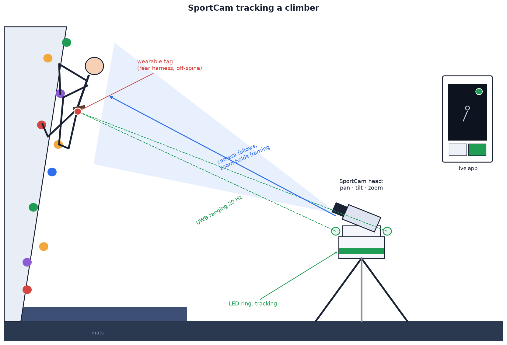
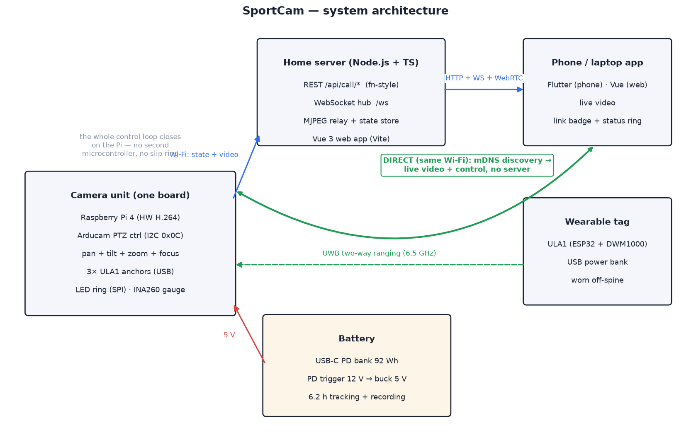
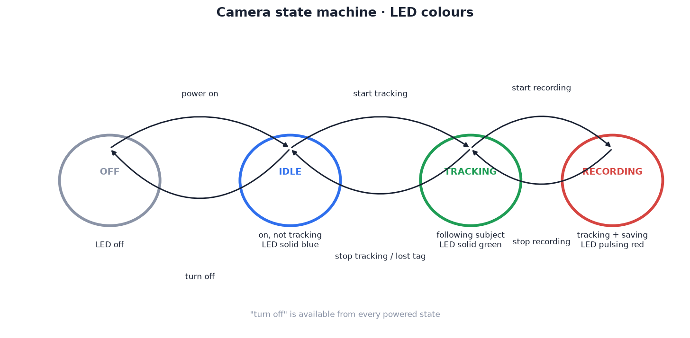
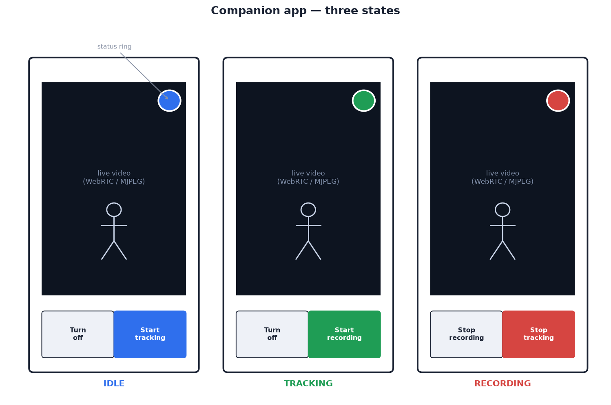

# 01 — System overview

## Introduction

One picture of what this project builds — an indoor climbing session, filmed
by nobody:

The climber wears a matchbox-sized UWB tag on the rear of their harness
(off-spine — see [wearing the tag](04-tracking-system.md#wearing-the-tag)).
On the mats 8–12 m back — anywhere from 7 m to ~30 m works, see the
[placement envelope](04-tracking-system.md#camera-placement-envelope) —
SportCam sits on an ordinary photo tripod: the
head unit ranges the tag 20 times a second through the climber's body and
clothing, pans and tilts to keep them centred — the 270° tilt axis follows
them from the first move to past-vertical top-outs — and the motorized lens
zooms to hold framing as they move up the wall. The LED ring on the base
glows green (tracking) or pulses red (recording), and the same status shows
in the companion app streaming the live view to a phone. Climb, tap
**Start recording**, and the session films itself.

## Goals

1. Camera on a robotic tripod head: **360° continuous pan**, **> 180° vertical
   coverage** (we achieve 270°: −45° below horizon to +225°), motorized
   **optical zoom**.
2. Camera **follows a human subject** wearing a small tracking wearable.
3. **LED status ring** on the unit showing three states: on-but-not-tracking,
   tracking, recording.
4. **Companion web app**: opens straight into the live stream, state-dependent
   bottom buttons, circular status indicator (top-right) matching the LED
   colours.
5. Both camera and app talk to a **home server** (Node.js + TypeScript,
   Vue 3 web app) started with a single `npm run dev` that watches `src` and
   reloads.
6. Server code written as **portable typed functions** so the API can later be
   lifted onto Firebase Cloud Functions with minimal change.

## The five subsystems

| Subsystem | Compute | Role |
| --- | --- | --- |
| **Head unit** (rotates) | Raspberry Pi 5 | Camera + zoom lens, tilt servo, UWB anchors, video encode/stream, tracking control loop |
| **Base unit** (static) | ESP32 | Pan stepper, LED status ring, power entry |
| **Wearable tag** | ESP32 + DW1000 | UWB ranging responder worn by the subject |
| **Home server** | Node.js + TS | State authority, command routing, stream relay, serves the app |
| **Companion app** | Vue 3 SPA | Live view + control |

Key architectural decision: **only power crosses the slip ring** (2 × 12 V,
2 × GND). All data — video, pan commands, LED state — travels over Wi-Fi.
This is what makes continuous 360° pan cheap and reliable: slip rings are
fine for power but noisy for high-speed signals, and a CSI camera ribbon
can never cross one.

Because the pan motor lives in the static base and the Pi lives on the
rotating head, pan commands go Pi → server → base-ESP32 over the LAN
(≈ 10–30 ms round trip — fine for a control loop running at 20 Hz). A direct
Pi → ESP32 WebSocket is a drop-in optimisation if you later want to shave
latency; the message shape is identical.

## Concept of operations

1. Power on → both controllers boot, join Wi-Fi, register with the server.
   State = **IDLE** (LED solid blue). Opening the app immediately shows the
   live stream.
2. User taps **Start tracking** (or long-presses the wearable button) →
   state = **TRACKING** (LED solid green). The head unit ranges the wearable
   ~20×/s, pans/tilts to centre the subject and zooms to hold framing.
3. User taps **Start recording** → state = **RECORDING** (LED pulsing red).
   Tracking continues; H.264 video is written on the Pi and optionally
   mirrored to the server.
4. **Turn off** from any state parks the head (pan home, tilt level), stops
   recording safely, and powers down cleanly.

## State machine

| State | LED | App status ring | Bottom buttons |
| --- | --- | --- | --- |
| `off` | off | grey | *(app shows reconnect screen)* |
| `idle` | solid blue | blue | **Turn off** · **Start tracking** |
| `tracking` | solid green | green | **Turn off** · **Start recording** |
| `recording` | pulsing red | red (pulsing) | **Stop recording** · **Stop tracking** |

Rules:

- `recording` implies `tracking`. **Stop recording** returns to `tracking`;
  **Stop tracking** while recording stops both (with a confirm in the app).
- Losing the UWB tag for > 5 s in `tracking` holds position, flashes the LED
  green, and falls back to `idle` after 30 s (recording is stopped and saved
  first if active).
- The server is the single source of truth for state; devices and app render
  whatever the server last broadcast.

## Companion app

Single screen: full-bleed live video, circular status indicator top-right
(same colours as the LED ring), two bottom buttons that change with state.
See [06 — Server & app](06-server-and-app.md).
