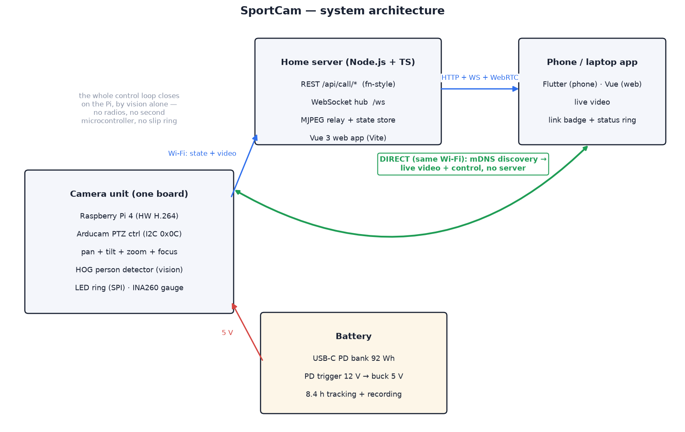

# 01 — System overview

SportCam comes in two builds that share everything except how the camera
finds the subject. This doc covers what they share first, then each build in
its own section:

- **[With UWB](#with-uwb)** — the subject wears a tag; anchors on the head
  range it and the camera points where the ranges say.
- **[Without UWB](#without-uwb)** — nothing worn; the camera sweeps the room by
  vision and locks on to the first person it sees.

## Introduction

One scene describes the project: an indoor climbing session, filmed
by nobody. SportCam sits on an ordinary photo tripod on the mats 6–12 m back,
running off a power bank with nothing plugged in. It pans and tilts to keep
the climber centred, and the motorized lens zooms to hold framing as they move
up the wall. The LED ring on the base glows green (tracking) or pulses red
(recording), and the same status shows in the companion app streaming the
live view to a phone. The session films itself.

How the camera knows where the climber is depends on the build — see
[With UWB](#with-uwb) and [Without UWB](#without-uwb) below, each with its own
picture of the scene.

## Goals

1. Camera on a motorized tripod head: **160° of pan** (±80°), **130° of tilt**
   (−45° to +85°), motorized **optical zoom**. Both axes and the lens come
   from the Arducam PTZ base, which is what keeps the build to a weekend —
   see [02](02-hardware-mechanical.md) for what that trades away.
2. Camera **follows a human subject** — by UWB tag or by vision alone,
   depending on the build.
3. **Runs on a battery** for a full session: ≥ 4 h tracking and recording from
   a USB-C power bank, with a gauge that says how long is left.
4. **LED status ring** on the unit showing the states: on-but-not-tracking,
   acquiring (turning to the tag, or searching), tracking, recording.
5. **Companion web app**: opens straight into the live stream, state-dependent
   bottom buttons, circular status indicator (top-right) matching the LED
   colours.
6. Both camera and app talk to a **home server** (Node.js + TypeScript,
   Vue 3 web app) started with a single `npm run dev` that watches `src` and
   reloads. **One server and one app serve both builds**; `TRACKING_MODE`
   picks which ([06](06-server-and-app.md#tracking-mode)).
7. Server code written as **portable typed functions** so the API can later be
   lifted onto Firebase Cloud Functions with minimal change.

## Constraints

Hard limits the design has to stay inside. A change that breaks one of these
needs a reason in the doc that makes it. C1 and C2 differ by build and are in
each build's section ([with UWB](#constraints-with-uwb),
[without UWB](#constraints-without-uwb)); C3 is shared.

| # | Constraint | Value | Why | Where it is set |
| --- | --- | --- | --- | --- |
| C3 | **Fits any standard tripod**, with interchangeable threads | 3/8-16 brass insert in the floor; a removable 3/8-16 → 1/4-20 reducer bushing for 1/4-20 screws | photo and phone tripods use 1/4-20, video heads and heavier tripods 3/8-16; one socket with a bushing takes both, with no adapter plate | `tripod_boss_d`, `tripod_hole_d` in `<build>/cad/config.scad`; see the build's BOM |

## Architecture

Every build has a camera unit, a home server and a companion app:

| Subsystem | Compute | Role |
| --- | --- | --- |
| **Camera unit** | Raspberry Pi 4 | Camera + zoom lens, pan/tilt servos, LED ring, battery gauge, video encode/stream, person detection, tracking control loop — plus, with UWB, three anchors |
| **Home server** | Node.js + TS | State authority, command routing, stream relay, serves the app. One server for both builds |
| **Companion app** | Vue 3 SPA / Flutter | Live view + control. One app for both builds |

The UWB build adds a fourth subsystem, the **wearable tag**.

Key architectural decision: **the whole control loop closes on one board.**
Pan, tilt, zoom and focus are all register writes to the Arducam PTZ
controller on the Pi's I2C bus, so a tracking correction never leaves the
device. The old revision put the pan stepper in a separate static base and
relayed velocity commands Pi → server → ESP32 over the LAN, because the head
rotated continuously and a stepper cannot ride on a slip ring. Giving up
continuous rotation deleted the slip ring, the second microcontroller, its
firmware and that entire network hop.

The server and the network are optional in the strict sense: unplug the
Wi-Fi and the camera still tracks, films, and shows its state on the ring.

## Concept of operations

The beginning and end of a session are the same in both builds:

1. **Power on** → the Pi boots, joins Wi-Fi, registers with the server.
   State = **IDLE** (LED solid blue). Opening the app immediately shows the
   live stream.
2. **Start, lock on, follow** — this is where the builds differ:
   [with UWB](#a-session-with-uwb) the tag starts and ends the session;
   [without UWB](#a-session-without-uwb) the app starts it and the camera
   searches. In both, the camera enters **TRACKING** in phase **acquiring**
   (green light chasing round the ring), and once the person detector has
   confirmed a person it records (LED breathing red, the app chimes). While
   recording, vision zooms so the subject fills about 65 % of the frame, with
   margin all round for sudden moves. H.264 video is written on the Pi and
   uploaded afterwards.
3. **Turn off** from any state centres both axes, stops recording safely, and
   powers down cleanly. The same thing happens on its own at 7 % battery, so
   a session that outlasts the pack still ends with a saved clip.

## State machine

The states, colours and transitions are the same in both builds; only the
wording of two buttons and the acquiring label changes.

| State | LED | App status ring | Bottom buttons |
| --- | --- | --- | --- |
| `off` | off | grey | *(app shows reconnect screen)* |
| `idle` | solid blue | blue | **Turn off** · **Start tracking** / **Track & record** |
| `tracking`, acquiring | green, chasing round the ring | green (fast blink), "Acquiring subject…" / "Looking for a person…" | **Turn off** · **Start recording** / **Record now** |
| `tracking`, locked on | solid green | green | **Turn off** · **Start recording** / **Record now** |
| `recording` | pulsing red | red (pulsing) | **Stop recording** · **Stop tracking** |

Where two labels are given, the first is with UWB and the second without.

Rules common to both:

- `recording` implies `tracking`. **Stop recording** returns to `tracking`;
  **Stop tracking** while recording stops both (with a confirm in the app).
- Losing the subject for > 2 s in `tracking` holds position and flashes the
  LED (2 Hz). What happens next depends on the build.
- Below 20 % battery the ring dims and blinks orange once a second over
  whatever colour the state is; below 7 % the camera saves and drops to idle.
- The server is the single source of truth for state; devices and app render
  whatever the server last broadcast. The head may change state itself (and
  reports it); the server adopts it.

## Companion app

Single screen: full-bleed live video, circular status indicator top-right
(same colours as the LED ring), two bottom buttons that change with state.
See [06 — Server & app](06-server-and-app.md).

---

## With UWB

The climber wears a matchbox-sized UWB tag on the rear of their harness
(off-spine — see [wearing the tag](../with_uwb/docs/04-tracking-system.md#wearing-the-tag)).
On the mats 6–12 m back — see the
[placement envelope](../with_uwb/docs/04-tracking-system.md#camera-placement-envelope) —
the camera ranges the tag 20 times a second through the climber's body and
clothing, and points where the ranges say. Climb, tap **Start recording**, and
the session films itself.

The fourth subsystem:

| Subsystem | Compute | Role |
| --- | --- | --- |
| **Wearable tag** | ULA1 (ESP32 + DWM1000) | polls all three anchors and broadcasts the ranges; worn by the subject, powered by a small USB bank |

On the camera unit, the three UWB anchors sit two on arms and one on a mast
for elevation.

### Constraints, with UWB

| # | Constraint | Value | Why | Where it is set |
| --- | --- | --- | --- | --- |
| C1 | **Compact head** for use in a cramped room | ≤ 30 cm across, ≤ 30 cm tall to the top of the A3 mast (enclosure floor up), excluding the tripod | the camera has to stand in small rooms without being in the way | `uwb_half_base`, `uwb_v_base` in `with_uwb/cad/config.scad` |
| C2 | **UWB anchor spacing** | A1–A2 **250 mm** apart (horizontal); A3 **250 mm** above them (vertical), 86 mm behind the pan axis | the spacing sets angle accuracy (noise ∝ 1/spacing): 250 mm gives ≈ 9° RMS filtered against ≈ 7° at 400 mm, and the vision trim absorbs the difference ([04](../with_uwb/docs/04-tracking-system.md#geometry)). Keep both ≥ 250 mm; below that the error and A3's blind corner grow quickly | `with_uwb/cad/config.scad` and, matching, `UWB_BASELINE_M`, `UWB_A3_UP_M`, `UWB_A3_BACK_M` in `with_uwb/device/sportcam/config.py` |

### A session, with UWB

1. **The climber switches the tag on.** That is the start button: the camera
   ranges continuously, even in standby, and notices the tag within about a
   second. State = **TRACKING**, phase **acquiring**. The head turns to where
   the tag says the subject is.
2. **Locked on.** Once the camera has settled on the subject and the person
   detector has seen a person in the middle of the frame, state =
   **RECORDING** and the app chimes. Vision has to verify: ranging alone never
   starts a recording, so a mis-set camera keeps chasing rather than filming a
   wall. If it can't see you after 15 s the app says so; **Start recording**
   in the app always works as an override.
3. **The climber switches the tag off.** 5 s later the camera saves the clip,
   the app chimes, and the camera returns to **IDLE**. The short wait rides
   over brief dropouts; a tag switched off looks exactly like one hidden
   behind a body, so a dropout longer than 5 s ends the session too, and the
   tag coming back starts a new one (two clips rather than one). Raise
   `LOST_IDLE_S` if that happens.

   The app can do all of this by hand instead (**Start tracking**, **Start
   recording**), and anything it does stands: stop a tag-started session from
   the phone and the camera stays stopped until the tag has been off for 5 s
   and comes back on. Set `AUTO_SESSION = False` to make the tag a plain
   ranging beacon again. Details: [`with_uwb/device/sportcam/session.py`](../with_uwb/device/sportcam/session.py).

### State machine, with UWB

- Losing the UWB tag for > 2 s in `tracking` holds position, flashes the LED,
  and falls back to `idle` after 5 s (recording is stopped and saved first if
  active). A subject crossing a pan soft limit looks exactly like this.

---

## Without UWB

Nobody wears anything. The climber taps **Track & record** in the app; the
camera zooms wide and sweeps the room until its person detector sees someone,
turns to centre them, locks on and starts recording. Tap, climb, and the
session films itself.

There is no wearable and no radio: the camera is the only sensor. Dropping
the UWB radios deleted the only other thing the camera had to talk to, and
the Pi's USB ports are left free.

### Constraints, without UWB

| # | Constraint | Value | Why | Where it is set |
| --- | --- | --- | --- | --- |
| C1 | **Compact head** for use in a cramped room | Ø 135 mm enclosure with the camera on top and nothing sticking out sideways, excluding the tripod | the camera has to stand in small rooms without being in the way | enclosure diameter in `without_uwb/cad/config.scad` |
| C2 | **Pan range ±80°** | soft limits `PAN_MIN_DEG` / `PAN_MAX_DEG` = ∓80°, no continuous rotation | the metal base fouls before 180°, and it cannot turn 360°; the search sweeps this range and the camera cannot look behind itself | `without_uwb/device/sportcam/config.py` |

### A session, without UWB

1. **The climber taps Track & record** in the app (or on the camera's local
   page). State = **TRACKING**, phase **acquiring** ("Looking for a person…"
   in the app). The camera zooms wide and **sweeps** pan ±80° at 25°/s,
   stepping between two tilt rows at each turn-around, until the person
   detector sees someone.
2. **Centre, then lock.** The sweep stops and the head turns to put that
   person in the middle of the frame. After two consecutive centred
   detections it is **locked** (solid green) and, because the session began
   in idle, recording starts straight away: the clip is of the person, not of
   an empty room. The first person found wins; afterwards the camera follows
   the detection nearest the last position, so a bystander walking past does
   not steal the lock. If nobody turns up for 15 s the app says so.
3. **Losing and finding again.** If the person is missing for 2 s the ring
   flashes and the camera holds still; after 6 s it sweeps again, starting
   toward the side they were last heading, while the recording carries on.
   If the camera is tracking (not recording), has never found anyone and 180 s
   pass, it gives up and returns to **IDLE**. A recording is never abandoned
   automatically — stopping it is the user's call.

   The app can drive everything by hand: **Record now** while tracking,
   **Stop recording** (tracking continues, and the camera does not start a
   second recording in the same session), **Stop tracking** to go back to
   idle. Set `AUTO_RECORD_ON_LOCK = False` to make recording a separate tap.
   Details: [`without_uwb/device/sportcam/session.py`](../without_uwb/device/sportcam/session.py).

### State machine, without UWB

- Losing the person for > 2 s in `tracking` holds position and flashes the
  LED (2 Hz); after 6 s the camera sweeps again. Nothing drops to `idle` on
  its own except a tracking-only session that never found anyone in 180 s.

