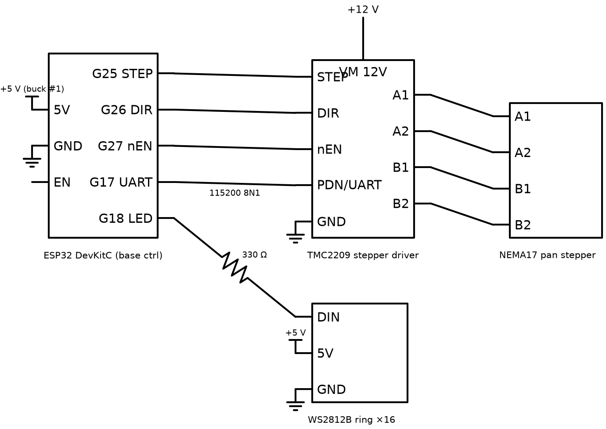
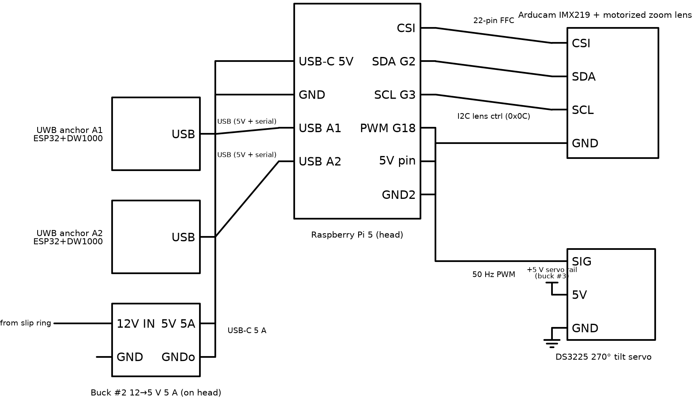

# 03 — Electronics

Three boards' worth of wiring, all off-the-shelf modules plus one optional
carrier PCB. Schematic sources live in `schematics/` — `render_schematics.py`
(schemdraw) produces the PNGs below, `schematics/interactive/index.html` is a
zoomable d3-hwschematic view of the whole system (open it via `npm run docs`
at http://localhost:8090/schematics/interactive/index.html — its libraries
are vendored locally, no internet needed), and
`schematics/tscircuit/base-board.circuit.tsx` is a tscircuit design for the
base carrier PCB if you want to fab one instead of point-to-point wiring.

## Base unit

| Signal | From → To | Notes |
| --- | --- | --- |
| STEP / DIR / nEN | ESP32 G25/G26/G27 → TMC2209 | 3.3 V logic, fine for TMC2209 |
| UART | ESP32 G17 → TMC2209 PDN_UART | set microstepping (16×), current (0.9 A RMS), StealthChop |
| LED data | ESP32 G18 → 330 Ω → WS2812B DIN | level-shifter-free works at 5 V ring / 3.3 V data in practice; add a 74AHCT125 if you see glitches |
| VM | 12 V → TMC2209 VM | 100 µF electrolytic across VM/GND at the driver |
| Homing | hall sensor (A3144) → ESP32 G34 | magnet glued to platform edge |

## Head unit

| Signal | From → To | Notes |
| --- | --- | --- |
| CSI | Pi CAM0 → Arducam 22-pin FFC | 300 mm FFC, spiral service loop at tilt shaft |
| Lens I2C | Pi GPIO2/3 → lens board | Arducam lens controller at addr 0x0C |
| Tilt PWM | Pi GPIO18 → DS3225 signal | 50 Hz, 500–2500 µs ≈ 270°; use `pigpio` hardware PWM |
| UWB anchors | 2 × ESP32-UWB via USB | power + `/dev/ttyUSB0/1` serial, 115200 |

## Wearable

ESP32-UWB board (DW1000 already on-board), TP4056 USB-C charge board with
protection, 1000 mAh LiPo, one button (pair / remote record), one status LED.
Runtime ≈ 8 h ranging at 20 Hz (measured DW1000 tag current ~90 mA average at
this rate; drop the rate to stretch battery).

## Power

| Rail | Source | Load (worst case) |
| --- | --- | --- |
| 12 V | 5 A desktop brick | everything below — total ≈ 3.4 A worst case |
| 5 V base (buck #1, 3 A) | ESP32 0.24 A + LED ring 16×60 mA = 1.2 A | 1.5 A |
| 5 V head (buck #2, 5 A, rides on head) | Pi 5 ≈ 2.5 A sustained (5 A transient) + camera 0.3 A + 2× UWB 0.5 A | Pi 5 wants a true 5 V/5 A source — use a quality buck and 18 AWG to the USB-C plug |
| 5 V servo (buck #3, 3 A, rides on head) | DS3225 idle 0.1 A, stall 2.5 A | isolated from the Pi rail so stalls can't brown-out the Pi |
| 12 V across slip ring | 4 + 4 paralleled wires | carrying 12 V (not 5 V) across the ring keeps current ≤ 1.8 A |

Grounds: single star point at the 12 V input; slip ring carries ground up to
the head; all head rails share the head-side ground plane.

## Bring-up order

1. Base: 12 V in → check 5 V rail → flash ESP32 → verify LED ring → set
   TMC2209 current with the motor **disconnected**, then connect motor and jog.
2. Head (bench, before mounting): buck #2 alone → 5.1 V under 4 A load
   (use a dummy load — the Pi 5 is unforgiving) → Pi boots → camera
   `rpicam-hello` → lens I2C `i2cdetect -y 1` shows 0x0c → servo sweep with
   end-stop limits configured → UWB anchors enumerate as ttyUSB.
3. Integration: slip ring continuity while rotating 10 turns each way, then
   full assembly.
