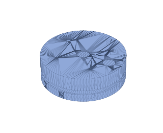
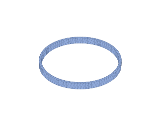
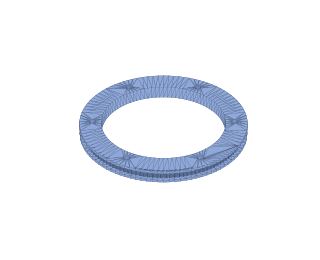
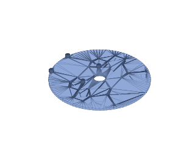
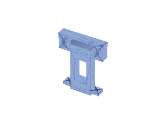
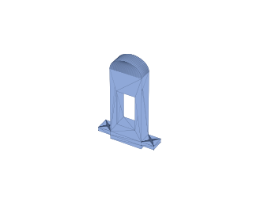
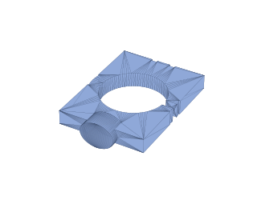
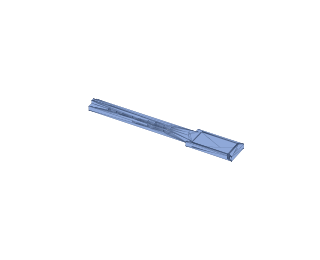
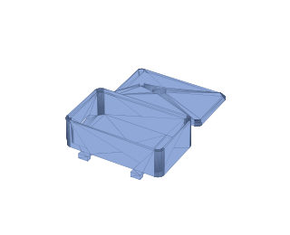

# 07 — Bill of materials (Canadian sourcing, Toronto / M2L 2E2)

Sourcing strategy for delivery to **M2L 2E2 (North York, Toronto) in under two
weeks**:

- **Amazon.ca Prime** — 1–3 days for everything they stock. Listings churn, so
  Amazon links are search links pinned to the exact part name; take a
  Prime-badged result matching the name (avoid "ships from China" sellers —
  those are the 3–4 week ones).
- **[PiShop.ca](https://www.pishop.ca/)** — official Canadian Raspberry Pi
  reseller, ships from Ontario in 1–3 days; no duties, honest MSRP-tracking
  prices. First choice for all Pi items.
- **[Digi-Key Canada](https://www.digikey.ca/)** — 1–3 days to Toronto,
  free shipping over C$100, customs pre-cleared. Good backstop for anything
  Amazon is out of.
- **Makerfabs (China, DHL)** — the UWB boards' manufacturer; DHL Express is
  5–8 days to Toronto and reliable, but add ~C$25 shipping + possible ~13%
  HST on import. Use if Amazon.ca UWB stock looks sketchy.
- Adafruit/Arducam US ship to Canada in ~a week but add duties/brokerage —
  only worth it for items 4 and 11 if Canadian stock fails.

Prices are approximate CAD street prices (Sep 2026), ±15%. The 2026
memory-shortage Pi price rises are reflected (Pi 5 4 GB ≈ C$150, up from its
C$80-class launch price).

## Electronics

| # | Part | Qty | ≈ CAD | Source | Notes |
| --- | --- | --- | --- | --- | --- |
| 1 | Raspberry Pi 5, 4 GB | 1 | $150 | [PiShop.ca](https://www.pishop.ca/product/raspberry-pi-5-4gb/) · [Amazon.ca](https://www.amazon.ca/s?k=raspberry+pi+5+4gb) | buy the bare board, not a kit — PSU/case are unused here |
| 2 | Official Pi 5 Active Cooler | 1 | $9 | [PiShop.ca](https://www.pishop.ca/) · [Amazon.ca](https://www.amazon.ca/s?k=raspberry+pi+5+active+cooler) | head runs warm while encoding |
| 3 | microSD 64 GB A2 (SanDisk Extreme) | 1 | $14 | [Amazon.ca](https://www.amazon.ca/s?k=sandisk+extreme+64gb+microsd+a2) | recordings land here |
| 4 | **Arducam 8 MP IMX219 motorized zoom/focus camera (“PTZ” lens kit)** | 1 | $95 | [Amazon.ca](https://www.amazon.ca/s?k=arducam+ptz+camera+raspberry+pi+zoom) · [Arducam](https://www.arducam.com/) | the optical-zoom heart of the build; we use the camera + lens, not its little PT bracket. Confirm the Amazon.ca listing ships domestically; else order Arducam direct (~1 wk + duties). Budget alt: Pi Camera Module 3, ~$35 at PiShop.ca (digital zoom only) |
| 5 | Pi 5 camera FFC 300 mm (22-pin ↔ 15-pin) | 1 | $8 | [PiShop.ca](https://www.pishop.ca/) · [Amazon.ca](https://www.amazon.ca/s?k=raspberry+pi+5+camera+cable+300mm) | Pi 5 uses the small 22-pin CSI |
| 6 | ESP32 DevKitC (2-pack) | 1 | $18 | [Amazon.ca](https://www.amazon.ca/s?k=esp32+devkitc+38+pin) | one for base, one spare |
| 7 | **ESP32 + DW1000 UWB module** | 3 | $50 ea | [Amazon.ca](https://www.amazon.ca/s?k=esp32+uwb+dw1000+module) · [Makerfabs](https://www.makerfabs.com/esp32-uwb-ultra-wideband.html) | 2 anchors + 1 tag. Check the Amazon.ca seller ships from Canada; otherwise Makerfabs DHL (5–8 days, ~C$25 ship). DW3000 variant also fine |
| 8 | NEMA17 stepper, ~59 N·cm | 1 | $20 | [Amazon.ca](https://www.amazon.ca/s?k=nema+17+stepper+59ncm) | any 1.5–2 A 17HS series |
| 9 | TMC2209 driver (3-pack) | 1 | $14 | [Amazon.ca](https://www.amazon.ca/s?k=tmc2209+v3+stepper+driver) | UART mode, StealthChop = silent pan |
| 10 | DS3225 25 kg **270°** servo | 1 | $25 | [Amazon.ca](https://www.amazon.ca/s?k=ds3225+25kg+servo+270+degree) | confirm the 270° variant in the listing — the 180° one caps tilt |
| 11 | Slip ring 22 mm, 12 wire × 2 A | 1 | $35 | [Amazon.ca](https://www.amazon.ca/s?k=slip+ring+12+wire+2a+22mm) · [Digi-Key.ca](https://www.digikey.ca/en/products/result?keywords=slip%20ring) | parallel 4+4 wires for power |
| 12 | WS2812B LED ring, 16 px | 1 | $14 | [Amazon.ca](https://www.amazon.ca/s?k=ws2812b+ring+16+led) | status indicator |
| 13 | 12 V 5 A desktop PSU (5.5×2.1 barrel) | 1 | $22 | [Amazon.ca](https://www.amazon.ca/s?k=12v+5a+power+supply+barrel+ul) | CSA/UL-listed brand |
| 14 | 12 V→5 V 5 A buck (USB-C out or bare) | 1 | $16 | [Amazon.ca](https://www.amazon.ca/s?k=12v+to+5v+5a+buck+converter+usb+c) | buck #2 — Pi rail; must hold 5.0 V at 5 A |
| 15 | MP1584 mini buck (6-pack) | 1 | $12 | [Amazon.ca](https://www.amazon.ca/s?k=mp1584+buck+converter) | buck #1 (base) + buck #3 (servo) |
| 16 | A3144 hall sensor modules + magnets | 1 | $10 | [Amazon.ca](https://www.amazon.ca/s?k=a3144+hall+effect+sensor+module) | pan homing |
| 17 | TP4056 USB-C charger w/ protection (5-pack) | 1 | $10 | [Amazon.ca](https://www.amazon.ca/s?k=tp4056+usb+c+lipo+charger+protection) | wearable |
| 18 | LiPo 1000 mAh 3.7 V (503450, JST) | 1 | $16 | [Amazon.ca](https://www.amazon.ca/s?k=3.7v+1000mah+lipo+503450+jst) | wearable battery — pick a listing shipping from Canada (batteries from abroad are slow) |
| 19 | Barrel jack, JST kit, 18/22 AWG silicone wire, heatshrink | — | $20 | [Amazon.ca](https://www.amazon.ca/s?k=jst+connector+kit+22awg+silicone+wire) | consumables |

## Mechanical

| # | Part | Qty | ≈ CAD | Source | Notes |
| --- | --- | --- | --- | --- | --- |
| 20 | GT2 20T pulley (5 mm bore) + 400 mm closed belt | 1 | $14 | [Amazon.ca](https://www.amazon.ca/s?k=gt2+20t+pulley+400mm+belt+6mm) | 120T ring side is printed (`cad/ring_pulley.scad`) |
| 21 | Lazy-susan bearing 3" | 1 | $10 | [Amazon.ca](https://www.amazon.ca/s?k=3+inch+lazy+susan+bearing) · Home Depot/Lee Valley in-store | pan stage |
| 22 | 6701ZZ bearing (12×18×4), 4-pack | 1 | $10 | [Amazon.ca](https://www.amazon.ca/s?k=6701zz+bearing) | tilt idler side |
| 23 | M2.5/M3/M4 screw + brass heat-set insert kit | 1 | $20 | [Amazon.ca](https://www.amazon.ca/s?k=m3+screw+assortment+brass+heat+set+inserts) | |
| 24 | 1/4-20 brass insert + screw | 1 | $8 | [Amazon.ca](https://www.amazon.ca/s?k=1%2F4-20+brass+insert) | tripod interface |
| 25 | PETG filament 1 kg | 1 | $25 | [Amazon.ca](https://www.amazon.ca/s?k=petg+filament+1kg) | ~350 g used; spool covers reprints |
| 26 | Aluminium tripod (1/4-20 head) | 1 | $35 | [Amazon.ca](https://www.amazon.ca/s?k=aluminum+camera+tripod) | skip if you own one |
| 27 | Elastic armband/pouch + strap | 1 | $10 | [Amazon.ca](https://www.amazon.ca/s?k=elastic+armband+pouch+small) | wearable mounting; see doc 04 for climbing-specific wearing |

## Printed parts

Fabricated from item 25's filament (~350 g total). Each row links the STL
compiled by OpenSCAD from the parametric sources
([Appendix A](appendix-a-cad-parts.md)) and, where one exists, an open-source
community alternative ([Appendix B](appendix-b-open-source-parts.md)).
Regenerate STLs/previews with `./cad/render_all.sh` and
`python3 cad/render_previews.py`.

| Preview | Part | Qty | Compiled STL | OpenSCAD source | Open-source alternative |
| --- | --- | --- | --- | --- | --- |
|  | Base housing | 1 | [base_housing.stl](../cad/stl/base_housing.stl) | [base_housing.scad](../cad/base_housing.scad) | [Motorized turntable — MakerWorld 1013366](https://makerworld.com/en/models/1013366-motorized-turntable-3-versions) |
|  | LED diffuser ring | 1 | [led_diffuser_ring.stl](../cad/stl/led_diffuser_ring.stl) | [led_diffuser_ring.scad](../cad/led_diffuser_ring.scad) | [Clip-on 16-LED diffuser — Printables 628361](https://www.printables.com/model/628361-clip-on-ws2812-neopixel-16-led-diffuser) |
|  | 120T GT2 ring pulley | 1 | [ring_pulley.stl](../cad/stl/ring_pulley.stl) | [ring_pulley.scad](../cad/ring_pulley.scad) | — (project-specific: must encircle the slip ring) |
|  | Rotating platform | 1 | [rotating_platform.stl](../cad/stl/rotating_platform.stl) | [rotating_platform.scad](../cad/rotating_platform.scad) | — (project-specific hole pattern) |
|  | Tilt tower, servo side | 1 | [tilt_tower_servo.stl](../cad/stl/tilt_tower_servo.stl) | [tilt_tower.scad](../cad/tilt_tower.scad) | [Pan-tilt mount — Printables 1180365](https://www.printables.com/model/1180365-pan-tilt-mount-nema-17-stepper-motor) |
|  | Tilt tower, bearing side | 1 | [tilt_tower_bearing.stl](../cad/stl/tilt_tower_bearing.stl) | [tilt_tower.scad](../cad/tilt_tower.scad) (`-D 'side="bearing"'`) | [Pan-tilt mount — Printables 1180365](https://www.printables.com/model/1180365-pan-tilt-mount-nema-17-stepper-motor) |
|  | Camera cradle | 1 | [camera_cradle.stl](../cad/stl/camera_cradle.stl) | [camera_cradle.scad](../cad/camera_cradle.scad) | [Arducam case — Printables 983982](https://www.printables.com/model/983982-case-for-arducam-camera-module-for-raspberry-pi) |
|  | UWB anchor arm | 2 | [anchor_arm.stl](../cad/stl/anchor_arm.stl) | [anchor_arm.scad](../cad/anchor_arm.scad) | — (project-specific: sets the 400 mm baseline) |
|  | Wearable pod (body + lid) | 1 | [wearable_case.stl](../cad/stl/wearable_case.stl) | [wearable_case.scad](../cad/wearable_case.scad) | [ESP32 smartwatch case — MakerWorld 1749335](https://makerworld.com/en/models/1749335-diy-smartwatch-case-for-esp32-c3-0-96-oled) |

## Totals (CAD)

| Configuration | Total |
| --- | --- |
| **Full build** (optical zoom + UWB), own tripod | **≈ C$755** |
| Full build + tripod | ≈ C$790 |
| Budget build (Camera Module 3 from PiShop.ca ~C$35; UWB boards via AliExpress ~C$35 ea — but that breaks the 2-week window) | ≈ C$640 |

(≈ US$540 / US$565 / US$460 at typical exchange + Canadian retail markup.)

## Two-week delivery plan

Order everything the same day:

1. **PiShop.ca** (items 1, 2, 5, and budget-alt camera): 1–3 days.
2. **Amazon.ca Prime** (everything else): 1–3 days per item; the UWB boards
   (item 7) are the only listing to vet carefully — filter to "Ships from
   Canada" or Prime, otherwise switch that line to Makerfabs DHL (5–8 days),
   still inside the window.
3. Nothing on the critical path should exceed 8 days; the risk items are 4
   and 7 (specialist modules) — order those first.

Substitution-sensitive parts, worth full price: the **270° servo** (a 180°
DS3218 silently caps tilt) and the **true-5 A Pi-rail buck** (cheap 3 A units
brown out a Pi 5 under encode load).
