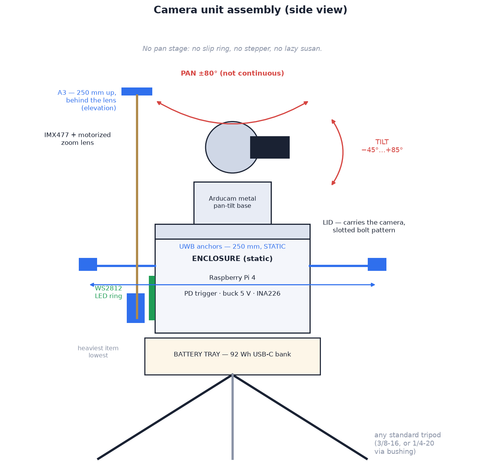

# 03 — Mechanical design

Shared head: tripod, battery tray, enclosure, lid, PTZ base, camera. <!--with_uwb-->The UWB build adds two anchor arms, a mast and a wearable pod
([With UWB](#with-uwb)).<!--/--><!--both--> <!--/--><!--without_uwb-->The camera-only build adds nothing
([Without UWB](#without-uwb)).<!--/-->

Core component: **Arducam IMX477 PTZ camera with metal pan-tilt base**
(B0167B12). It supplies the sensor, the motorized zoom lens and both motion
axes. There is no pan stage, slip ring or tilt tower; every printed part is an
enclosure or a bracket.

> **Design trade-off.** A continuous-rotation pan stage needs a bearing, a
> slip ring, a stepper and driver, and about a month of build time. The PTZ
> base is a weekend build and pans ±80°. Consequences:
> [ranges of motion](#ranges-of-motion). Continuous-pan alternatives:
> [Appendix B](../appendix/appendix-b-open-source-parts.md#if-you-want-continuous-pan).

## Stack, bottom to top

| # | Item | Description |
| --- | --- | --- |
| 1 | **Tripod** | any standard tripod. Floor socket: 3/8-16 insert with removable 1/4-20 reducer bushing |
| 2 | **Battery tray** | printed saddle for the USB-C bank, strapped low on a leg or the centre column (lowers the centre of mass). Cable to a USB-C inlet low in the enclosure wall |
| 3 | **Enclosure** | printed, <!--with_uwb-->Ø 141 × 84 mm<!--/--><!--both--> with UWB, <!--/--><!--without_uwb-->Ø 135 × 73 mm<!--/--><!--both--> without<!--/--> with the assumed part sizes ([layout](#layout-inside-the-enclosure)). No moving parts inside. <!--both-->Wall: three bosses and an anchor-cable slot with UWB; plain without<!--/--><!--with_uwb: Wall: three bosses for the arms and mast, and an anchor-cable slot--><!--without_uwb: Wall: plain all round--> |
| 4 | **Lid** | printed, 5 mm, structural: carries the whole camera. The Arducam base bolts through four radial slots; ribbon and servo lead pass through the central opening |
| 5 | **Arducam pan-tilt base** | aluminium bracket, two digital servos, both axes 0–180°. Supplied assembled with the camera |
| 6 | **Camera and lens** | IMX477 12 MP sensor, motorized zoom lens. Zoom and focus steppers driven over the same I2C bus as the servos |

<!--with_uwb-->

The UWB build adds anchor arms and a mast to this stack ([below](#with-uwb)).

<!--/-->

## Layout inside the enclosure

| Layer | Contents | Mounting |
| --- | --- | --- |
| Floor | USB-C PD trigger (socket at the wall inlet), rocker switch (on/off) and 5 V jack in the wall, power latch, battery gauge, buck converter | foam tape; switch and jack panel-mount |
| LED window | WS2812B ring, LEDs down, lighting a 12 mm window all round; translucent band over the window outside | ring foam-taped under the shelf; band slides onto a ledge |
| Shelf | Raspberry Pi 4, level shifter | Pi on M2.5 nylon standoffs; shelf on three wall posts, M3 into inserts |
| Lid | Arducam base | ring under the lid drops into the mouth; four M3 through the wall into inserts in the ring |

Board positions, Pi orientation, wall openings and enclosure size are
generated, not hand-drawn: `cad/fit.py` solves them from the bought-part sizes
(`cad/ordered_parts.toml`) and the design parameters
(`<build>/cad/config.scad`), then audits fit and printability. See
[Appendix A](../appendix/appendix-a-cad-parts.md#fit-the-layout-to-your-parts);
latest result: [`cad/FIT_REPORT.md`](../../cad/FIT_REPORT.md).

## Ranges of motion

| Axis | Mechanism | Range | Notes |
| --- | --- | --- | --- |
| Pan | PTZ base servo, direct | **±80° soft (160° total)** | servo travel 180°; soft limits stop short of the bracket fouling |
| Tilt | PTZ base servo, direct | **−45° … +85°** | verify with `python3 -m sportcam.ptzcheck` |
| Zoom | Arducam motorized lens | 96° → 33° horizontal (≈ 3.5× optical) | ≈ 2.8–10.6 mm EFL on this sensor |

**Pan limit consequences.** No following through 360°, no short way round
behind the head. A subject crossing a soft limit is lost; the camera holds,
then<!--with_uwb--> (with UWB) drops to awake after 5 s<!--/--><!--both-->, or (without UWB)<!--/--><!--without_uwb--> sweeps again after a few
seconds; the search covers the same ±80°<!--/-->. Aim the tripod at the filming
area; the limit matters only when people move around the tripod.

**Tilt.** A 15 m top-out seen from 7 m is ≈ 65° elevation, inside +85°. At
+85° and full wide zoom the top frame edge is ≈ 27° past vertical.<!--with_uwb--> The A3
board is just outside that ([below](#with-uwb)).<!--/-->

### How far the zoom reaches

Lens FOV 96° → 33° horizontal = 64° → 18.9° vertical on the IMX477's 16:9
frame. At full zoom the frame height is 0.333 · d at distance d, so a 1.8 m
subject fills `5.4 / d` of it:

| Distance | Subject height in frame, full zoom | Verdict |
| --- | --- | --- |
| 3 m | exceeds the frame — zoom out | close-up |
| 6 m | 90 % | tight |
| 8.3 m | 65 % (framing target) | **last distance at target framing** |
| 10 m | 54 % | excellent |
| 13.5 m | 40 % | good |
| 20 m | 27 % | usable, wider shot |
| 30 m | 18 % | small; the person detector needs ≈ 15 % |

- Beyond ≈ 8 m the lens is at full zoom and the subject is smaller than the
  target; framing degrades gradually.
- Minimum distance for a full body at the wide end: ≈ 1.5 m.
- Source: the lens's published FOV. Verify with the zoom calibration in
  14 — Software setup.

## Design rules that matter

- **The lid is the structure:** 5 walls, 40 % infill. Everything above it is
  cantilevered off four slots.
- **Stability:** the pan axis carries only the camera, so head balance is
  irrelevant; tripod stability is not. Mount the battery tray low and spread
  the legs<!--with_uwb--> (wider with the UWB arms and mast fitted)<!--/-->.
- **Cable service loop:** ribbon and servo lead cross the pan axis. Leave
  ≈ 80 mm of slack under the lid; sweep both axes to their limits by hand
  before securing it.

## Printed parts and CAD

| Build | Printed parts |
| --- | --- |
| both | enclosure, Pi shelf, LED diffuser band, lid, battery tray |
| with UWB | + 2 anchor arms, mast foot, mast cradle, wearable pod |

Every part prints in one piece on a Bambu Lab A1 Mini (≤ 170 mm per axis),
checked by `cad/fit.py`.

| Topic | Doc |
| --- | --- |
| Part list, previews, STL links | BOM: [with UWB](../../with_uwb/docs/setup/10-bill-of-materials.md#printed-parts), [without UWB](../../without_uwb/docs/setup/10-bill-of-materials.md#printed-parts) |
| Print settings, orientation, supports, times | [11 — 3D printing](../setup/11-3d-printing.md) |
| OpenSCAD sources and `cad/fit.py` | [Appendix A](../appendix/appendix-a-cad-parts.md) |

## Assembly

Interactive 3D assembly guide per build
([with UWB](../../with_uwb/docs/setup/assembly/index.html),
[without UWB](../../without_uwb/docs/setup/assembly/index.html); open the
file directly or from the docs viewer). Steps: enclosure electronics, lid and
camera, battery, cabling, bring-up<!--with_uwb-->; with UWB also the anchor arms and A3
mast<!--/-->. Each step highlights and animates the part being fitted.

---

## With UWB

Additions to the stack:

| # | Item | Description |
| --- | --- | --- |
| 7 | **UWB anchor arms** | two printed arms on the ±Y wall bosses, each carrying a ULA1 on a USB extension. Extensions enter through a slot high in the wall, behind the Pi's USB ports. **Static:** they don't rotate with the camera ([05](../../with_uwb/docs/design/05-tracking-system.md)) |
| 8 | **A3 mast** | ½-inch hardwood dowel, 246 mm, in a printed foot on the −X boss behind the lens. A printed cradle holds the third ULA1 **250 mm above A1/A2** (elevation). Out of shot at every tilt angle |

Head envelope: ≈ **42 cm across the arms, 28 cm tall** to the mast top
([C1](../product/01-requirements.md#non-functional-requirements)).

**Tilt and the mast.** Top frame edge at +85°, full wide: ≈ 27° past
vertical. A3 board: ≈ 30° past vertical from the tilt axis, so just out of
shot. A taller mast enters the shot; lower `TILT_MAX_DEG` to compensate.

### Design rules, with UWB

- **Anchor placement:** at the arm ends, antennas level with each other and
  clear of the enclosure. Horizontal baseline sets bearing resolution
  (400 mm: ≈ 7° RMS filtered; 250 mm: ≈ 9°;
  [05](../../with_uwb/docs/design/05-tracking-system.md#geometry)). A3 height sets
  elevation resolution the same way. The arms give 400 mm, so the camera can
  tell the climber from a belayer standing close
  ([05](../../with_uwb/docs/design/05-tracking-system.md#telling-the-tag-wearer-from-everyone-else)).
  Minimum 250 mm for both; below that the
  noise and the
  [blind corner](../../with_uwb/docs/design/05-tracking-system.md#elevation-from-the-third-anchor)
  grow quickly. Widening: [Appendix A](../appendix/appendix-a-cad-parts.md#with-uwb).
- **No metal near an antenna** (hence a wooden mast). Metal under A3 detunes
  it and biases its range; 1 cm of r₃ bias ≈ 2° of elevation error at 10 m.

---

## Without UWB

The common stack is the whole head. Enclosure wall plain all round; no side
protrusions
([C1](../product/01-requirements.md#non-functional-requirements)).

**Tilt and the search.** The search uses two tilt rows (5° and 22°); the
rest of the tilt range is used for tracking once the person is found.
