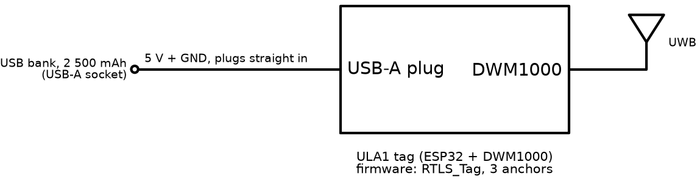
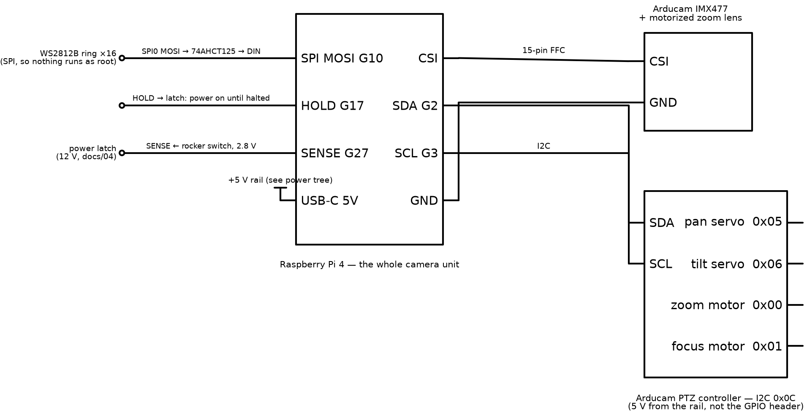

# 04 — Electronics

Common to both builds:

| Block | Part | Function |
| --- | --- | --- |
| Compute | **Raspberry Pi 4** | runs all software |
| Motion | **Arducam PTZ controller** (I2C 0x0C) | pan, tilt, zoom, focus |
| Status | **WS2812B LED ring**, 16 LEDs | state display |
| Power | **USB-C PD bank** → PD trigger (12 V) → **power latch** → **buck** (5 V) | single 5 V rail; the rocker switch turns the latch on and off ([below](#power-switch)) |
| Metering | **INA260** battery gauge (I2C 0x40), optional | energy used, time remaining |

<!--with_uwb-->

The UWB build adds three USB anchors on the head and a wearable tag
([With UWB](#with-uwb)).

<!--/-->

<!--without_uwb-->

The camera-only build adds nothing; the Pi's USB ports are unused
([Without UWB](#without-uwb)).

<!--/-->

## Why a Pi 4 and not a Pi 5

| Factor | Pi 4 | Pi 5 |
| --- | --- | --- |
| H.264 encode | **hardware**, near-zero power | software on the CPU; ≈ 4 W more, ≈ 2 h less runtime |
| CPU | baseline; person detector ≈ 3 fps | ≈ 2–2.5× faster |
| Camera ribbon | Arducam 15-pin fits directly | needs an adapter cable |
| Power config | none | `usb_max_current_enable` flag |
| Price | — | ≈ C$55 more |

Decision: Pi 4. Recording is the main job and the Pi 5's software encoder is
the largest item it would add to the power budget. The detector's speed is
sufficient at 3 fps (see your build's section below).

**Schematics:** sources in <!--both-->each build's<!--/--><!--with_uwb: the build's--><!--without_uwb: the build's--> `schematics/`;
`render_schematics.py` (schemdraw) renders the PNGs;
`schematics/interactive/index.html` is a zoomable whole-system view, served
by `npm run docs` at <!--with_uwb-->http://localhost:8090/with_uwb/schematics/interactive/index.html<!--/--><!--both--> or<!--/--> <!--without_uwb-->http://localhost:8090/without_uwb/schematics/interactive/index.html<!--/-->
(libraries vendored; works offline).

## Head unit

Pin-by-pin wiring with checks: 12 — Wiring guide
([with UWB](../with_uwb/setup/12-wiring.md),
[without UWB](../without_uwb/setup/12-wiring.md)). This section
gives the design rationale. Head schematic: <!--both-->each build's section below<!--/--><!--with_uwb: [With UWB](#with-uwb)--><!--without_uwb: [Without UWB](#without-uwb)-->.

Common connections:

| Signal | From → To | Notes |
| --- | --- | --- |
| CSI | Pi CSI → Arducam 15-pin FFC | kit cable fits a Pi 4; service loop under the lid |
| PTZ I2C | Pi GPIO2/3 → PTZ controller | one device at **0x0C** for pan, tilt, zoom and focus |
| LED data | Pi GPIO10 (SPI0 MOSI) → 74AHCT125 → WS2812B DIN | [below](#driving-the-ws2812b-ring) |
| Battery gauge | INA260 (or INA226) on I2C **0x40** | 12 V side, between trigger and buck; optional ([below](#knowing-what-is-left)) |
| Power switch | rocker → latch; latch HOLD ← Pi GPIO17; SENSE → Pi GPIO27 | off is a clean shutdown ([below](#power-switch)) |

### The PTZ controller

All motion is register writes to one I2C device:

| Channel | Register | Range | Axis |
| --- | --- | --- | --- |
| `OPT_ZOOM` | 0x00 | 3000–20000 | zoom motor, wide → tele |
| `OPT_FOCUS` | 0x01 | 0–20000 | focus motor |
| `OPT_MOTOR_X` | 0x05 | 0–180 | pan servo, degrees |
| `OPT_MOTOR_Y` | 0x06 | 0–180 | tilt servo, degrees |
| `OPT_IRCUT` | 0x0C | 0/1 | IR-cut filter |

- Driver: `src/<build>/device/sportcam/ptz.py`.
- Power the controller from the 5 V rail, not the Pi's GPIO 5 V pin: two
  stalled servos draw ≈ 0.7 A. Common ground.

### Driving the WS2812B ring

- Path: SPI0 MOSI (GPIO10) → 74AHCT125 (3.3 V → 5 V) → DIN.
- Enable SPI: `raspi-config` → Interface Options.
- Driver: `src/<build>/device/sportcam/led.py`, using
  `adafruit-circuitpython-neopixel-spi`.
- Not used: `rpi_ws281x` (PWM/DMA on GPIO18). It requires the service to run
  as root, and doesn't work on a Pi 5 (RP1 doesn't expose those peripherals).

## Power

```
power bank ──PD trigger (12 V)──► latch ──► INA260 ──► buck 12→5 V 8 A ──┬─► Pi 4 (USB-C)
                                    ▲                                     ├─► PTZ controller + servos
                              rocker switch                               ├─► (with UWB) 3 × UWB anchors (Pi USB)
                                                                          └─► WS2812B ring
```

Power tree diagram: <!--both-->each build's section below<!--/--><!--with_uwb: [With UWB](#with-uwb)--><!--without_uwb: [Without UWB](#without-uwb)-->.

Rationale for 12 V + local buck rather than the bank's 5 V output: the 5 V
rail also feeds the servos and ring<!--with_uwb--> (and the three anchors)<!--/-->, and most
banks cap 5 V at 3 A. The 12 V → 5 V conversion costs ≈ 8 %.

### Power switch

A rocker switch in the enclosure wall is the camera's on/off
([F12](../product/01-requirements.md#functional-requirements)). It doesn't
carry the power. A latch does, so that off can be a clean shutdown and not a
power cut. A Pi that loses power while recording leaves a clip with no index
(unplayable), and can corrupt the SD card.

```
           ┌────────── rocker ──────────┐ SW
           │                            ├──────────► Q3 ─┐
 12 V ─────┴─── Q1 (P-MOSFET) ──► gauge → buck → Pi      ├─► Q1 on
                                             GPIO17 HOLD ──► Q2 ─┘
                                             GPIO27 SENSE ◄── SW (÷ to 2.8 V)
```

| Event | What happens |
| --- | --- |
| Switch on | Q3 turns Q1 on; the Pi boots. The firmware drives HOLD (GPIO17) high within ≈ 1 s (`gpio=17=op,dh`), so Q2 holds Q1 on as well |
| Switch off | Q3 lets go, but Q2 keeps the power on. SENSE (GPIO27) falls, and the `gpio-shutdown` overlay turns that into a power-key press: systemd shuts down. `sportcam-head` gets SIGTERM first (`Head.power_off`): stop the encoder so the clip is complete, park the head, ring off. The clip uploads after the next boot (`upload_loop`) |
| Pi halted | `POWER_OFF_ON_HALT=1` turns the Pi's 3.3 V off, HOLD drops, Q2 and Q1 let go. Off ≈ 10–15 s after the switch. Nothing draws from the bank |
| Pi hung | the systemd watchdog resets it (15 s running, 2 min in a shutdown). A reset drops HOLD until the firmware is back, long enough for the latch to let go |

Why this way:

- **A hard rocker in the 12 V line** (the first design) is simplest, but every
  switch-off mid-recording loses the clip.
- **A soft-power pushbutton module** needs a new panel cut-out and a part
  with few Canadian sources; the rocker also shows on or off at a glance.
- **Supercapacitor hold-up** would need ≈ 1 F at 16 V to carry 10 W for
  the shutdown, plus inrush limiting, and still ends in a cut if the Pi is
  slow. The latch has no time limit: the bank powers the shutdown.
- **HOLD from the firmware**, not the service: it's high before Linux starts
  and stays high through a service restart, so only a halt or a reset
  releases it. The `gpio-poweroff` overlay would also work, but it interferes with `reboot`.
- **SENSE through the kernel** (`gpio-shutdown`), not the service: off works
  even if the service has crashed, and systemd stops it properly.

Parts: IRF4905 (−55 V, 0.02 Ω; ≈ 0.06 W at 1.7 A, no heatsink), two 2N3904,
eight resistors on perfboard (BOM 13a). The rocker only carries under 1 mA.
Circuit, values and checks: 12 — Wiring
([with UWB](../with_uwb/setup/12-wiring.md#power-latch),
[without UWB](../without_uwb/setup/12-wiring.md#power-latch)). Pi
settings: 14 — Software setup
([with UWB](../with_uwb/setup/14-software-setup.md#power-switch),
[without UWB](../without_uwb/setup/14-software-setup.md#power-switch)).

### Load budget

| Load | Average | Peak |
| --- | --- | --- |
| Raspberry Pi 4, 1080p hardware encode + 3 fps detect | 6.0 W | 7 W |
| PTZ servos and lens motors | 1.0 W | 4 W |
| WS2812B ring at 45 % | 1.5 W | 2.9 W |
| **5 V total, without UWB** | **8.5 W** | ≈ 14 W |
| *with UWB:* 3 × ULA1 UWB anchors | 3.0 W | 3.8 W |
| **5 V total, with UWB** | **11.5 W** | ≈ 18 W |

Pi 4 breakdown (≈ 6 W): ≈ 3 W baseline, ≈ 1 W preview JPEG encode, ≈ 1 W
person detector, ≈ 0.5 W recording.

### Runtime

Energy budget, 92 Wh bank:

- Bank cells → 12 V output (the bank's own boost, ≈ 91 %): **84 Wh** at the
  12 V rail, where the gauge measures.
- Usable before the 7 % critical stop: **78 Wh**.
- Draw figures below include the 12 → 5 V buck (≈ 92 %).

| Mode | Draw at 12 V, with UWB | Runtime, with UWB | Draw at 12 V, without UWB | Runtime, without UWB |
| --- | --- | --- | --- | --- |
| Tracking **and** recording | 12.5 W | **6.2 h** | 9.2 W | **8.4 h** |
| Tracking only | 12.0 W | 6.5 h | 8.7 W | 8.9 h |
| Awake, streaming preview | 9.7 W | 8.0 h | 6.4 W | 12 h |
| Sleep (sensor off, head parked; UWB still ranging) | ≈ 6.8 W | ≈ 11 h | ≈ 3.6 W | ≈ 21 h |

- Both builds exceed the 4 h requirement (C4).
- **Sleep** figures are estimates: the Pi's ≈ 3 W baseline plus a parked
  head, with no sensor, preview encode or detector. With UWB the anchors
  keep ranging (≈ 3 W) so the tag can still start a session. The camera
  sleeps after 30 s awake with no session and no one watching the live
  view (`AWAKE_TIMEOUT_S`).
- **With UWB**: the three anchors account for ≈ 3 W at 5 V (3.3 W at 12 V):
  about a third of the draw and ≈ 2 h of runtime.
- **Without UWB**: figures are estimates from the load budget (5 V total ÷
  92 %), not measurements. Verify with the gauge.
- **74 Wh (20 000 mAh) alternative:** ≈ <!--with_uwb-->5.0 h<!--/--><!--both--> with UWB, <!--/--><!--without_uwb-->6.7 h<!--/--><!--both--> without<!--/-->; ≈ C$25
  cheaper, ≈ 200 g lighter. Listed in each BOM. Keep under 100 Wh for air
  travel.
- **`BATTERY_WH` = 84** for a 92 Wh bank (67 for 74 Wh): the energy at the
  12 V rail, not the nameplate. Using the nameplate overstates every estimate
  by ≈ 10 %.

### Knowing what is left

A PD bank doesn't report its charge, so the camera meters consumption:

- Sensor on the 12 V side, read at 1 Hz.
- `src/<build>/device/sportcam/power.py` integrates Wh and reports fraction
  remaining, present draw, and minutes left (60 s rolling average).
- Counting starts when the camera service starts, assuming a full bank.
  **Start each session on a charged bank.** Restarting the service resets
  the count; there is no app control for it.

| `POWER_MONITOR` | Part | Notes |
| --- | --- | --- |
| `"ina260"` (default) | INA260 | integrated shunt; nothing to calibrate |
| `"ina226"` | INA226 + external shunt | set `INA226_SHUNT_OHMS` |
| `"none"` | — | no low-battery warning or automatic save-and-park; see the BOM ([with UWB](../with_uwb/setup/10-bill-of-materials.md#parts-that-are-hard-to-source-in-canada), [without UWB](../without_uwb/setup/10-bill-of-materials.md#parts-that-are-hard-to-source-in-canada)) |

Both sensors use I2C 0x40.

| Threshold | Action |
| --- | --- |
| **20 %** (low) | ring dims and blinks orange at 1 Hz; app warning; estimate continues |
| **7 %** (critical) | recording stopped and saved; both axes park; state `sleep` |

### The SD card

Recording: 1080p H.264 at 12 Mbit/s = **5.4 GB/h**. The card is a buffer:
clips upload in the background and are deleted only after the backend
confirms the byte count.

| Card | Free for clips after the OS | Recording time |
| --- | --- | --- |
| 32 GB | ≈ 24 GB | 4.4 h |
| **64 GB** (specified) | ≈ 56 GB | **10 h** |
| 128 GB | ≈ 120 GB | 22 h |
| 256 GB | ≈ 248 GB | 46 h |

- 64 GB exceeds one battery charge of recording; larger cards help only
  with spare banks and several offline sessions.
- Write rate 1.5 MB/s; any genuine Class 10 card is sufficient. Counterfeit
  cards are the most common cause of Pi corruption; buy a known brand.
- Clips accumulate when uploads fail
  ([08 — Failure behaviour](08-recordings-and-cloud.md#failure-behaviour)).
  `storage.py` guards the space:

| Free recording time | Action |
| --- | --- |
| < 20 min | ring blinks orange; app warning |
| < 5 min | new recordings refused; a running one is stopped cleanly |
| 500 MB reserve | never used for video (filesystems corrupt at zero free space) |

Rationale for stopping early: the encoder fails ungracefully on ENOSPC and
leaves a truncated file; a controlled stop leaves a playable one.

### Saving power

| Lever | Effect | Setting |
| --- | --- | --- |
| Sleep | sensor, preview and detector off after 30 s awake with no session and no live viewer (automatic) | `AWAKE_TIMEOUT_S` |
| Detector rate while awake | 0.5 fps when not tracking (automatic) | `DETECT_FPS_AWAKE` |
| Ring dimming on low battery | automatic | — |
| Preview frame rate, or stream only while a phone is connected | ≈ 1 W in every mode | `MJPEG_FPS` |
| 720p recording | lower encode load | `RECORD_SIZE` |
| CPU clock cap | lower baseline | Pi firmware |

Grounding: single star point at the buck output.

## Bring-up order

Stage-by-stage, verifying each before the next:

1. Buck trimmed to 5.1 V under load, before anything is connected.
2. Power latch and switch: the rocker turns the buck on and off.
3. Pi.
4. I2C devices, and the latch's HOLD and SENSE.
5. LED ring.
6. PTZ controller and camera.
7. **With UWB**: anchors.

Procedure and checks: 12 — Wiring guide
([with UWB](../with_uwb/setup/12-wiring.md#wiring-order-with-checks),
[without UWB](../without_uwb/setup/12-wiring.md#wiring-order-with-checks));
then the bench checks in 15 — Verification.

---

## With UWB


Additional connection:

| Signal | From → To | Notes |
| --- | --- | --- |
| UWB anchors | 3 × Haorutech ULA1 via USB-A | **one** carries serial at 115200 baud (`/dev/ttyUSB0`) and reports all ranges; the other two use 5 V only. Uses 3 of the Pi 4's 4 USB-A ports |

**Detector role:** with A3 fitted, trims angles already set by ranging. With
two anchors, it drives tilt (subject motion ≈ 1.7°/s). 3 fps is sufficient
for both ([05](../with_uwb/design/05-tracking-system.md)).


### Wearable



| Item | Value |
| --- | --- |
| Radio | ULA1 module (DWM1000) |
| Power | 5 V USB from a small power bank; no battery connector on the module |
| Runtime | 2 500 mAh bank: > 1 day |
| Controls | none; power on starts a session, power off ends it |

---

## Without UWB



No radios, anchors or wearable. The common connections are the complete
head; the Pi's USB ports are unused.

**Detector role:** sole sensor for the tracker. HOG on a Pi 4 at ≈ 3 fps.
Sufficient for walking or climbing at several metres; the few hundred ms of
latency is handled by gains below 1
([05](../without_uwb/design/05-tracking-system.md)). For faster
subjects: a faster board or a MobileNet-SSD detector.


