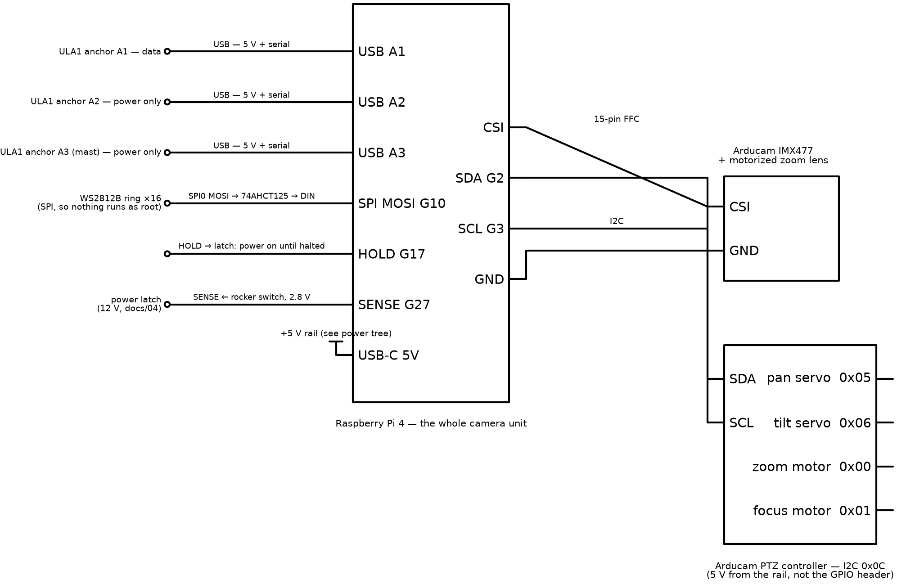
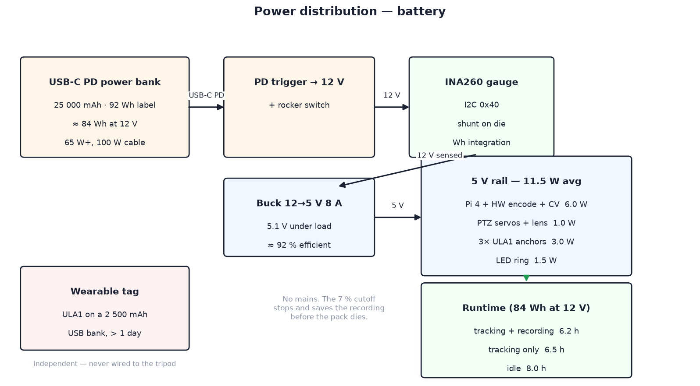
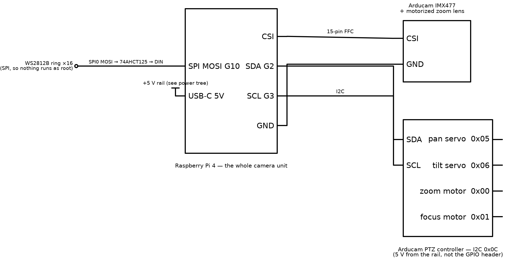
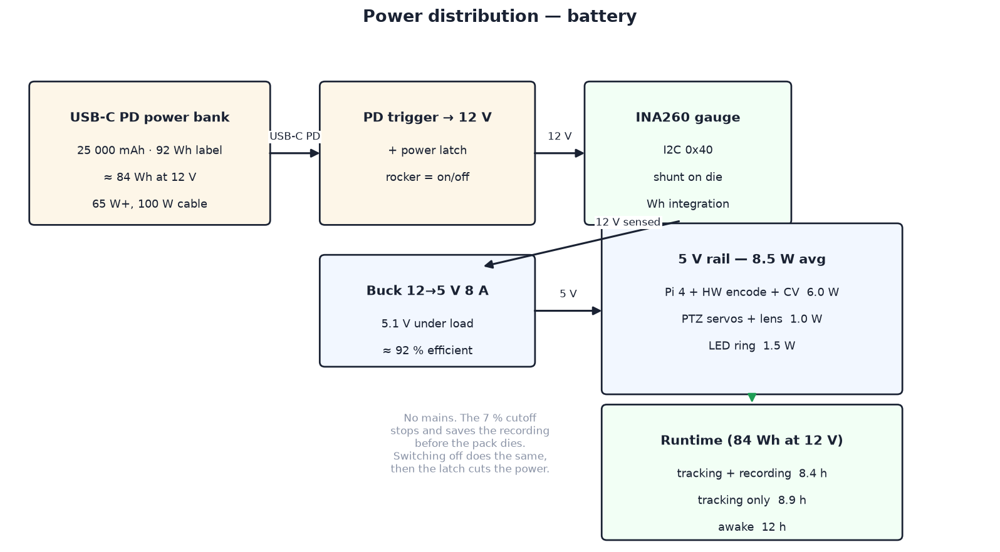

# 04 — Electronics

One board does the computing and one does the moving. Every build has:

- a **Raspberry Pi 4**, which runs everything;
- the **Arducam PTZ controller**, which drives pan, tilt, zoom and focus, on
  the Pi's I2C bus;
- the **WS2812B LED ring** that shows the state;
- a **battery gauge** and a **USB-C power bank**, with one 5 V supply
  between them.

<!--with_uwb-->

The UWB build adds three USB anchors on the head and a wearable tag
([With UWB](#with-uwb)).

<!--/-->

<!--without_uwb-->

The camera-only build adds nothing and leaves the Pi's USB ports free
([Without UWB](#without-uwb)).

<!--/-->

## Why a Pi 4 and not a Pi 5

Because of the **hardware H.264 encoder**. The Pi 5 dropped the block the
Pi 4 has, so on a Pi 5 every recorded frame is encoded in software on the CPU,
and on a battery-powered camera whose main job is recording that is the single
largest line in the power budget. A Pi 4 encodes 1080p for almost nothing.

The Pi 5 is roughly two to two and a half times faster on CPU, which matters
only for the person detector. A Pi 4 runs it at about 3 fps. How much that
matters depends on the build: <!--with_uwb-->with UWB the detector only trims angles ranging
has already set<!--/--><!--both-->; <!--/--><!--without_uwb-->without UWB it is the tracker's only sense<!--/-->.<!--both--> In both, a<!--/--><!--with_uwb:  A--><!--without_uwb:  A--> few
frames per second is enough for a person moving at several metres — see <!--both-->each
build's section<!--/--><!--with_uwb: [With UWB](#with-uwb)--><!--without_uwb: [Without UWB](#without-uwb)--> below. Paying four watts for a Pi 5 costs about two hours of
runtime.

Three smaller things follow from the choice, all in the Pi 4's favour: the
Arducam kit's 15-pin ribbon plugs straight in, so there is no adapter cable to
buy; there is no `usb_max_current_enable` flag to set; and the board is about
C$55 cheaper.

Schematic sources live in <!--both-->each build's<!--/--><!--with_uwb: the build's--><!--without_uwb: the build's--> `schematics/` —
`render_schematics.py` (schemdraw) produces the PNGs, and
`schematics/interactive/index.html` is a zoomable view of the whole system
(open it from `npm run docs` at <!--with_uwb-->http://localhost:8090/with_uwb/schematics/interactive/index.html<!--/--><!--both--> or<!--/--> <!--without_uwb-->http://localhost:8090/without_uwb/schematics/interactive/index.html<!--/--> — its
libraries are vendored locally, no internet needed).

## Head unit

To actually wire it, follow your build's **wiring guide**
([with UWB](../../with_uwb/docs/setup/12-wiring.md),
[without UWB](../../without_uwb/docs/setup/12-wiring.md)): every connection pin by
pin, in order, with a check after each. This section explains the choices
behind it. <!--both-->Each build's head schematic is in its section below.<!--/--><!--with_uwb: The head schematic is in [With UWB](#with-uwb) below.--><!--without_uwb: The head schematic is in [Without UWB](#without-uwb) below.-->

Connections <!--both-->common to both builds<!--/--><!--with_uwb: every build has--><!--without_uwb: every build has-->:

| Signal | From → To | Notes |
| --- | --- | --- |
| CSI | Pi CSI → Arducam 15-pin FFC | the cable in the kit fits a Pi 4 directly; service loop under the lid |
| PTZ I2C | Pi GPIO2/3 → PTZ controller | one board at **0x0C** drives pan, tilt, zoom and focus |
| LED data | Pi GPIO10 (SPI0 MOSI) → 74AHCT125 → WS2812B DIN | see the note below |
| Battery gauge | INA260 (or INA226) on I2C **0x40** | sits on the 12 V side, between trigger and buck. Optional — see below |

### The PTZ controller

Everything that moves is a register write on one I2C device:

| Channel | Register | Range | Axis |
| --- | --- | --- | --- |
| `OPT_ZOOM` | 0x00 | 3000–20000 | zoom motor, wide → tele |
| `OPT_FOCUS` | 0x01 | 0–20000 | focus motor |
| `OPT_MOTOR_X` | 0x05 | 0–180 | pan servo, degrees |
| `OPT_MOTOR_Y` | 0x06 | 0–180 | tilt servo, degrees |
| `OPT_IRCUT` | 0x0C | 0/1 | IR-cut filter |

`src/<build>/device/sportcam/ptz.py` wraps this. Power the controller board from the 5 V
rail directly rather than through the Pi's GPIO 5 V pin — two servos stalling
is about 0.7 A, which you do not want crossing the header — and share ground.

### Driving the WS2812B ring

Data goes out of SPI0 MOSI (GPIO10), through a 74AHCT125 to lift 3.3 V logic
to 5 V, into DIN. Enable SPI in `raspi-config` → Interface Options.
`src/<build>/device/sportcam/led.py` uses `adafruit-circuitpython-neopixel-spi`.

A Pi 4 can also drive WS2812B the classic way, with `rpi_ws281x` on GPIO18
using PWM and DMA. We do not, for one reason: that driver needs the whole
camera service to run as root. SPI does not. It is also the only method that
would survive a move to a Pi 5, whose RP1 I/O controller does not expose the
peripherals the PWM driver pokes.

## Power

SportCam runs off a **USB-C PD power bank**, so there is nothing to plug in.
A PD trigger board negotiates 12 V from the bank, one buck makes the single
5 V rail, and everything hangs off that:

```
power bank ──PD trigger (12 V)──► INA260 ──► buck 12→5 V 8 A ──┬─► Pi 4 (USB-C)
                                                               ├─► PTZ controller + servos
                                                               ├─► (with UWB) 3 × UWB anchors (Pi USB)
                                                               └─► WS2812B ring
```

<!--both-->

Each build's power tree is drawn in its section below.

<!--/-->

<!--with_uwb: The power tree is drawn in [With UWB](#with-uwb) below.-->

<!--without_uwb: The power tree is drawn in [Without UWB](#without-uwb) below.-->

Why not feed the Pi from the bank's 5 V port directly? Because the 5 V rail
also carries the servos and the LED ring<!--with_uwb--> (and, with UWB, three anchors)<!--/-->, and most banks cap
their 5 V profile at 3 A. Pulling 12 V and stepping down locally gives the
whole rail headroom and costs about 8 % in conversion.

### Load budget

| Load | Average | Peak |
| --- | --- | --- |
| Raspberry Pi 4, 1080p hardware encode + 3 fps detect | 6.0 W | 7 W |
| PTZ servos and lens motors | 1.0 W | 4 W |
| WS2812B ring at 45 % | 1.5 W | 2.9 W |
| **5 V total, without UWB** | **8.5 W** | ≈ 14 W |
| *with UWB:* 3 × ULA1 UWB anchors | 3.0 W | 3.8 W |
| **5 V total, with UWB** | **11.5 W** | ≈ 18 W |

Of the Pi's six watts, roughly three is the board simply being on, one is
JPEG-encoding the preview stream, one is the person detector and half a watt
is the recording. Recording is the cheapest thing it does, which is the whole
argument for this board.

### Runtime

A bank's advertised capacity is measured at its cells, and there are **two**
conversions between there and the 5 V rail: the bank's own boost up to 12 V,
and our buck back down. At roughly 91 % and 92 %, about **84 Wh of a 92 Wh
bank reaches the 12 V rail** where the gauge sits. Stopping at the 7 %
critical threshold leaves 78 Wh to spend:

| Mode | Draw at 12 V, with UWB | Runtime, with UWB | Draw at 12 V, without UWB | Runtime, without UWB |
| --- | --- | --- | --- | --- |
| Tracking **and** recording | 12.5 W | **6.2 h** | 9.2 W | **8.4 h** |
| Tracking only | 12.0 W | 6.5 h | 8.7 W | 8.9 h |
| Idle, streaming preview | 9.7 W | 8.0 h | 6.4 W | 12 h |

<!--both-->

The three UWB anchors are the whole difference: about 3 W at 5 V, 3.3 W at
12 V, roughly a third of the draw and about two hours of runtime. Both are
well over the 4 h target. The camera-only figures are estimates from the load
budget (5 V total ÷ 92 % buck efficiency), not measurements; measure your own
unit with the gauge.

<!--/-->

<!--with_uwb:

The three UWB anchors are about 3 W at 5 V and 3.3 W at 12 V: roughly a
third of the draw, and about two hours of runtime. It is well over the 4 h
target.

-->

<!--without_uwb:

Without the UWB build's three anchors the camera draws about a third less,
and runs about two hours longer. It is well over the 4 h target. The figures
are estimates from the load budget (5 V total ÷ 92 % buck efficiency), not
measurements; measure your own unit with the gauge.

-->

A **74 Wh (20 000 mAh) bank** manages about **<!--with_uwb-->5.0 h<!--/--><!--both--> with UWB, <!--/--><!--without_uwb-->6.7 h<!--/--><!--both-->
without<!--/-->**, saves about C$25 and a couple of hundred grams, and is the sensible
choice unless you want a full day between charges — each BOM lists it as the
alternative. Stay under 100 Wh if you ever want to fly with it.

`BATTERY_WH` in `config.py` is therefore **84**, not the 92 on the label. The
gauge measures what passes the 12 V rail, so that is what it has to be told is
available; setting it to the nameplate makes every estimate about 10 %
optimistic. Use 67 for a 74 Wh bank.

### Knowing what is left

A power bank reports nothing about its own charge over PD, so SportCam
measures instead. The sensor on the 12 V side is read every second;
`src/<build>/device/sportcam/power.py` integrates watt-hours and reports a
fraction remaining, present draw, and an estimated minutes-left from a 60 s
rolling average. It counts from when the camera service started and assumes
the bank was full then, so **start each session on a charged bank**.
Restarting the service zeroes it; there is no app button for that yet.

Two parts work, set by `POWER_MONITOR` in `config.py`. Prefer the **INA260**:
its shunt is on the die, so there is nothing to calibrate and no
`INA226_SHUNT_OHMS` to get wrong. An **INA226** with an external shunt is
equivalent if you already have one. Both sit at I2C 0x40.

The gauge is **optional**. Set `POWER_MONITOR = "none"` and everything still
runs; you lose the low-battery warning and the automatic save-and-park, so
you watch the clock instead. Sourcing is the usual reason — see the
bill of materials ([with UWB](../../with_uwb/docs/setup/10-bill-of-materials.md#parts-that-are-hard-to-source-in-canada),
[without UWB](../../without_uwb/docs/setup/10-bill-of-materials.md#parts-that-are-hard-to-source-in-canada)).

Two thresholds act on their own:

- **20 % — low.** The ring dims and slips an orange blink in once a second,
  the app shows a warning, and the estimate keeps counting down.
- **7 % — critical.** Recording stops and is saved, both axes park, and the
  camera drops to idle. The clip survives; a pack that dies mid-write might
  not have let it.

### The SD card

Recording is 1080p H.264 at 12 Mbit/s, which is **5.4 GB per hour**. The card
is a buffer, not a store: clips upload in the background and are deleted only
once the backend confirms the byte count.

| Card | Free for clips after the OS | Recording time |
| --- | --- | --- |
| 32 GB | ≈ 24 GB | 4.4 h |
| **64 GB**, as specified | ≈ 56 GB | **10 h** |
| 128 GB | ≈ 120 GB | 22 h |
| 256 GB | ≈ 248 GB | 46 h |

64 GB already holds more than one battery charge can produce, so storage is
not the binding constraint — the pack is. Bigger cards only pay off if you
carry spare banks and stay offline for days. Write speed is a non-issue:
12 Mbit/s is 1.5 MB/s, which any genuine Class 10 card beats several times
over. Buy a real card from a known brand; counterfeits are the commonest
cause of Pi corruption.

What does bite is **failed uploads**: film a session with no backend
reachable and those clips stay on the card until an upload succeeds
([08 — Failure behaviour](08-recordings-and-cloud.md#failure-behaviour)). So
**`storage.py` guards the space**, with the same shape as the battery
gauge. Below **20 minutes** of recording room the ring blinks orange and the
app warns. Below **5 minutes** the camera refuses to start a recording and
stops a running one cleanly. A 500 MB reserve is never spent on video,
because filesystems corrupt at zero.

Stopping deliberately matters because the encoder has no graceful failure: it
writes until the card returns ENOSPC and leaves a truncated file. A clean stop
leaves one you can watch.

### Saving power

The detector drops to 0.5 fps when nothing is being tracked and the ring dims
on low battery, both automatically. The biggest lever left is the preview
stream, not the recording: lowering `MJPEG_FPS`, or only streaming while a
phone is connected, takes roughly a watt off every mode. Beyond that, drop
`RECORD_SIZE` to 720p or cap the Pi's clock. All of these are in
`config.py`.

Grounds: single star point at the buck output; everything on the head shares
that plane.

## Bring-up order

Bring the electronics up one stage at a time, checking each before the next:
trim the buck to 5.1 V under load before anything is connected to it, then
the Pi, the I2C devices, the LED ring, the PTZ controller and camera<!--with_uwb-->, and
the anchors<!--/-->. Your build's 12 — Wiring guide
([with UWB](../../with_uwb/docs/setup/12-wiring.md#wiring-order-with-checks),
[without UWB](../../without_uwb/docs/setup/12-wiring.md#wiring-order-with-checks))
has each step and its check; 15 — Verification lists the bench checks after
that.

---

## With UWB



One more connection on the head:

| Signal | From → To | Notes |
| --- | --- | --- |
| UWB anchors | 3 × Haorutech ULA1 via USB-A | **one** carries serial at 115200 (`/dev/ttyUSB0`) and reports every range; the other two need 5 V only. A Pi 4 has four USB-A ports, so this uses three of them |

**The detector's job.** With the third anchor fitted, the person detector only
trims angles ranging has already set; on a two-anchor build it drives tilt,
which needs to keep up with about 1.7°/s of subject motion. Either way a few
frames per second is enough
([05](../../with_uwb/docs/design/05-tracking-system.md)).



### Wearable


A ULA1 module (DWM1000 on board) plugged into a small USB power bank. The
module takes 5 V over USB and has no battery connector, so the bank is its
battery. A 2 500 mAh bank runs it well past a full day. It has no buttons:
switching it on starts a session, and switching it off ends one.

---

## Without UWB



There are no radios, no anchors and no wearable: the camera is the only
sensor, so the Pi's USB ports are left free. The common connections above are
the whole head.

**The detector's job.** Here the person detector is the *only* sense the
tracker has, and a Pi 4 runs HOG at about 3 fps. That is enough for a person
walking or climbing at several metres (a few hundred milliseconds of delay,
handled by under-correcting gains — see
[05](../../without_uwb/docs/design/05-tracking-system.md)), and the 3 fps tuning is
what makes the Pi 4 workable. A faster board, or a MobileNet-SSD detector, is
the upgrade if you need to follow fast movers.


