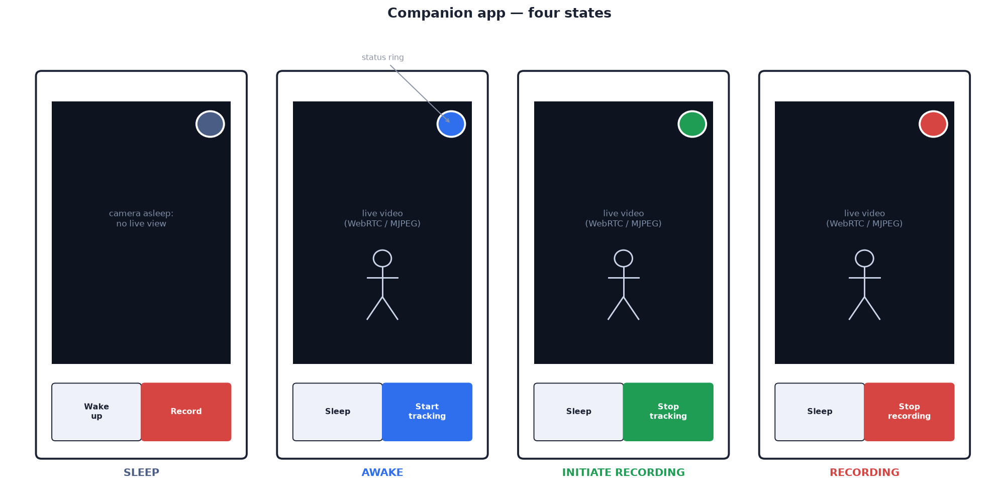

# 09 — Direct phone ↔ camera connection & the native app

On the camera's Wi-Fi the app discovers the camera, streams full-rate video
and controls it with no cloud or internet in the path. Elsewhere the same app
connects through Firebase.

## Why the camera serves its own API

Firebase access is limited to a ≈ 1 frame/s preview, and fails when the
gym's internet is down. The camera therefore hosts its own copy of the API
(`src/<build>/device/sportcam/local_api.py`) with the **same callable
protocol** as the Firebase function:

| | Firebase | **Camera (direct)** |
| --- | --- | --- |
| `POST /api/call/*` | ✅ (with the camera key) | ✅ |
| Live view | preview, ~1 frame/s, while watched | `GET /api/stream.mjpeg`, 15 fps (or WebRTC) |
| `GET /api/recordings/:name` | signed URL | ✅ (clips not yet uploaded) |
| Live state | Firestore document | `WS /ws` |
| Live person boxes | with each preview frame | `WS /ws` `boxes` message, each detection |
| Joystick (aim by hand) | — | the app sends `WS /ws` `jog` messages ([below](#aiming-by-hand)) |
| Works at the gym | needs internet | ✅ **needs nothing** |

- Same protocol, so the app's calls are identical; only the base URL changes.
- Single state owner on the device (`Head.apply_state`). Direct commands,
  Firebase commands and camera-initiated changes (<!--with_uwb-->tag on/off<!--/--><!--both--> with UWB; <!--/--><!--without_uwb-->found for 3 s → recording<!--/--><!--both--> without<!--/-->)
  take the same path; app, LED ring and Firestore stay consistent.
- State includes `mode` (`config.TRACKING_MODE`), so a direct client selects
  the build's wording ([07 — Tracking mode](07-backend-and-app.md#tracking-mode)).

## Discovery: mDNS / Bonjour

Service `_sportcam._tcp.local` (`src/<build>/device/sportcam/discovery.py`),
with the API port and TXT records:

```
name=SportCam   state=tracking   ver=1
api=/api/call   stream=/api/stream.mjpeg
```

- Also resolves as `sportcam.local`.
- TXT `state` updates on every transition, so a picker can show each
  camera's state before connecting.
- Rationale: the Pi gets a new DHCP address on each network; mDNS removes
  the need for IP addresses.

Connection strategy (`camera_client.dart`), in order:

| # | Method | Mode |
| --- | --- | --- |
| 1 | mDNS sweep → direct connection | `LinkMode.direct` |
| 2 | last known address (for networks that block multicast) | `LinkMode.direct` |
| 3 | Firebase, if built with the backend address and camera key (`--dart-define`, [below](#running-and-testing-it)). State polled every 2 s; live view is the preview | `LinkMode.relay` |
| 4 | none; retry every 3 s | `LinkMode.offline` |

## Why the app is native (Flutter)

The web app works through Firebase. For direct connection, browsers have two
blocking limitations:

| Limitation | Detail |
| --- | --- |
| **No service discovery** | no mDNS/Bonjour API in browsers. A web app can only try `http://sportcam.local:8787` and rely on OS `.local` resolution (reliable on iOS/macOS, not on Android). It can't enumerate cameras or read TXT state |
| **Mixed content** | an HTTPS page (Firebase Hosting) can't make plain-HTTP requests to the LAN. The camera can't hold a valid TLS certificate for a private IP |

Additional native benefits: hardware H.264 playback (ExoPlayer/AVPlayer); an
MJPEG decoder that owns its socket (reconnects in ≈ 2 s after a Wi-Fi drop);
background audio and notifications.

**The Vue web app is retained:** served by Firebase Hosting, it works on any
device with nothing installed. Both clients use the same protocol.

## The app's screen

<!--both-->



<!--/-->

<!--with_uwb: -->

<!--without_uwb: -->

Same layout as the web app, plus a connection badge:

| Element | Behaviour |
| --- | --- |
| **Top left — connection** (`ConnectionBadge`) | green **"SportCam · Direct · 10.0.0.42"**; blue **"Firebase"**; amber pulsing **"Searching…"**; red **"Offline — tap to retry"**. Tap to re-scan |
| **Below the badge** | recordings button with clip-count badge; under it, **Boxes on / off** for the live view (remembered on the phone, separately from the player's) |
| **Live view** | the MJPEG stream (direct) or the preview (Firebase), with the camera's [person boxes](08-recordings-and-cloud.md#in-the-live-view) painted over it (`widgets/person_boxes.dart`). Only in `awake`, `tracking` and `recording`; in `sleep` the sensor is off and the screen says the camera is asleep |
| **Bottom right — joystick** (`widgets/joystick.dart`) | in `awake` over the direct connection only: a knob in a ring to aim the camera by hand ([below](#aiming-by-hand)) |
| **Top right, stalled-tracking pill, bottom buttons** | as in the web app ([07](07-backend-and-app.md#web-app-srcweb)) |
| **Recording player** (`lib/screens/library_screen.dart`) | the native player with the clip's [person boxes](08-recordings-and-cloud.md#person-boxes) painted over it, a **Boxes on / off** button beside play/pause (remembered on the phone) and a legend. Over the direct connection the boxes come from the camera's card (`/api/recordings/<clip>.boxes.json`) |
| **Sounds** (`lib/session_audio.dart`) | a sonar ping every 3 s while searching, a beep each second of the found countdown (3, 2, 1), then a rising chime on record start; falling on stop. Queued, so the chime follows the last beep. Plays **including in the background**. While connected the app stays awake: Android foreground service with a "SportCam connected" notification; iOS background audio mode (looped silence). Mixes over music; plays with the iOS silent switch on. Platform setup: [`src/app_flutter/README.md`](../../src/app_flutter/README.md) |

## Aiming by hand

The joystick sits bottom right of the live view, above the buttons. Drag the
knob and the camera turns towards the pull: left pans left, up tilts up. The
further the knob is from the centre, the faster it turns. Let go and the knob
springs back and the camera stops where it is.

| | |
| --- | --- |
| When | `awake` only, over the direct connection. In `tracking` and `recording` the tracker drives the head; in `sleep` there is no picture to aim by; through Firebase a command takes about a second, so the camera would overshoot. The web app has no joystick for the same reason |
| Message | while held, the app sends `{"type": "jog", "pan": x, "tilt": y}` on the WebSocket every 50 ms, even with the finger still: `x` right +, `y` up +, each the knob's offset as a fraction of its travel (the rim is 1). Releasing sends one `(0, 0)` |
| Speed | the camera turns at `JOG_PAN_MAX_DPS × r × x` and `JOG_TILT_MAX_DPS × r × y` (60°/s and 45°/s at the rim), where `r` is the distance from the centre: speed grows with the square of the pull, so a small pull aims finely. The soft limits still apply |
| Dead man | the camera moves only within `JOG_TIMEOUT_S` (0.3 s) of the last message, so a dropped Wi-Fi link or a backgrounded app can't leave it turning |
| Where it runs | `LocalApi._on_jog` checks and clamps each message; `Head.jog` notes it; `Head.manual_aim` turns the head once per control tick (`Ptz.jog`), so it moves smoothly however unevenly messages arrive. Using it keeps the camera awake |
| Then | a session started afterwards begins from where you aimed it: <!--with_uwb-->the camera turns from there to the tag<!--/--><!--both--> (with UWB), or <!--/--><!--without_uwb-->the sweep starts from there, and with a person in frame it skips the sweep<!--/--><!--both--> (without)<!--/-->. Going to sleep, and a session ending, re-centre the head |

## Running and testing it

See [`src/app_flutter/README.md`](../../src/app_flutter/README.md):

- `flutter run`: LAN discovery only.
- Add `--dart-define` backend address and camera key (both printed by
  `firebase-setup.sh`) for Firebase fallback.
- Required platform setup: iOS `NSBonjourServices`; Android multicast and
  cleartext permissions. Without it discovery silently finds nothing.
- Checks without hardware or a Flutter SDK, including a contract check of
  the app's model code against the real camera API and the real Firebase
  function.

## Known limits

| Limit | Impact | Mitigation |
| --- | --- | --- |
| **Multicast blocked** (some guest/corporate Wi-Fi) | discovery fails | remembered address; `sportcam.local` if the OS resolves it |
| **MJPEG bandwidth** (≈ 2–4 Mbit/s at 720p15) | fine on a LAN | WebRTC via MediaMTX (`WHEP_URL`); the app already receives the URL in the state |
| **No authentication on the local API** | anyone on the same Wi-Fi can control the camera | use a private hotspot at public venues. Fix: check the camera-key header, as the Firebase API does |
