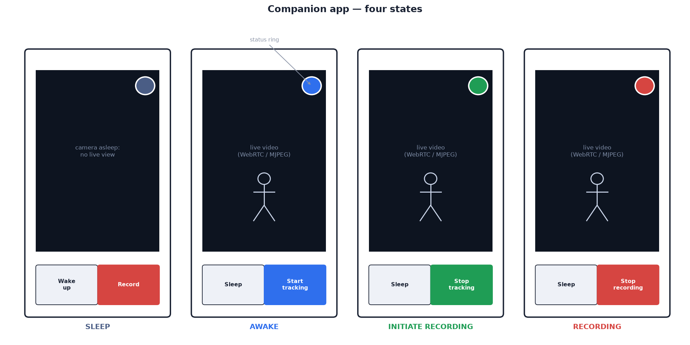

# 09 — Direct phone ↔ camera connection & the native app

On the camera's Wi-Fi the app discovers the camera, streams full-rate video
and controls it with no cloud or internet in the path. Elsewhere the same app
connects through Firebase.

## Why the camera serves its own API

Firebase access is limited to a ≈ 1 frame/s preview, and fails when the
gym's internet is down. The camera therefore hosts its own copy of the API
(`src/<build>/device/sportcam/local_api.py`) with the **same callable
protocol** as the Firebase function:

| | Firebase | **Camera (direct)** |
| --- | --- | --- |
| `POST /api/call/*` | ✅ (signed in, with the camera key) | ✅ |
| Live view | preview, ~1 frame/s, while watched | `GET /api/stream.mjpeg`, 15 fps (or WebRTC) |
| `GET /api/recordings/:name` | the owner's signed URL | ✅ your clips not yet uploaded (`X-Session-Secrets`) |
| Live state | Firestore document | `WS /ws` |
| Live person boxes | with each preview frame | `WS /ws` `boxes` message, each detection |
| Joystick (aim by hand) | — | the app sends `WS /ws` `jog` messages ([below](#aiming-by-hand)) |
| Zoom, tap to focus | — | the app sends `WS /ws` `lens` and `focus` messages ([below](#zoom-and-focus)) |
| Works at the gym | needs internet | ✅ **needs nothing** |

- Same protocol, so the app's calls are identical; only the base URL changes.
- Single state owner on the device (`Head.apply_state`). Direct commands,
  Firebase commands and camera-initiated changes (<!--with_uwb-->tag on/off<!--/--><!--both--> with UWB; <!--/--><!--without_uwb-->found for 3 s → recording<!--/--><!--both--> without<!--/-->)
  take the same path; app, LED ring and Firestore stay consistent.
- State includes `mode` (`config.TRACKING_MODE`), so a direct client selects
  the build's wording ([07 — Tracking mode](07-backend-and-app.md#tracking-mode)).
- **Whose session it is holds with no internet too.** The camera hands the
  phone that starts a session its secret and refuses a stop without it; it
  lists and serves a clip on its card only to a phone holding its session's
  secret. Nothing here needs an account or the backend: the phone claims the
  clips in the cloud library later
  ([07 — Accounts](07-backend-and-app.md#accounts-and-whose-recording-is-whose)).

## Discovery: mDNS / Bonjour

Service `_sportcam._tcp.local` (`src/<build>/device/sportcam/discovery.py`),
with the API port and TXT records:

```
name=SportCam   state=tracking   ver=1
api=/api/call   stream=/api/stream.mjpeg
```

- Also resolves as `sportcam.local`.
- TXT `state` updates on every transition, so a picker can show each
  camera's state before connecting.
- Rationale: the Pi gets a new DHCP address on each network; mDNS removes
  the need for IP addresses.

Connection strategy (`camera_client.dart`), in order:

| # | Method | Mode |
| --- | --- | --- |
| 1 | mDNS sweep → direct connection | `LinkMode.direct` |
| 2 | last known address (for networks that block multicast) | `LinkMode.direct` |
| 3 | Firebase, if built with the backend address and camera key (`--dart-define`, [below](#running-and-testing-it)). State polled every 2 s; live view is the preview | `LinkMode.relay` |
| 4 | none; retry every 3 s | `LinkMode.offline` |

## Why the app is native (Flutter)

The app is the only client. It is native because a web page can't make the
direct connection, for two reasons:

| Limitation | Detail |
| --- | --- |
| **No service discovery** | no mDNS/Bonjour API in browsers. A web app can only try `http://sportcam.local:8787` and rely on OS `.local` resolution (reliable on iOS/macOS, not on Android). It can't enumerate cameras or read TXT state |
| **Mixed content** | an HTTPS page (Firebase Hosting) can't make plain-HTTP requests to the LAN. The camera can't hold a valid TLS certificate for a private IP |

Additional native benefits: hardware H.264 playback (ExoPlayer/AVPlayer); an
MJPEG decoder that owns its socket (reconnects in ≈ 2 s after a Wi-Fi drop);
background audio and notifications.

## The app's screen

<!--both-->



<!--/-->

<!--with_uwb: -->

<!--without_uwb: -->

One screen (requirement F5 in [01](../product/01-requirements.md#functional-requirements)). It opens into the live view, with no play button:

| Element | Behaviour |
| --- | --- |
| **Sign in** (`lib/screens/login_screen.dart`) | before anything else, when the app is built with a backend: email, password, **Forgot password?**. No sign-up ([07 — Accounts](07-backend-and-app.md#accounts-and-whose-recording-is-whose)) |
| **Top left — connection** (`ConnectionBadge`) | green **"SportCam · Direct · 10.0.0.42"**; blue **"Firebase"**; amber pulsing **"Searching…"**; red **"Offline — tap to retry"**. Tap to re-scan |
| **Below the badge** | recordings button with clip-count badge; under it, **Boxes on / off** for the live view (remembered on the phone, separately from the player's) |
| **Live view** | the MJPEG stream (direct) or the preview (Firebase), with the camera's [person boxes](08-recordings-and-cloud.md#in-the-live-view) painted over it (`widgets/person_boxes.dart`). Only in `awake`, `tracking` and `recording`; in `sleep` the sensor is off and the screen says the camera is asleep |
| **Bottom — aim and zoom** (`widgets/aim_panel.dart`) | in `awake` over the direct connection only, behind an **arrow** on the bottom bar: tap it and the controls rise out of the bar, tap again and they sink back (remembered on the phone; tucked away to start). Two knobs in rings, pan under the left thumb and tilt under the right, to aim the camera by hand ([below](#aiming-by-hand)), with a **Zoom** slider above them (wide → tele, read as 1.0× … 3.8×; `widgets/lens_controls.dart`) |
| **Tap to focus** (`widgets/tap_focus.dart`) | in `awake` over the direct connection: tap the picture and the camera autofocuses on what is under the tap. A square marks the spot, blue while it focuses, green when done ([below](#zoom-and-focus)) |
| **Sample** (camera button, under Boxes) | in `awake`, `tracking` and `recording`, over the direct connection: the camera saves the frame it sees now — full size, the frame detection saw, and a `.json` of what it made of it (the detector on that frame, the tracker's labelled boxes, zoom, focus, aim) — in `SAMPLE_DIR` on its card, for improving person detection (`samples.py`, callable `takeSample`). `scripts/pi/samples.sh` copies them into `samples/`, which git ignores. They are photos of people: they never go to the cloud backend |
| **Top right — status ring** (`widgets/status_ring.dart`) | the camera's state in the LED colours ([01 — State machine](../product/01-requirements.md#state-machine)); hollow while the camera is offline |
| **Under the ring — account menu** | who is signed in; <!--with_uwb-->**Pair my tag**; <!--/--><!--both-->with UWB, **Pair my tag**; <!--/-->for admins, **People** (`lib/screens/admin_screen.dart`: everyone who can sign in, and **Add person**); **Sign out** |
| **Bottom buttons** (`widgets/control_bar.dart`) | swap with the state, with the labels in [01 — State machine](../product/01-requirements.md#state-machine). In `sleep`: **Wake up** and **Track**; in `tracking`: **Sleep**, **Stop tracking** and **Record**, Record greyed out until the camera has seen someone in the last 3 s (telemetry `canRecord`); in `recording`: **Stop recording** only, back to `tracking` |
| **Stalled-tracking pill** | if tracking stalls: <!--with_uwb-->"Can't pick you out — step into view, away from anyone else"<!--/--><!--both--> (with UWB) or<!--/--><!--without_uwb--> "Can't find anyone — step into the room, facing the camera" (<!--/--><!--both-->without UWB, <!--/--><!--without_uwb-->after 15 s with nobody found)<!--/--> |
| **Someone else's session** | while a session another phone started runs, **Sleep** and **Stop** are greyed out under *"Someone else is recording — only their phone can stop it"*. The app knows from the state's `sessionHash`, compared with the hashes of the secrets it holds (`lib/keys.dart`) |
| **No optimistic UI** | a button calls the API, and the screen changes only when the camera reports its new state, so the app, the LED ring and other phones stay consistent |
| **Recording library** (`lib/screens/library_screen.dart`) | opened from the recordings button: **your** clips only — the cloud library, from every camera, plus, connected directly, yours still on the camera's card (*"on the camera, uploading soon"*). An upload pill shows progress while a clip uploads; **"Recording saved — watch now"** when one of yours lands |
| **Recording player** (`lib/screens/library_screen.dart`) | the native player with the clip's [person boxes](08-recordings-and-cloud.md#person-boxes) painted over it, a **Boxes on / off** button beside play/pause (remembered on the phone) and a legend. Over the direct connection the boxes come from the camera's card (`/api/recordings/<clip>.boxes.json`) |
| **Sounds** (`lib/session_audio.dart`) | a sonar ping every 3 s while searching, a beep each second of the found countdown (3, 2, 1), then a rising chime on record start; falling on stop. Queued, so the chime follows the last beep. Plays **including in the background**. While connected the app stays awake: Android foreground service with a "SportCam connected" notification; iOS background audio mode (looped silence). Mixes over music; plays with the iOS silent switch on. Platform setup: [`src/app_flutter/README.md`](../../src/app_flutter/README.md) |

## Aiming by hand

Two sticks sit at the bottom of the live view, above the buttons, one under
each thumb: pan on the left, whose knob slides left and right, and tilt on the
right, whose knob slides up and down. Drag a knob and the camera turns that
way: left pans left, up tilts up. The further the knob is from the centre, the
faster it turns, and the two work together for a diagonal. Let go and the knob
springs back and that axis eases to a stop where it is.

| | |
| --- | --- |
| When | `awake` only, over the direct connection. In `tracking` and `recording` the tracker drives the head; in `sleep` there is no picture to aim by; through Firebase a command takes about a second, so the camera would overshoot |
| Message | while either is held, the app sends `{"type": "jog", "pan": x, "tilt": y}` on the WebSocket every 50 ms, even with the finger still: `x` the pan stick (right +), `y` the tilt stick (up +), each its knob's offset as a fraction of its travel (the end is 1). Each stick changes only its own value, so holding one never zeroes the other. Releasing a stick sends its axis as 0 |
| Speed | the camera turns at `JOG_PAN_MAX_DPS × x × abs(x)` and `JOG_TILT_MAX_DPS × y × abs(y)` (60°/s and 45°/s at the end): each axis's speed grows with the square of its own stick, so a small pull aims finely. It eases up to that speed and back down to a stop at `JOG_PAN_ACCEL_DPS2` / `JOG_TILT_ACCEL_DPS2`, using the same acceleration step as tracking (`motion.py`). The soft limits still apply |
| Dead man | the camera moves only within `JOG_TIMEOUT_S` (0.3 s) of the last message, so a dropped Wi-Fi link or a backgrounded app can't leave it turning |
| Where it runs | `LocalApi._on_jog` checks and clamps each message; `Head.jog` notes it; `Head.manual_aim` turns the head once per control tick (`Ptz.jog`), so it moves smoothly however unevenly messages arrive. Using it keeps the camera awake |
| Then | a session started afterwards begins from where you aimed it: <!--with_uwb-->the camera turns from there to the tag<!--/--><!--both--> (with UWB), or <!--/--><!--without_uwb-->the sweep starts from there, and with a person in frame it skips the sweep<!--/--><!--both--> (without)<!--/-->. Going to sleep, and a session ending, re-centre the head |

## Zoom and focus

The **Zoom** slider sits above the sticks, in the panel the arrow brings up:
from the widest view to full tele, shown as a multiple of the widest
(1.0× … 3.8×). There is no focus slider: the camera autofocuses, by itself
once the zoom is still, and where you **tap** the live view.

| | |
| --- | --- |
| When | as the sticks: `awake` only, over the direct connection. Tracking and recording drive the lens themselves, starting from wide, and focus from `FOCUS_GRID` by distance: an autofocus search would show in the clip |
| Messages | while the slider moves the app sends `{"type": "lens", "zoomMm": z}` on the WebSocket, at most every 120 ms and once more where it is let go; a tap sends `{"type": "focus", "x": x, "y": y}`, the point as 0…1 of the camera's own frame (`frameSize` in telemetry). The tap layer sits inside the live view's turn and mirror (`OrientedView`), so the point is already in the camera's frame however the view is turned. The camera clamps both and drops anything malformed |
| Autofocus | `autofocus.py`: contrast autofocus with focuscal's measure, the variance of the Laplacian, over a square around the point (`AF_REGION` of the frame's short side). The focus motor is slow (≈ 5 s end to end, 0–2100) and sharp in a narrow band, so it runs the motor down a window of ± `AF_SWEEP_HALVES[0]` round where it already is in one continuous move, scoring every frame on the way — each frame's position read off the clock between the write and the busy flag clearing, less `AF_FRAME_LAG_S` — and over the whole travel if that shows no clear peak (`AF_PEAK_RATIO`). A short stepped pass (`AF_FINE`) refines it, each move upward and the last onto the best from below (`AF_BACKLASH`). ≈ 5 s near where it starts, ≈ 15 s when it must cover the whole travel. Where it ends, relative to `FOCUS_GRID`, becomes the focus trim (`Ptz.learn_focus`), added to every lookup after, so zoom moves and sweeps stay near focus. While it runs `Ptz.af_active` holds off everyone else's zoom and focus, and the trackers don't count frames blurred by a lens move as their person lost. It runs on a tap, once the zoom is still, `AF_ON_WAKE_S` after waking (refocused for `AWAKE_FOCUS_M` at once: homing parks the focus at its stop), and in tracking as it locks on to its person — never while recording. Each run logs an `[af]` line |
| After a zoom | `Head.manual_lens` zooms (past `ZOOM_RATE_LIMIT_S`, which stops the tracker's lens breathing) and, once no zoom has come for `AF_AFTER_ZOOM_S`, autofocuses on the last point tapped (the centre until then). While the app holds a zoom, awake stops forcing the lens wide. Using either keeps the camera awake |
| Feedback | telemetry carries `zoomMm`, `zoomRangeMm`, `focusing` and `frameSize`, on the direct link (the state message carries `Head.telemetry()` whole) and through Firebase alike. The slider stays where the finger left it for 1.5 s, then follows the camera; the tap's square stays while `focusing` |
| Then | any state change cancels a sweep and clears the app's zoom and tap point: woken again, the lens is back to wide |

## Running and testing it

Installing it: 14 — Software setup, the app step. Building, platform setup
and the checks that run without hardware or a Flutter SDK:
[`src/app_flutter/README.md`](../../src/app_flutter/README.md).

## Known limits

| Limit | Impact | Mitigation |
| --- | --- | --- |
| **Multicast blocked** (some guest/corporate Wi-Fi) | discovery fails | remembered address; `sportcam.local` if the OS resolves it |
| **MJPEG bandwidth** (≈ 2–4 Mbit/s at 720p15) | fine on a LAN | WebRTC via MediaMTX (`WHEP_URL`): the camera already reports the URL in its state, but the app doesn't play WebRTC yet |
| **No sign-in on the local API** | anyone on the same Wi-Fi can drive the camera: wake it, aim it, start a session when none is running. Not stop someone else's, nor see their clips | use a private hotspot at public venues. Fix: check the camera-key header, as the Firebase API does |
| **Secrets over plain HTTP on the LAN** | someone capturing the Wi-Fi traffic could copy a session secret, and with it stop that session or claim its clips first | WPA2/3 Wi-Fi; the backend refuses a second claim on a secret already claimed. Fix: TLS with a pinned self-signed certificate |
