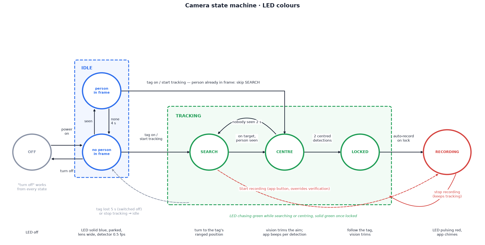
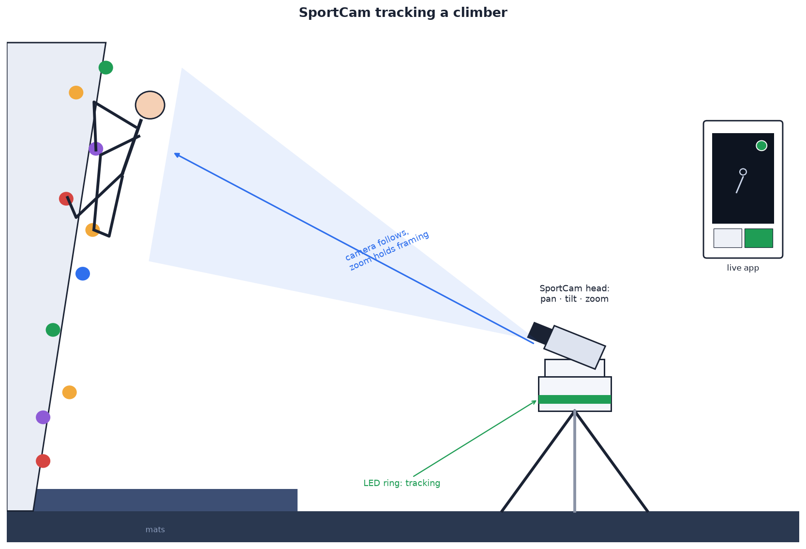
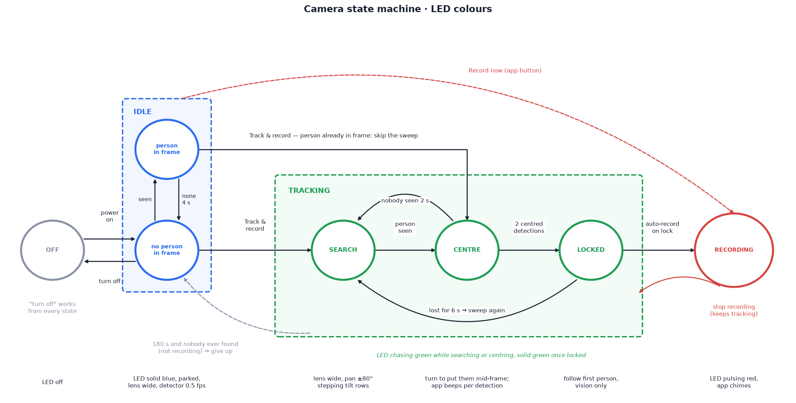

# 01 — Product requirements

Functional requirements (F), non-functional requirements (C), the ideal
path and the state machine. Design: [02 — System architecture](../design/02-system-architecture.md)
onward.

Structure: shared requirements first, then build-specific requirements in
[With UWB](#with-uwb) and [Without UWB](#without-uwb).

## Use case

Reference scenario: an indoor climbing session with no camera operator.

| Parameter | Value |
| --- | --- |
| Mounting | standard photo tripod on the floor or mats |
| Distance to subject | 6–12 m |
| Power | battery only, no mains |
| Camera behaviour | pans and tilts to keep the climber centred; zooms to hold framing |
| Status | LED ring on the head; same state and a live view in the app |

Subject localisation is build-specific: [With UWB](#with-uwb),
[Without UWB](#without-uwb).

## The two builds

<!--compare-->

| | [**With UWB**](../../README.md#with-uwb) | [**Without UWB**](../../README.md#without-uwb) |
| --- | --- | --- |
| Subject localisation | worn UWB tag, ranged by 3 anchors at 20 Hz | vision only: pan sweep, follow the first person detected |
| Session start | tag switched on | **Track & record** in the app |
| Distinguishes subject from bystanders | yes (tag identity) | no (first person found) |
| Extra hardware | 3 × ULA1 anchors, 2 anchor arms, A3 mast, wearable pod | none |
| Head size | ≈ 42 cm across the arms, 28 cm to the mast top; Ø 141 mm enclosure | Ø 135 mm enclosure, no protrusions |
| Runtime, 92 Wh bank, tracking + recording | ≈ 6.2 h | ≈ 8.4 h (estimated) |
| Cost, excluding tripod | ≈ C$1079 | ≈ C$716 |
| `TRACKING_MODE` | `"with_uwb"` | `"without_uwb"` |

Selection: UWB when the subject must be distinguished from other people in
view; camera-only for lower cost, size and power.

## Functional requirements

| ID | Requirement | Reference |
| --- | --- | --- |
| F1 | **Pan, tilt, zoom.** Pan 160° (±80°); tilt 130° (−45° to +85°); optical zoom 96° → 33° horizontal (≈ 3.5×). All three from the Arducam PTZ base | [03](../design/03-mechanical-design.md) |
| F2 | **Follow a person** <!--both-->by UWB tag or by vision, per build<!--/--><!--with_uwb: by the UWB tag they wear--><!--without_uwb: by vision alone-->, and zoom to keep them framed | <!--both-->05 tracking ([with UWB](../../with_uwb/docs/design/05-tracking-system.md), [without UWB](../../without_uwb/docs/design/05-tracking-system.md))<!--/--><!--with_uwb:[05](../../with_uwb/docs/design/05-tracking-system.md)--><!--without_uwb:[05](../../without_uwb/docs/design/05-tracking-system.md)--> |
| F3 | **Record unattended.** Recording starts once a found person has stayed in frame for 3 s, and stops at session end. A clip is saved even when the battery runs out | [Ideal path](#ideal-path) |
| F4 | **LED status ring** showing each state and sub-state (connecting, pairing, idle with or without a person in frame, search, found, recording) and low battery | [State machine](#state-machine) |
| F5 | **Companion app**: opens into the live view; state-dependent bottom buttons; status ring top right in the LED colours | [07](../design/07-backend-and-app.md#web-app-srcweb) |
| F6 | **Remote use.** State, live preview and control from any internet-connected phone or computer. One backend and one app serve both builds; the camera reports its build | [07](../design/07-backend-and-app.md#tracking-mode) |
| F7 | **Recordings library.** Each stopped recording uploads to the backend and appears in the app's library | [08](../design/08-recordings-and-cloud.md) |
| F8 | **Direct connection.** On the camera's Wi-Fi, a phone discovers and controls it with no server or internet | [09](../design/09-direct-connection-and-app.md) |
| F9 | **Person boxes in recordings and the live view.** A box round every person the camera detects: **green** round the climber, **yellow** round anyone else, and **red** round everyone while it can't tell which is the climber (in `idle` nobody has been picked yet, so every box is red). Each recording keeps its boxes and both apps' players draw them over the video; both apps' live views draw them over the picture as the camera detects. The player and the live view each have a **Boxes on / off** button, remembered on that phone or browser | [08](../design/08-recordings-and-cloud.md#person-boxes) |
| F10 | **Wi-Fi setup at a new gym.** With no saved network in range, the camera enters [pairing](#pairing) on its own; the phone shows its Wi-Fi share QR code to the lens, so the password is never retyped. The network is remembered for next time | [Pairing](#pairing); [08](../design/08-recordings-and-cloud.md#connecting-the-camera-to-gym-wi-fi-from-your-phone) |

## Non-functional requirements

Constraints the design must meet. A change that breaks one must state why
in the doc that makes it. C1 and C2 are build-specific
(<!--both-->[with UWB](#non-functional-requirements-with-uwb),
[without UWB](#non-functional-requirements-without-uwb)<!--/--><!--with_uwb: [with UWB](#non-functional-requirements-with-uwb)--><!--without_uwb: [without UWB](#non-functional-requirements-without-uwb)-->).

| # | Requirement | Value | Rationale | Set in |
| --- | --- | --- | --- | --- |
| C3 | **Standard tripod mount** | 3/8-16 brass insert in the floor; removable 3/8-16 → 1/4-20 reducer bushing | photo tripods use 1/4-20, video heads 3/8-16; one socket takes both without an adapter plate | `tripod_boss_d`, `tripod_hole_d` in `<build>/cad/config.scad`; BOM |
| C4 | **Battery operation** | ≥ 4 h tracking + recording from a USB-C PD bank; remaining-time gauge; clean save and stop at 7 % | no wall socket; no lost clip at end of charge | [04 — Runtime](../design/04-electronics.md#runtime) |
| C5 | **Printable on a Bambu Lab A1 Mini** | every part ≤ 170 mm on every axis, as oriented for printing | the printer in use | [11](../setup/11-3d-printing.md#design-rule-every-part-prints-on-a-bambu-lab-a1-mini); `cad/fit.py` |
| C6 | **Bought parts fit the printed parts** | every part in `cad/ordered_parts.toml` fits with clearance | parts are bought before they can be measured | `cad/fit.py`, on render, commit and Claude Code stop ([Appendix A](../appendix/appendix-a-cad-parts.md#fit-the-layout-to-your-parts)) |
| C7 | **Operates offline** | tracks, records and shows state with no server and no Wi-Fi | gym Wi-Fi is unreliable | [02](../design/02-system-architecture.md#key-decisions) |
| C8 | **No home server** | deployed backend is Firebase only (Functions, Firestore, Storage, Hosting) | no machine to keep running; reachable from anywhere | [07](../design/07-backend-and-app.md) |
| C9 | **Testable without cloud or camera** | backend runs on the Firebase emulators with a simulated camera (`npm run dev`); API tests run against them (`npm test`) | test before deploying, without hardware | [Appendix C](../appendix/appendix-c-development.md) |
| C10 | **Owner-only access** | every call and read requires the camera key; cameras can't be listed; no client writes | backend is public | [07 — The camera key](../design/07-backend-and-app.md#the-camera-key) |

## Ideal path

One successful session, end to end: subject found, filmed, clip in the
library. Deviations (dropouts, loss, manual control): <!--both-->[with UWB](#state-machine-with-uwb),
[without UWB](#state-machine-without-uwb)<!--/--><!--with_uwb: [state machine, with UWB](#state-machine-with-uwb)--><!--without_uwb: [state machine, without UWB](#state-machine-without-uwb)-->.

1. **Power on.** State `connecting` (white light chasing round the ring):
   the Pi joins a saved Wi-Fi network (at a new gym, [pairing](#pairing)
   first), then connects to Firebase. State `idle`
   (solid blue): head parked, lens wide. The app opens into the live view;
   the status ring reads "On — no one in frame", then "On — person in frame"
   once the climber walks into view, and the LED ring and the app's ring
   start breathing slowly.
2. **Start.** State `tracking` (initiate tracking).
   - **With UWB**: the climber switches the tag on. The camera ranges
     continuously, including in idle, and detects the tag within ≈ 1 s.
   - **Without UWB**: the user taps **Track & record** (app or the camera's
     local page).
3. **Search.** Green light chasing round the ring; the app pings every 3 s.
   - **With UWB**: the location is known at once, so the head turns to the
     ranged position: "Turning to your tag…". Search ends when the head is
     on that position and the person there is detected — under a second
     here, with the climber already in view. It is never skipped: a person
     in frame in idle could be anyone.
   - **Without UWB**: skipped here. The climber is already in frame, so
     tracking starts at **found**. (With nobody in frame it sweeps ±80° at
     25°/s, zoomed wide, stepping between two tilt rows at each end:
     "Looking for a person…", until a person is detected.)
4. **Found.** The camera follows and frames the climber exactly as it will
   while recording (pan, tilt, zoom, focus); they don't have to be centred.
   The LED ring fills with green over 3 s and the app beeps each second
   ("Found you — recording in 3… 2… 1…"). Ranging alone never starts a
   recording. With UWB, vision alone doesn't either: only the person where
   the tag is counts, so a belayer beside the climber or someone walking
   past is never found, and never followed. Without UWB, the first person
   found is kept; afterwards the tracker follows the detection nearest the
   last position, so a passing bystander doesn't take over.
5. **Record.** Still in frame after 3 s (`FOUND_CONFIRM_S`): state
   `recording` (pulsing red; the app chimes after the beeps). Pan and tilt
   keep the climber in frame; zoom holds them at ≈ 65 % of the frame. H.264
   is written on the Pi.
6. **End.** The clip is saved, the app chimes, state `idle`.
   - **With UWB**: the climber switches the tag off; the session ends 5 s
     later.
   - **Without UWB**: the user taps **Stop recording**.
7. **Upload.** The clip uploads to Firebase and appears in the app's library
   ([08](../design/08-recordings-and-cloud.md)).
8. **Turn off.** Both axes centre and the Pi shuts down. **Turn off** works
   from any state and saves any recording first; the same sequence runs
   automatically at 7 % battery.

## State machine

States, colours, sounds and transitions are shared; the idle button and
the search label differ by build. `idle` and `tracking` (initiate tracking)
each have two sub-states, reported to the app as telemetry `phase`.

| State | LED | App status ring | App sound | Bottom buttons |
| --- | --- | --- | --- | --- |
| `off` | off | grey | — | *(app shows reconnect screen)* |
| `connecting` | white, chasing round the ring | grey, as `off` | — | *(app shows reconnect screen)* |
| `pairing` | white, blinking slowly (1 s on, 1 s off) | grey, as `off` | — | *(app shows reconnect screen)* |
| `idle`, no person in frame | solid blue | blue, "On — no one in frame" | — | **Turn off** · <!--with_uwb-->**Start tracking**<!--/--><!--both--> / <!--/--><!--without_uwb-->**Track & record**<!--/--> |
| `idle`, person in frame | blue, breathing slowly | blue (slow breath), "On — person in frame" | — | **Turn off** · <!--with_uwb-->**Start tracking**<!--/--><!--both--> / <!--/--><!--without_uwb-->**Track & record**<!--/--> |
| `tracking`, search | green, chasing round the ring | green (fast blink), <!--with_uwb-->"Turning to your tag…"<!--/--><!--both--> / <!--/--><!--without_uwb-->"Looking for a person…"<!--/--> | sonar ping every 3 s | **Turn off** · **Stop tracking** |
| `tracking`, found | green, filling round the ring over 3 s | solid green, "Found you — recording in 3…" | a beep each second (3, 2, 1) | **Turn off** · **Stop tracking** |
| `recording` | pulsing red | red (pulsing) | rising chime on start, falling chime on stop<!--both-->; without UWB, pings again if it loses the person and searches<!--/--><!--without_uwb: ; pings again if it loses the person and searches--> | **Turn off** · **Stop recording** |

<!--both-->

Where two labels are given: with UWB / without UWB.

<!--/-->

Rules:

- `idle` sub-state: the head is parked (centred, lens wide) and the person
  detector runs at 0.5 fps (`DETECT_FPS_IDLE`). **Person in frame** from a
  detection until 4 s (`IDLE_PERSON_HOLD_S`) pass without one; otherwise
  **no person in frame**. Telemetry `phase`: `person-in-frame` /
  `no-person-in-frame`.
- `tracking` (initiate tracking) has two sub-states, the same in both
  builds:
  1. **Search** (phase `search`) — get the subject into frame. With UWB the
     location is known at once, so the head turns to the ranged position;
     without UWB it sweeps the room. The app pings every 3 s.
  2. **Found** (phase `found`) — a person is detected (with UWB: the
     person where the tag is, not just anyone). The camera runs the
     same pan, tilt, zoom and focus routine as in `recording`; the person
     need not be centred. Still in frame 3 s later (`FOUND_CONFIRM_S`), the
     camera starts recording. Nobody seen for 1 s (`FOUND_LOST_S`): back to
     search, and the countdown starts again. Telemetry `countdown` carries
     the seconds left; the app beeps on each.

  Without UWB, tracking started from **person in frame** begins at found
  and skips search. With UWB it always begins at search, because only the
  tag says who the subject is.
- Recording always follows found; there is no manual record button.
- **Stop recording** saves the clip and ends the session: `recording` →
  `idle`. **Stop tracking** cancels a session that hasn't started
  recording.
- Subject missing > 2 s in `recording`: hold position, LED flashes at 2 Hz.
  Next step is build-specific.
- Battery < 20 %: ring dims and blinks orange at 1 Hz over the state colour.
  Battery < 7 %: save, park, drop to `idle`.
- `connecting` and `pairing` happen only at power on, before `idle`; no app
  can reach the camera yet, so every app shows it as `off`. Wi-Fi lost
  after that changes nothing: the camera carries on, and NetworkManager
  rejoins when it can ([Pairing](#pairing)).
- The camera is the single source of truth. App commands are requests; the
  camera applies them and reports the result. The camera may also change
  state on its own and reports that the same way.

### Pairing

How the camera gets onto a network it hasn't seen. Shared by both builds.
The head has no buttons, keyboard or display, and a phone can't hand a
saved Wi-Fi password to an app or web page (neither iOS nor Android
exposes it), so the password travels as the phone's own **Wi-Fi share QR
code**, read through the lens.

1. **Connecting.** At power on (state `connecting`) the Pi tries its saved
   networks. One joins: `idle`. None in range at the first scan (≈ 10 s,
   `FIRST_SCAN_S`), or none joined within 60 s (`BOOT_GRACE_S`): `pairing`.
2. **Pairing.** The camera raises its hotspot **`SportCam-Setup`**, parks
   facing forward with the lens wide and focused near, and the ring blinks
   white.
3. **Give it the network**, either way:
   - **QR code (no typing).** On the phone, already on the gym's Wi-Fi,
     open the network's share code and hold it 15–30 cm in front of the
     lens:
     - Android: Settings → Wi-Fi → the network → **Share**;
     - iPhone (iOS 18+): Passwords → Wi-Fi → the network → **Show Network
       QR Code**.

     The camera reads the standard `WIFI:S:<ssid>;T:<type>;P:<password>;;`
     code twice a second. The phone never leaves the gym's Wi-Fi.
   - **Setup page (fallback).** Join `SportCam-Setup` from the phone (its
     password is on the head's label); the setup page opens by itself, or
     go to `http://10.42.0.1`. Pick the network and paste the password
     (both phones can copy a saved Wi-Fi password from their settings).
4. **Join.** Back to `connecting` while the camera joins. NetworkManager
   saves the network, so the next visit to the same gym needs no pairing.
   Join fails (wrong password, out of range): back to `pairing`; the setup
   page says why, and the same QR code is tried again after 20 s
   (`QR_RETRY_S`).
5. **Idle.** Joined: `idle`, and the camera connects to Firebase as in the
   [ideal path](#ideal-path).

Rules:

- No network to join (C7): **Use without Wi-Fi** on the setup page sends
  the camera to `idle` with the hotspot still up, and a phone on
  `SportCam-Setup` controls it directly
  ([09](../design/09-direct-connection-and-app.md)). Recordings upload
  once it's on a network.
- Pairing happens only at power on. Saved networks are tried strongest
  first; several gyms can be saved.
- A QR code that isn't a Wi-Fi share code is ignored.
- Not supported: networks with a browser sign-in page or WPA-Enterprise
  (username + password; its QR code is refused). Use a phone hotspot
  instead, paired the same way.
- `SportCam-Setup` is protected by a password made at install and printed
  on the head's label, not a shared default.

---

## With UWB

The climber wears a UWB tag on the rear of the harness, off-spine
([wearing the tag](../../with_uwb/docs/design/05-tracking-system.md#wearing-the-tag)).
The camera, 6–12 m back
([placement envelope](../../with_uwb/docs/design/05-tracking-system.md#camera-placement-envelope)),
ranges the tag at 20 Hz through body and clothing and points at the result.

### Non-functional requirements, with UWB

| # | Requirement | Value | Rationale | Set in |
| --- | --- | --- | --- | --- |
| C1 | **Compact head** | ≤ 45 cm across, ≤ 30 cm tall to the top of the A3 mast (enclosure floor up), excluding the tripod | must fit small rooms; the width follows the anchor spacing (C2) | `uwb_half_base`, `uwb_v_base` in `with_uwb/cad/config.scad` |
| C2 | **Anchor spacing** | A1–A2 **400 mm** horizontal; A3 **250 mm** above them, ≈ 89 mm behind the pan axis | angle noise ∝ 1/spacing: 400 mm gives ≈ 7° RMS filtered (≈ 9° at 250 mm) ([05](../../with_uwb/docs/design/05-tracking-system.md#geometry)). Telling the climber from a belayer beside them waits on that noise: at 400 mm someone 1.5 m away is resolved in ≈ 8 s rather than ≈ 17 s, and 1 m away in ≈ 12 s rather than never. Measure it with `bearingcal`. Below 250 mm, error and A3's blind corner grow quickly | `with_uwb/cad/config.scad`; `UWB_BASELINE_M`, `UWB_A3_UP_M`, `UWB_A3_BACK_M` in `src/with_uwb/device/sportcam/config.py` |

### State machine, with UWB

Deviations from the [ideal path](#ideal-path):

- Tag lost > 2 s in `tracking` or `recording`: hold, LED flashes. Lost > 5 s: `idle`
  (any recording saved first). A subject crossing a pan soft limit behaves
  the same way.
- The 5 s delay rides over short dropouts. A switched-off tag and a
  body-shadowed tag are indistinguishable, so a dropout > 5 s also ends the
  session; the tag returning starts a new one (two clips). Raise
  `LOST_IDLE_S` if this happens.
- Only the tag wearer is found: a detection counts only if its bearing and
  distance match the tag's. When two people both match, the one nearer the
  tag on average wins, once the averages are firm enough to be sure
  ([05](../../with_uwb/docs/design/05-tracking-system.md#telling-the-tag-wearer-from-everyone-else)).
  The countdown holds at 1 until then: a few extra seconds with a belayer
  2.5 m away, ≈ 8 s at 1.5 m, ≈ 12 s at 1 m. Within ≈ 0.5 m the two can't be
  told apart and it doesn't record.
- Tracking for 15 s without recording (vision can't confirm the person, or
  someone is standing too close to the climber to tell apart): the app
  reports it.
- **Start tracking** in the app starts a session without the tag; it
  records after found the same way. A session stopped from the app
  (**Stop tracking** or **Stop recording**) stays stopped until the tag has
  been off for 5 s and comes back on.
- `AUTO_SESSION = False` disables tag-driven sessions.

Implementation: [`src/with_uwb/device/sportcam/session.py`](../../src/with_uwb/device/sportcam/session.py).

---

## Without UWB

Nothing is worn. **Track & record** in the app starts a wide-angle pan
sweep; the first person detected is followed and, still in frame 3 s later,
recorded. If idle already has a person in frame, the sweep is skipped and
that person is followed directly.

### Non-functional requirements, without UWB

| # | Requirement | Value | Rationale | Set in |
| --- | --- | --- | --- | --- |
| C1 | **Compact head** | Ø 135 mm enclosure (assumed part sizes), camera on top, no side protrusions, excluding the tripod | must fit small rooms | `base_d_min` in `without_uwb/cad/config.scad`; `cad/fit.py` widens it only if parts require |
| C2 | **Pan range ±80°** | soft limits `PAN_MIN_DEG` / `PAN_MAX_DEG` = ∓80°; no continuous rotation | the base fouls before 180° and can't turn 360°; the search covers this range only | `src/without_uwb/device/sportcam/config.py` |

### State machine, without UWB

Deviations from the [ideal path](#ideal-path):

- Nobody found in 15 s: the app reports it.
- Person missing 2 s in `recording`: hold, LED flashes at 2 Hz. Missing 6 s:
  sweep again (phase `search`; the app pings), toward the last direction of
  travel; recording continues. The next person found is followed at once,
  with no countdown.
- `tracking` with nobody found for 180 s of sweeping: `idle`. This is the
  only automatic return to `idle`; a recording is never stopped
  automatically.

Implementation: [`src/without_uwb/device/sportcam/session.py`](../../src/without_uwb/device/sportcam/session.py).

