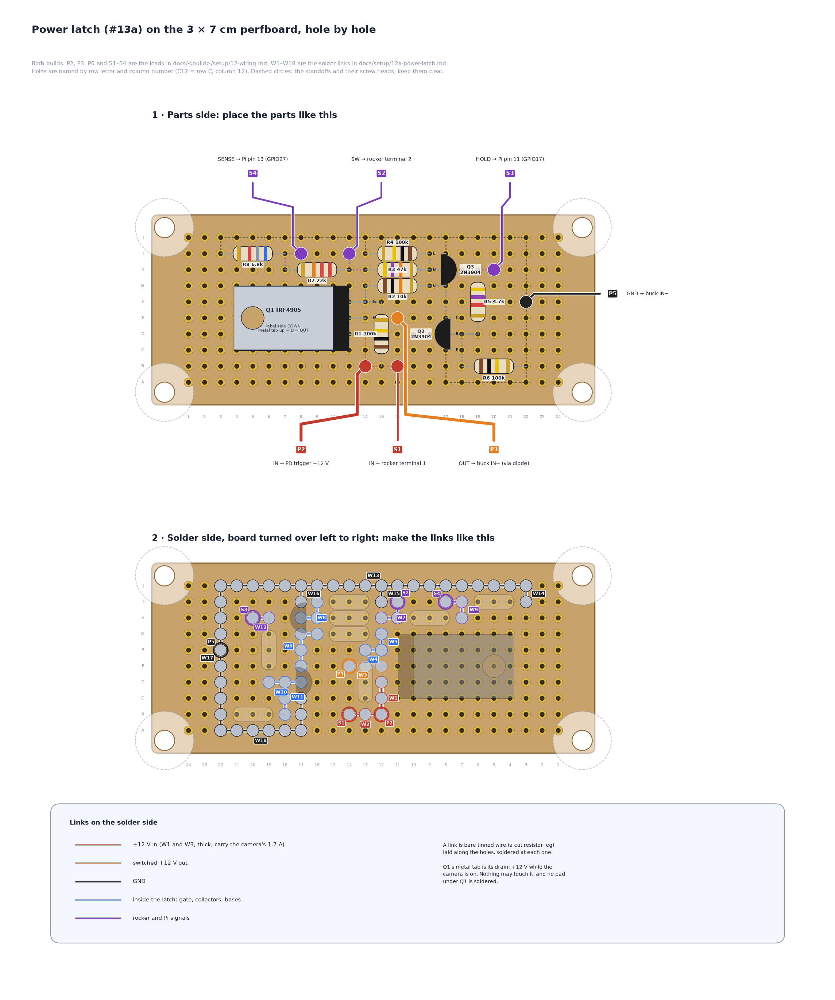

# 12a — Building the power latch

The power latch is the small board that lets the rocker switch shut the camera
down cleanly. When you switch on, it connects the camera to the battery.
When you switch off, it keeps the power on until the Pi has saved the recording,
parked the head and halted. Only then does it disconnect the camera.

The latch is the same in both builds. Build it and test it on the bench
**before** it goes into the enclosure. It's the first board in the 12 V chain,
in step 3 of the wiring guide ([with UWB](../with_uwb/setup/12-wiring.md#power-latch) ·
[without UWB](../without_uwb/setup/12-wiring.md#power-latch)). That section has the
circuit and explains how the latch behaves; this guide covers how to build it.

| | |
| --- | --- |
| Time | ≈ 1 h to build, 15 min to test |
| Parts | BOM item 13a, listed part by part in its own table ([with UWB](../with_uwb/setup/10-bill-of-materials.md#power-latch) · [without UWB](../without_uwb/setup/10-bill-of-materials.md#power-latch)) |
| Tools | soldering iron, solder, flush cutters, a multimeter, pliers to bend Q1's legs; a 3.2 mm drill if an M3 screw won't pass the corner holes |
| To test it | the PD trigger and power bank (or any 12 V supply), and a 3.3 V source: a Pi's pin 1, or two AA cells (≈ 3 V) |

*Drawn by [`cad/render_latch_board.py`](../../cad/render_latch_board.py), which also
checks every link against the circuit before drawing.*

## Finding a hole

- **Hold the board parts side up**, long edge toward you, with Q1 at the left.
- **Rows** are lettered **A** (the edge nearest you) to **J**.
- **Columns** are numbered **1** (left) to **24**.
- **C12** means row C, column 12.

When you turn the board over to solder, turn it left to right, as in view 2 of the
diagram. Column 1 is then on your right, and the rows don't move.

**The corner holes are where the board is screwed down.** It stands on four M3 standoffs
inside the enclosure, like the buck. The dashed circles in the diagram are the
standoffs and their screw heads: nothing goes there, and no lead or wire may cross
them. If your board's corner holes are smaller than 3.2 mm, drill them out **before**
you start, so the drill can't catch on a part.

## 1 · Place the resistors

Lay each resistor flat and push its legs through the two holes in the table. Bend
the legs out a little underneath to hold it in place, then solder it. **Don't trim the
legs yet**: the offcuts make the links in step 4. Resistors work either way round.

| Part | Value | Bands | Legs in | Joins |
| --- | --- | --- | --- | --- |
| R1 | 100 kΩ | brown black yellow | B13 – F13 (standing up the board) | IN to Q1's gate: holds Q1 off |
| R2 | 10 kΩ | brown black orange | G12 – G16 | Q1's gate to the two collectors |
| R3 | 47 kΩ | yellow violet orange | H12 – H16 | the rocker's SW line to Q3's base |
| R4 | 100 kΩ | brown black yellow | I12 – I16 | Q3's base to GND |
| R5 | 4.7 kΩ | yellow violet red | D19 – H19 (standing up the board) | HOLD to Q2's base |
| R6 | 100 kΩ | brown black yellow | B18 – B22 | Q2's base to GND |
| R7 | 22 kΩ | red red orange | H7 – H11 | SW to SENSE (top of the divider) |
| R8 | 6.8 kΩ | blue grey red | I3 – I7 | SENSE to GND (bottom of the divider) |

Each resistor also has a fourth band, gold for 5 %. If your kit's resistors have five
bands, check the value with the multimeter. R2, R3 and R4 sit side by side in
rows G, H and I: lay them straight so they don't touch.

## 2 · Place the transistors

Q2 and Q3 stand upright. Their flat faces point **opposite ways**.

| Part | Legs in | Flat face toward | Check |
| --- | --- | --- | --- |
| Q2 2N3904 | **E** C17 · **B** D17 · **C** E17 | the right (column 18) | E is nearest you |
| Q3 2N3904 | **C** G17 · **B** H17 · **E** I17 | the left (column 16) | E is furthest from you |

Seen from the flat face with the legs down, a 2N3904's legs are E, B, C from left to
right. Push it in until its body is ≈ 3 mm above the board, then solder it.

## 3 · Place Q1, the IRF4905

Q1 lies flat so the board stays below the LED window:

1. **Bend the legs.** Hold Q1 label toward you, legs down: the legs are **G, D, S**
   from left to right. Bend all three legs 90° toward the label side, ≈ 3 mm
   from the body.
2. **Put it in label side down**, with its metal tab facing up and pointing left. The
   legs go into column 12: **S** in **D12**, **D** in **E12**, **G** in **F12**. The
   body covers columns 4–11, rows C–G.
3. **Solder the three legs.** Don't trim them yet.

**The metal tab is Q1's drain**, so it's at +12 V whenever the camera is on. Nothing
may touch it: no wire, no screw and not the buck. No hole under Q1 is used, and none
may be soldered. Q1 runs cool (≈ 0.06 W at the camera's 1.7 A), so it needs no
heatsink, and the tab hole stays empty.

## 4 · Make the links on the solder side

Turn the board over left to right. Make each link from a resistor-leg offcut,
or from a part's own leg where the table says so:

- lay the wire flat along the holes listed;
- solder it at **every** hole it crosses;
- trim it.

Where two holes are next to each other, a bridge of solder is enough.

**W1 and W3 carry the camera's whole current, ≈ 1.7 A**, so make them thick: a doubled
offcut, or a stripped length of solid wire, soldered all along.

| Link | Holes | Net | Joins |
| --- | --- | --- | --- |
| **W1** | D12 → B12 | +12 V in | Q1's source to the IN lead. **Thick** |
| W2 | B12 → B14 | +12 V in | IN to R1 and the rocker lead (S1) |
| **W3** | E12 → E14 | switched +12 V | Q1's drain to the OUT lead. **Thick** |
| W4 | F12 → F13 | gate | Q1's gate to R1 |
| W5 | F12 → G12 | gate | Q1's gate to R2 |
| W6 | G16 → G17 → E17 | collectors | R2 to Q3's and Q2's collectors (through F17) |
| W7 | H12 → H11 → I11 | SW | R3 and R7 to the SW lead |
| W8 | H17 → H16 → I16 | Q3 base | Q3's base to R3 and R4 |
| W9 | H7 → I7 → I8 | SENSE | R7 and R8 to the SENSE lead |
| W10 | D17 → D19 | Q2 base | Q2's base to R5 |
| W11 | D18 → B18 | Q2 base | that link down to R6 |
| W12 | H19 → H20 | HOLD | R5 to the HOLD lead |
| W13 | J3 → J22 | GND | the ground rail along row J |
| W14 | I3 → J3 | GND | R8 to the rail |
| W15 | I12 → J12 | GND | R4 to the rail |
| W16 | I17 → J17 | GND | Q3's emitter to the rail |
| W17 | J22 → A22 | GND | the rail down column 22 (R6 and the GND lead are on it) |
| W18 | C17 → A17 → A22 | GND | Q2's emitter, along row A, to column 22 |

**Keep links apart.** Where two links run in neighbouring holes, they mustn't touch:
- W3 (row E) runs between W1 and W4.
- W7 (I11) is next to W15 (I12).

## 5 · Solder the leads

Cut the leads long enough to reach their parts with a little slack. The [3D assembly guide](../without_uwb/setup/assembly/index.html#power)
([with UWB](../with_uwb/setup/assembly/index.html#power)) shows where each part sits. Push each lead through its hole from the parts side and
solder it on the solder side.

| Lead | Hole | Wire | Goes to | Wiring guide |
| --- | --- | --- | --- | --- |
| IN | B12 | 18 AWG, red | PD trigger **+12 V** | P2 |
| IN (rocker) | B14 | 22 AWG | rocker terminal 1 | S1 |
| OUT | E14 | 18 AWG, red | buck **IN+**, through the Schottky diode | P3 |
| GND | F22 | 22 AWG, black | buck **IN−** | P5 |
| SW | I11 | 22 AWG | rocker terminal 2 | S2 |
| SENSE | I8 | Dupont lead (female end at the Pi) | Pi **pin 13** (GPIO27) | S4 |
| HOLD | H20 | Dupont lead (female end at the Pi) | Pi **pin 11** (GPIO17) | S3 |

If the 18 AWG wire won't go through its hole, do one of these:
- drill that one hole to 1.3 mm, clear of its neighbours; or
- tin the wire's end and lay it along W1 (or W3) on the solder side, soldered all along.

Bring the leads off the long edges, as in the diagram, never across a corner.

## 6 · Check it before powering it

**Look first.** With a magnifier, look along every row on the solder side for
solder bridging two links, especially along rows E, F, G, H and I.

**Then measure, with the multimeter on resistance and nothing connected:**

| Between | Expect | If not |
| --- | --- | --- |
| IN and GND | open: more than 100 kΩ, rising as the meter charges the circuit | a short: look for a bridge to W13–W18 |
| IN and OUT | open | Q1 is in backwards, or W1 touches W3 |
| IN and Q1's gate (F12) | ≈ 100 kΩ (R1) | W4 is missing |
| SENSE and GND | ≈ 6.5 kΩ (R8, with R7, R3 and R4 in parallel) | W9 or W14 |
| SW and SENSE | ≈ 19 kΩ (R7, with R3, R4 and R8 in parallel) | W7 or W9 |
| HOLD and GND, black probe on HOLD | ≈ 105 kΩ (R5 + R6). The other way round it reads lower, through Q2's base | W10–W12 |
| Q1's tab and anything but OUT | open | the tab is touching something |

## 7 · Test it on the bench

Use the PD trigger and the power bank (or any 12 V supply) for IN and GND. Leave OUT
unloaded, and measure it to GND. Do this test **before** the Pi is anywhere near:
until you've checked SENSE, it could carry 12 V.

| Do this | OUT should read | Means |
| --- | --- | --- |
| power on; SW and HOLD unconnected | **0 V** | Q1 is off: the latch draws nothing |
| touch SW to IN (the rocker on) | **≈ 12 V** | Q3 turns Q1 on |
| measure SENSE to GND, with SW still on IN | **≈ 2.8 V** (under 3.0 V) | the divider is right. **Over 3.3 V: stop, and check R7 and R8** before it ever meets the Pi |
| take SW off IN | **0 V** | Q1 turns off again |
| put 3 V on HOLD (two AA cells, or the Pi's 3.3 V on pin 1) | **≈ 12 V** | Q2 holds Q1 on: this is the Pi keeping the power up through shutdown |
| take HOLD away | **0 V** | the latch lets go once the Pi halts |

Then connect a load to OUT (a 12 V bulb, or a 100 Ω resistor rated ≥ 2 W for ≈ 120 mA),
switch on through SW, and check that Q1 stays cool. At the camera's 1.7 A it warms by only a few degrees.

## 8 · Mount it

1. **Screw the four standoffs on from the top.** Each 8 mm M3 female–female nylon standoff
   (BOM 13a.11) goes under a corner hole, held by an M3 × 6 screw from the parts side.
2. **Fit the board in the enclosure.** Set it on the floor where the 3D model shows,
   Q1's tab clear of the buck and of the wall.
3. **Screw it down from underneath.** Four M3 × 8 countersunk screws go up through
   the floor into the standoffs.
4. **Make the connections.** Do the rest in the order of the wiring guide's step 3:
   P2, P3, P5, then S1–S4 when the rocker and Pi are in.

If your board's holes or standoffs differ from these, enter their sizes in `[latch]`
in [`cad/ordered_parts.toml`](../../cad/ordered_parts.toml):
- `hole_dx` and `hole_dy`, the corner-hole spacing;
- `standoff_h`;
- `h`, the height with Q1 lying flat.

Then run `python3 cad/fit.py` before you print the enclosure.

## If something is wrong

| Symptom | Likely cause |
| --- | --- |
| OUT is always ≈ 12 V, even with SW off | Q1's gate isn't pulled up (R1 or W4), or a bridge from IN to node C, Q3 or Q2 |
| OUT never comes on | Q1 is in backwards (S and D swapped), Q3 is turned the wrong way, or W6 is missing |
| comes on with SW, but HOLD doesn't keep it on | Q2 is the wrong way round, or W10, W11 or R5 is open |
| OUT reads 12 V but sags under load | W1 or W3 is too thin, or a dry joint on Q1's legs |
| the camera powers off as soon as you switch off, without a clean shutdown | HOLD isn't reaching the Pi (S3), or the Pi isn't setting GPIO17 high: see the wiring guide's checks |
| SENSE over 3.3 V | R7 and R8 swapped, or the wrong values |
