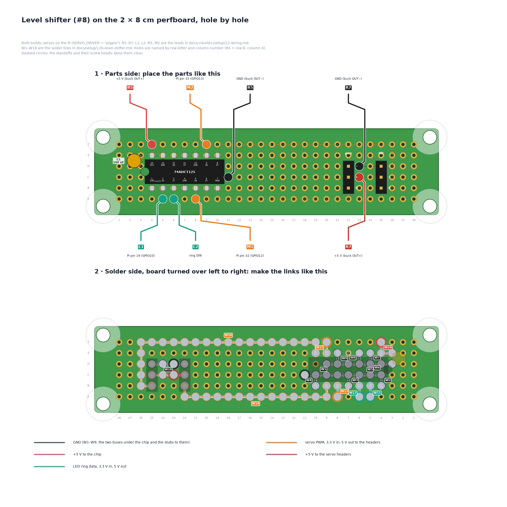
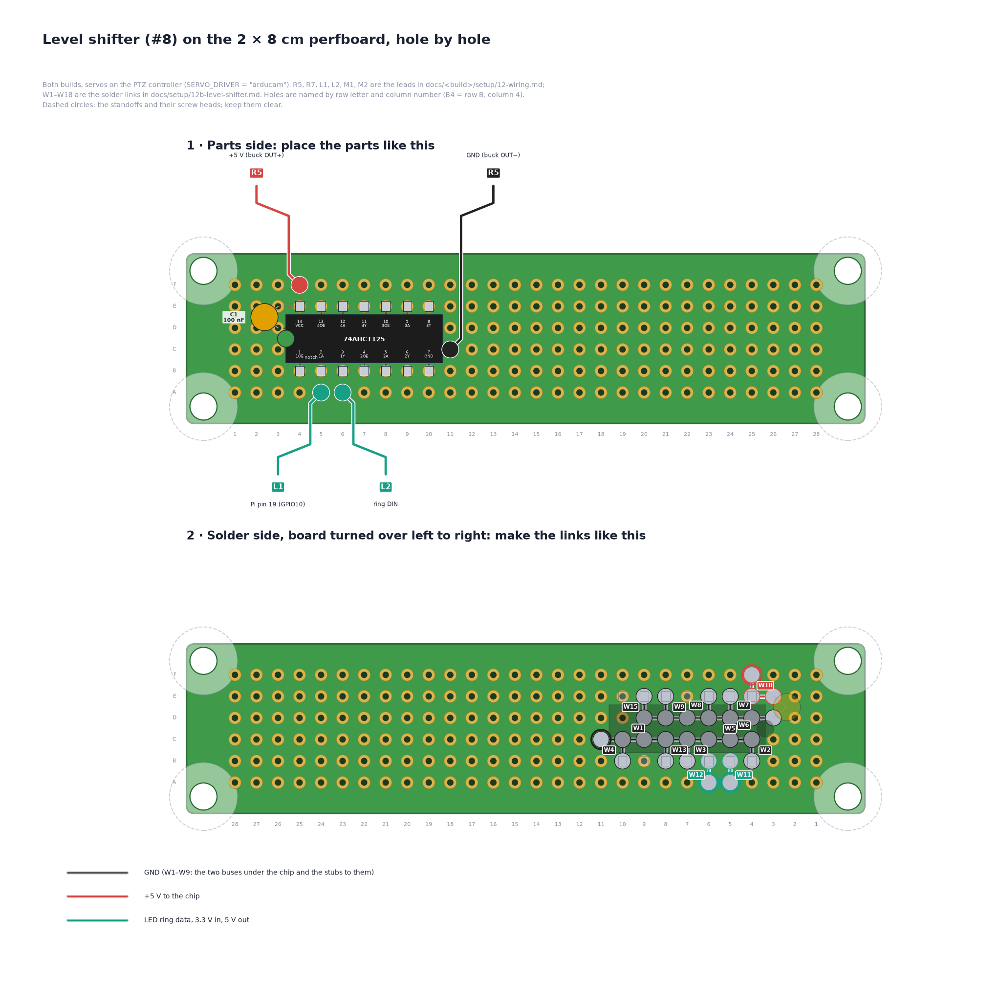

# 12b — Building the level shifter

The level shifter is the small board that turns the Pi's 3.3 V signals into the
5 V ones the LED ring<!--both--> (and, with the servos on the Pi, the servos)<!--/--><!--pigpio: and the servos--> need. It's one chip, a
74AHCT125, on a 2 × 8 cm perfboard with a capacitor<!--both-->, plus two servo
headers when the Pi drives the servos<!--/--><!--pigpio: and two servo headers-->.

The board is the same in both builds. What's on it depends on how the servos are
driven ([servo drive](../with_uwb/setup/12-wiring.md#servos)): the docs viewer shows
your choice (the gear by the title)<!--both-->; on GitHub both layouts are below<!--/-->.
Build it and test it on the bench **before** it goes in. The wiring guide has its
connections ([with UWB](../with_uwb/setup/12-wiring.md#led-ring--spi-through-the-level-shifter) ·
[without UWB](../without_uwb/setup/12-wiring.md#led-ring--spi-through-the-level-shifter)); this
guide covers how to build it.

| | |
| --- | --- |
| Time | ≈ 45 min to build, 10 min to test |
| Parts | BOM item 8, listed part by part in its own table ([with UWB](../with_uwb/setup/10-bill-of-materials.md#level-shifter) · [without UWB](../without_uwb/setup/10-bill-of-materials.md#level-shifter)) |
| Tools | soldering iron, solder, flush cutters, a multimeter; a 3.2 mm drill if an M3 screw won't pass the corner holes |
| To test it | a 5 V supply (the buck, set up per [12c](12c-power-boards.md), or a USB charger's 5 V) and a 3.3 V source: a Pi's pin 1, or two AA cells (≈ 3 V) |

<!--pigpio-->

<!--/servo-->

<!--arducam-->

<!--/servo-->

*Drawn by [`cad/render_shifter_board.py`](../../cad/render_shifter_board.py), which
also checks every link against the circuit before drawing.*

## Finding a hole

- **Hold the board parts side up**, long edge toward you, the chip at the left.
- **Rows** are lettered **A** (the edge nearest you) to **F**.
- **Columns** are numbered **1** (left) to **28**.
- **B4** means row B, column 4.

When you turn the board over to solder, turn it left to right, as in view 2 of the
diagram. Column 1 is then on your right, and the rows don't move.

**The corner holes are where the board is screwed down.** It stands on four M3
standoffs, like the power latch. The dashed circles in the diagram are the standoffs
and their screw heads: nothing goes there. If the corner holes are smaller than
3.2 mm, drill them out **before** you start.

## 1 · Place the chip

Use the DIP-14 socket (BOM 8.2) if you have one: it saves the chip from the iron,
and a dead chip swaps out in seconds.

1. **The notch goes left**, toward column 1.
2. **Pins 1–7 go in row B**, columns 4–10, left to right: pin 1 in **B4**.
3. **Pins 8–14 go in row E**, columns 10–4, right to left: pin 8 in **E10**, pin 14
   in **E4**.
4. Solder the corners first (B4, B10, E4, E10), check it sits flat, then the rest.
   With a socket, push the chip in last, notch to the left.

The holes under the chip (rows C and D, columns 4–10) are left empty on the parts
side; links run through them on the solder side.

| Pin | Name | Hole | Goes to |
| --- | --- | --- | --- |
| 1 | 1OE | B4 | GND: gate 1 always on |
| 2 | 1A | B5 | the Pi's GPIO10 (L1) |
| 3 | 1Y | B6 | the LED ring's DIN (L2) |
| 4 | 2OE | B7 | GND |
| 5 | 2A | B8 | <!--both-->the Pi's GPIO12 (M1), or GND<!--/--><!--pigpio: the Pi's GPIO12 (M1)--><!--arducam: GND: gate 2 unused--> |
| 6 | 2Y | B9 | <!--both-->the pan header's S, or nothing<!--/--><!--pigpio: the pan header's S--><!--arducam: nothing--> |
| 7 | GND | B10 | GND |
| 8 | 3Y | E10 | <!--both-->the tilt header's S, or nothing<!--/--><!--pigpio: the tilt header's S--><!--arducam: nothing--> |
| 9 | 3A | E9 | <!--both-->the Pi's GPIO13 (M2), or GND<!--/--><!--pigpio: the Pi's GPIO13 (M2)--><!--arducam: GND: gate 3 unused--> |
| 10 | 3OE | E8 | GND |
| 11 | 4Y | E7 | nothing |
| 12 | 4A | E6 | GND: gate 4 unused, and a floating input oscillates |
| 13 | 4OE | E5 | GND |
| 14 | VCC | E4 | +5 V (R5) |

## 2 · Place the capacitor

C1, 100 nF ceramic (marked **104**), goes in **E3** and **D3**, either way round.
It sits right by pin 14 and steadies the chip's supply when its outputs switch.

<!--pigpio-->

## 3 · Place the servo headers

Two 3-pin straight male headers, cut from the strip (BOM 18), standing up:

| Header | S | + | − |
| --- | --- | --- | --- |
| pan | **B22** | C22 | D22 |
| tilt | **B25** | C25 | D25 |

S (signal) is nearest you on both. Plug the servo leads in with their **orange,
yellow or white** wire on S and **brown or black** on −.

<!--/servo-->

## 4 · Make the links on the solder side

Turn the board over left to right. Make each link from a bare offcut (a cut
resistor or capacitor leg, or stripped solid wire), lay it flat along the holes listed,
solder it at **every** hole it crosses, and trim it. Where two holes are next to each
other, a bridge of solder is enough.

| Link | Holes | Net | Joins |
| --- | --- | --- | --- |
| W1 | C4 → C11 | GND | the ground bus under the chip, out to the GND lead |
| W2 | B4 → C4 | GND | pin 1 (1OE) to the bus |
| W3 | B7 → C7 | GND | pin 4 (2OE) |
| W4 | B10 → C10 | GND | pin 7 (GND) |
| W5 | D3 → D9 | GND | the second bus, row D, from C1 |
| W6 | C5 → D5 | GND | joins the two buses |
| W7 | E5 → D5 | GND | pin 13 (4OE) |
| W8 | E6 → D6 | GND | pin 12 (4A) |
| W9 | E8 → D8 | GND | pin 10 (3OE) |
| W10 | E3 → E4 → F4 | +5 V | C1 to pin 14 and the +5 V lead |
| W11 | A5 → B5 | L1 | the GPIO10 lead to pin 2 |
| W12 | A6 → B6 | L2 | pin 3 to the ring's DIN lead |
| W13 <!--pigpio row--> | A8 → B8 | M1 | the GPIO12 lead to pin 5 |
| W14 <!--pigpio row--> | B9 → A9 → A22 → B22 | pan | pin 6 along row A to the pan header's S |
| W15 <!--pigpio row--> | F9 → E9 | M2 | the GPIO13 lead to pin 9 |
| W16 <!--pigpio row--> | E10 → F10 → F26 → B26 → B25 | tilt | pin 8 along row F, down column 26, to the tilt header's S |
| W17 <!--pigpio row--> | C22 → C25 | servo +5 V | both headers' + (the R7 lead is on C23) |
| W18 <!--pigpio row--> | D22 → D25 | servo GND | both headers' − (the R7 lead is on D23) |
| W13 <!--arducam row--> | B8 → C8 | GND | pin 5 (2A) to the bus: gate 2 unused |
| W15 <!--arducam row--> | E9 → D9 | GND | pin 9 (3A) to the bus: gate 3 unused |

**Keep links apart.** Rows C and D are full of ground links right next to the chip's
pins: a blob that runs from a bus into B5, B6, B8, B9, E7, E9 or E10 shorts a signal
to ground. W10 (+5 V, E3–E4) sits next to W5 (ground, D3–D4): keep them apart too.

## 5 · Solder the leads

Push each lead through its hole from the parts side and solder it on the solder side.
Cut them long enough to reach with a little slack: the [3D assembly guide](../without_uwb/setup/assembly/index.html#led)
([with UWB](../with_uwb/setup/assembly/index.html#led)) shows where the board sits.

| Lead | Hole | Wire | Goes to | Wiring guide |
| --- | --- | --- | --- | --- |
| +5 V | F4 | 22 AWG, red | buck **OUT+** | R5 |
| GND | C11 | 22 AWG, black | buck **OUT−** | R5 |
| GPIO10 | A5 | Dupont lead (female end at the Pi) | Pi **pin 19** | L1 |
| ring DIN | A6 | 22 AWG, short | ring **DIN** | L2 |
| GPIO12 <!--pigpio row--> | A8 | Dupont lead (female end at the Pi) | Pi **pin 32** | M1 |
| GPIO13 <!--pigpio row--> | F9 | Dupont lead (female end at the Pi) | Pi **pin 33** | M2 |
| servo +5 V <!--pigpio row--> | C23 | 20–22 AWG, red | buck **OUT+** | R7 |
| servo GND <!--pigpio row--> | D23 | 20–22 AWG, black | buck **OUT−** | R7 |

## 6 · Check it before powering it

**Look first.** With a magnifier, look along rows B to E on the solder side for solder
bridging a bus into a pin next to it.

**Then measure, with the multimeter on resistance, nothing connected and the chip out
of its socket:**

| Between | Expect | If not |
| --- | --- | --- |
| +5 V lead and GND lead | open, rising as the meter charges C1 | a short: W10 touching W5, or C1 bridged |
| GND lead and pins 1, 4, 7, 10, 12, 13 (and 5 and 9 with the servos on the controller) | 0 Ω | the link to that pin (W2–W9, W13, W15) |
| GND lead and pins 2, 3, 6, 8, 11 (and 5 and 9 with the servos on the Pi) | open | a bridge from a bus into that pin |
| +5 V lead and pin 14 | 0 Ω | W10 |
| each lead and its pin: A5–pin 2, A6–pin 3<!--pigpio:, A8–pin 5, F9–pin 9--> | 0 Ω | W11, W12<!--pigpio:, W13, W15--> |

<!--pigpio-->

Also: pin 6 to the pan header's S and pin 8 to the tilt header's S, 0 Ω; each header's
S to its + and to its −, open; the R7 leads to both headers' + and −, 0 Ω.

<!--/servo-->

## 7 · Test it on the bench

Put the chip in its socket, notch to the left. Connect 5 V to the R5 leads (+5 V on
F4, GND on C11). Measure each output to GND.

| Do this | Measure | Should read | Means |
| --- | --- | --- | --- |
| nothing on L1 | — | — | (a floating input can read anything: skip) |
| 3 V on L1 (A5) | L2 (A6) | **≈ 5 V** | gate 1 lifts 3.3 V to 5 V for the ring |
| L1 to GND | L2 | **0 V** | |
| 3 V on M1 (A8) <!--pigpio row--> | pan header S | **≈ 5 V** | gate 2 drives the pan servo's signal |
| 3 V on M2 (F9) <!--pigpio row--> | tilt header S | **≈ 5 V** | gate 3, the tilt |

The chip should stay cold. Warm means an output shorted to ground or 5 V: unplug and
recheck step 6.

## 8 · Mount it

1. **Screw the four standoffs on from the top.** Each 6 mm M3 female–female nylon
   standoff (BOM 8.6) goes under a corner hole, held by an M3 × 6 screw from the
   parts side.
2. **Fit it where the 3D model shows**: on the shelf beside the Pi, or on the floor
   if the layout put it there (`cad/FIT_REPORT.md` says which).
3. **Screw it down from underneath.** Four M3 countersunk screws go up through the
   shelf (or the floor) into the standoffs; the length is in `cad/FIT_REPORT.md`. On
   the shelf, do it before the LED ring goes on underneath.
4. **Make the connections** in the order of the wiring guide: R5 and L1–L2 at step 6<!--pigpio:, M1, M2 and R7 at step 7-->.

If your board or standoffs differ, enter their sizes in `[shifter]` in
[`cad/ordered_parts.toml`](../../cad/ordered_parts.toml) (`hole_dx`, `hole_dy`,
`standoff_h`, and `h` with the servo plugs on their headers) and run
`python3 cad/fit.py` before you print.

## If something is wrong

| Symptom | Likely cause |
| --- | --- |
| ring dark, L2 stays at 0 V | no 5 V on pin 14 (W10, R5), pin 1 not grounded (W2), or the chip in backwards |
| ring flickers random colours | an unused input floating: pin 12 (W8)<!--arducam:, or pins 5 and 9 (W13, W15)-->; or a long L2 lead |
| an output stuck at 5 V or 0 V whatever its input does | a bridge from that pin to a bus or to the +5 V link |
| chip warm | an output shorted: unplug, recheck step 6 |
| servo doesn't move, or buzzes <!--pigpio row--> | its header's S isn't reaching the chip (W14, W16), pins 4 and 10 not grounded (W3, W9), or the plug backwards |
