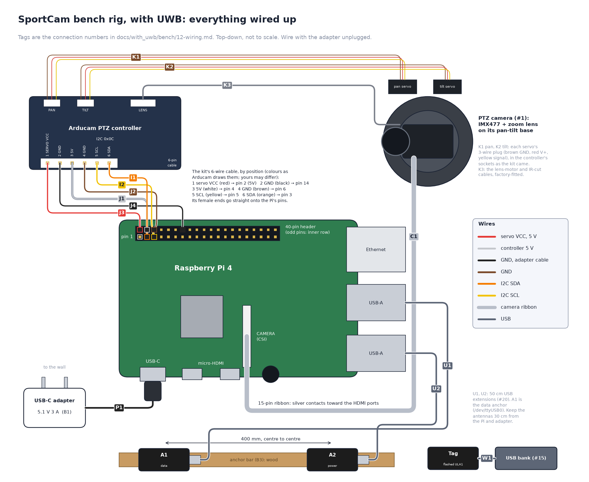

# 12 — Wiring guide (bench test, with UWB)

The bench rig: a USB-C wall adapter powers the Pi, and the PTZ controller
takes its 5 V and its I2C from the Pi's header on four jumper wires, the way
the Arducam kit is meant to be wired. Two UWB anchors go on the Pi's USB.
No mains wiring, no soldering, no breadboard.
Parts are the [bench bill of materials](10-bill-of-materials.md)'s; the
full build's wiring, with the battery, latch, gauge, buck, ring and the
third anchor, is the [UWB build's wiring guide](../setup/12-wiring.md).

**Schematics**, if you want the picture first:

| Diagram | Shows |
| --- | --- |
| [Interactive bench schematic](../../../with_uwb/schematics/interactive/bench.html) | the whole rig as one clickable graph, each lead tagged with its number below. Open it in a browser or from `npm run docs` |
| [Bench rig, wired up](../images/bench-wiring.png) | every part, top-down: a picture to copy wire for wire |



```
 wall ── USB-C power adapter 5.1 V 3 A (B1) ──► Pi USB-C
                                                Pi pin 2 (5V)   ── jumper ──► PTZ controller 5V
                                                Pi pin 6 (GND)  ── jumper ──► PTZ controller GND
                                                Pi pin 3 (SDA)  ── jumper ──► PTZ controller SDA
                                                Pi pin 5 (SCL)  ── jumper ──► PTZ controller SCL
                                                Pi CSI          ◄── camera ribbon
                                                Pi USB-A        ◄── extension ── anchor A1   (data: /dev/ttyUSB0)
                                                Pi USB-A        ◄── extension ── anchor A2   (power only)
                                                tag ──► its own USB bank
```

**Rules:**

- **Wire with the adapter unplugged.** The header's 5 V pins are live
  whenever the Pi has power, and a jumper slipping onto the wrong pin can
  kill the Pi.
- **Use a 5.1 V, 3 A adapter**, ideally the official Raspberry Pi one. The
  PTZ controller's motors and servos draw through the Pi, so a phone
  charger that sags under load browns the Pi out.
- **One ground.** The PTZ controller's GND jumper (J2) is its only ground,
  and it's the Pi's.

## Why this works on the bench, and not in the full build

The header's 5 V pins are the adapter's 5 V, passed straight through the
Pi. The Pi draws ≈ 1.2 A on average and 2 A at its peaks, and the PTZ
controller draws up to ≈ 1 A while the lens motors and both servos move,
and the two anchors ≈ 0.2 A each on the Pi's USB: within the adapter's
3 A.

The full build keeps its own wiring. It runs off the 12 V power bank, so
there is no 5 V adapter: the buck makes the 5 V for everything, and the
controller, servos and LED ring take it from the buck, not through the Pi
([04 — Electronics](../../design/04-electronics.md)).

If the check in step 3 shows undervoltage, the adapter is sagging: use the
official one, and a short USB-C cable.

## Connections

Pi pin numbers are physical header pins. Pin 1 is at the end of the header
away from the USB ports, and its pad is square. Odd pins are on the inner
row, even pins on the board's edge.

| # | From | To | Notes |
| --- | --- | --- | --- |
| P1 | USB-C power adapter (B1) | Pi **USB-C** | the only power in the rig. Plug it into the wall last |
| J1 | Pi **pin 2** (5V) | PTZ controller **5V** (VCC) | F-F jumper (B2). The zoom and focus motors and both servos |
| J2 | Pi **pin 6** (GND) | PTZ controller **GND** | F-F jumper |
| I1 | Pi **pin 3** (GPIO2, SDA) | PTZ controller **SDA** | F-F jumper |
| I2 | Pi **pin 5** (GPIO3, SCL) | PTZ controller **SCL** | F-F jumper |
| C1 | camera ribbon (15-pin, from the kit) | Pi **CSI** connector | silver contacts **toward the HDMI ports**; lift the latch, insert fully, press it down |

The servo leads stay plugged into the PTZ controller, as the kit came
(`SERVO_DRIVER = "arducam"` in [14](14-software-setup.md)).

```
            3.3V  [ 1] [ 2]  5V    J1 → PTZ 5V
  I1 SDA   GPIO2  [ 3] [ 4]  5V
  I2 SCL   GPIO3  [ 5] [ 6]  GND   J2 → PTZ GND
                  [ 7] [ 8]
                  ...
```

## Anchors and tag

Flash the three radios first ([14, step 3](14-software-setup.md#3-flash-the-radios-on-your-computer)).

| # | From | To | Notes |
| --- | --- | --- | --- |
| U0 | A1 and A2 boards | the anchor bar (B3), **400 mm apart** centre to centre | masking tape, boards the same way up with the antenna ends level. Lay the bar across the bench **in front of the camera's base, centred on it and square to the lens** when the lens is centred: the bearing is measured from the bar, not the lens |
| U1 | anchor **A1** | Pi USB-A, via a 50 cm extension | the **data** anchor: shows up as `/dev/ttyUSB0` |
| U2 | anchor **A2** | Pi USB-A, via a 50 cm extension | power only |
| W1 | tag | its USB bank | that is the whole tag |

Keep the antennas **30 cm or more from the Pi and its adapter** and other
metal: it detunes them and biases the ranges. Which end A1 goes on doesn't
matter yet; the bearing-sign check in [14](14-software-setup.md#4-bench-checks)
sorts it out.

## Wiring order, with checks

1. **Camera and jumpers**, adapter unplugged. C1, then J1, J2, I1, I2.
   **Check** by eye before any power: 5V on pin 2 (the corner pin on the
   board's edge), GND on pin 6, SDA and SCL on pins 3 and 5, and each
   jumper's other end on the matching pin of the controller.
2. **Power.** P1: plug the adapter into the Pi, then into the wall. The Pi
   boots.
   **Check**, once you can SSH in ([14](14-software-setup.md)):
   `i2cdetect -y 1` shows **0c**, and `rpicam-hello -t 2000` shows a
   picture.
3. **Power under load**, after the software setup's `ptzcheck` sweep
   ([14](14-software-setup.md)). **Check:** `vcgencmd get_throttled` prints
   `throttled=0x0`. Anything else means the 5 V sagged while the motors ran:
   see [below](#if-something-is-wrong).
4. **Anchors.** U0–U2. **Check:** `ls /dev/ttyUSB*` shows `/dev/ttyUSB0`.

## If something is wrong

| Symptom | Likely | Fix |
| --- | --- | --- |
| Pi doesn't boot, or reboots when the head moves | the adapter | a 5.1 V 3 A adapter (the official one) and a short USB-C cable |
| `vcgencmd get_throttled` not `0x0`, or a lightning bolt on a monitor | the adapter sagging under the motors | as above. Still there with the official adapter? Unplug J1 and power the controller from its own 5 V supply, GND still to pin 6 |
| `0c` missing from `i2cdetect` | J1, J2, I1 or I2 | controller unpowered, SDA and SCL swapped, or a jumper on the wrong pin |
| No picture | C1 | ribbon backwards or not fully in; add `dtoverlay=imx477` ([14](14-software-setup.md)) |
| No `/dev/ttyUSB0` | U1 | A1's extension not seated, or a power-only USB lead: the extensions must carry data |
| Pan moves in whole-degree ticks | — | expected on the bench: the servos run from the controller (`SERVO_DRIVER = "arducam"`) |
