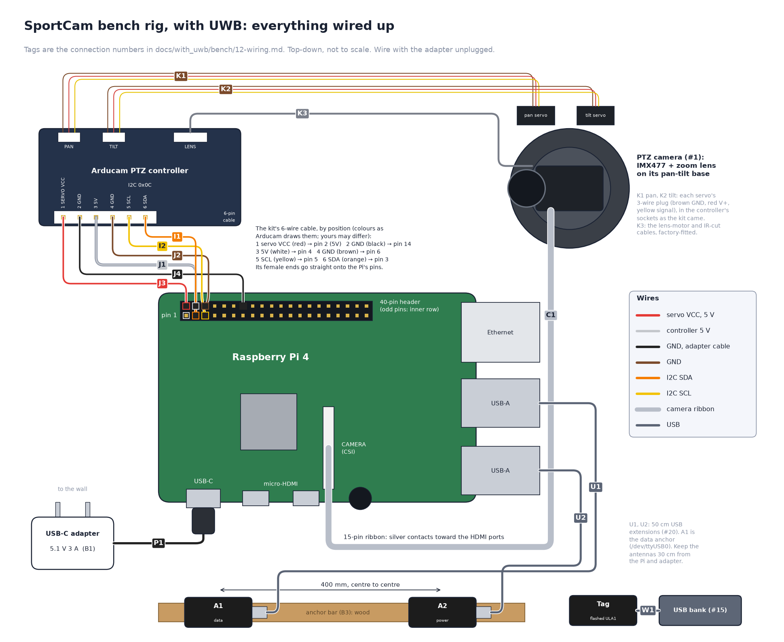

# 12 — Wiring guide (bench test, with UWB)

The bench rig: a USB-C wall adapter powers the Pi, and the PTZ controller
takes its power and its I2C from the Pi's header on the kit's own 6-wire
cable, the way Arducam's
[quick start](https://docs.arducam.com/Raspberry-Pi-Camera/Pan-Tilt-Zoom-Camera/quick-start/)
wires it. The lens stays plugged into the controller, as the kit came, and
the servos <!--both-->stay on it too or move to the Pi's header ([servo drive](#servo-drive))<!--/--><!--arducam: stay on it too--><!--pigpio: come off it onto the Pi's header, on jumper wires ([servo drive](#servo-drive))-->. Two UWB anchors go on the Pi's USB.
No mains wiring, no soldering, no breadboard.
Parts are the [bench bill of materials](10-bill-of-materials.md)'s; the
full build's wiring, with the battery, latch, gauge, buck, ring and the
third anchor, is the [UWB build's wiring guide](../setup/12-wiring.md).

**Schematics**, if you want the picture first:

| Diagram | Shows |
| --- | --- |
| [Interactive bench schematic](../../../with_uwb/schematics/interactive/bench.html) | the whole rig as one clickable graph, each lead tagged with its number below. Open it in a browser or from `npm run docs` |
| [Bench rig, wired up](../images/bench-wiring.png) | every part, top-down: a picture to copy wire for wire |



<!--both-->

With the servos on the Pi instead: [that picture](../images/bench-wiring-pigpio.png).

<!--/-->

<!--arducam-->

```
 wall ── USB-C power adapter 5.1 V 3 A (B1) ──► Pi USB-C
                                                Pi pin 2 (5V)   ◄── red ────── PTZ controller servo VCC  ┐
                                                Pi pin 14 (GND) ◄── black ──── PTZ controller GND        │ the kit's
                                                Pi pin 4 (5V)   ◄── white ──── PTZ controller 5V         │ 6-wire
                                                Pi pin 6 (GND)  ◄── brown ──── PTZ controller GND        │ cable
                                                Pi pin 5 (SCL)  ◄── yellow ─── PTZ controller SCL        │
                                                Pi pin 3 (SDA)  ◄── orange ─── PTZ controller SDA        ┘
                                                Pi CSI          ◄── camera ribbon
                                  PTZ controller PAN / TILT ◄── each servo's 3-wire plug (as the kit came)
                                  PTZ controller lens       ◄── lens-motor and IR-cut cables (factory-fitted)
                                                Pi USB-A        ◄── extension ── anchor A1   (data: /dev/ttyUSB0)
                                                Pi USB-A        ◄── extension ── anchor A2   (power only)
                                                tag ──► its own USB bank
```

<!--/servo-->

<!--pigpio-->

```
 wall ── USB-C power adapter 5.1 V 3 A (B1) ──► Pi USB-C
                                                (its red, servo VCC: off pin 2, taped)   ┐
                                                Pi pin 14 (GND) ◄── black ──── PTZ controller GND        │ the kit's
                                                Pi pin 4 (5V)   ◄── white ──── PTZ controller 5V         │ 6-wire
                                                Pi pin 6 (GND)  ◄── brown ──── PTZ controller GND        │ cable
                                                Pi pin 5 (SCL)  ◄── yellow ─── PTZ controller SCL        │
                                                Pi pin 3 (SDA)  ◄── orange ─── PTZ controller SDA        ┘
                                                Pi CSI          ◄── camera ribbon
                                                Pi pin 2 (5V)   ◄── both servos' red, joined on a Y jumper
                                                Pi pin 32       ◄── pan servo signal   (GPIO12)
                                                Pi pin 30 (GND) ◄── pan servo brown
                                                Pi pin 33       ◄── tilt servo signal  (GPIO13)
                                                Pi pin 34 (GND) ◄── tilt servo brown
                                  PTZ controller lens       ◄── lens-motor and IR-cut cables (factory-fitted)
                                                Pi USB-A        ◄── extension ── anchor A1   (data: /dev/ttyUSB0)
                                                Pi USB-A        ◄── extension ── anchor A2   (power only)
                                                tag ──► its own USB bank
```

<!--/servo-->

**Rules:**

- **Wire with the adapter unplugged.** The header's 5 V pins are live
  whenever the Pi has power, and a wire slipping onto the wrong pin can
  kill the Pi.
- **Go by position, not colour.** The colours here are Arducam's and match
  the kits we've seen, but Arducam says the order varies from kit to kit.
  Count the wires from the end of the controller's connector (pin 1, servo
  VCC) and check the labels printed beside it.
- **Use a 5.1 V, 3 A adapter**, ideally the official Raspberry Pi one. The
  PTZ controller's motors and servos draw through the Pi, so a phone
  charger that sags under load browns the Pi out.
- **One ground.** Both of the cable's GND wires (J2, J4) go to the Pi's GND
  pins: the servos and the controller share the Pi's ground. <!--pigpio: The servos' own browns (K5, K6) go to two more.-->

<!--pigpio-->

- **Only the servos' signal wires go on pins 32 and 33.** A red on either
  puts 5 V on a GPIO pin and kills the Pi. Check every jumper against the
  table before plugging the adapter in.
- **3.3 V pulses, no level shifter.** Most servos take them. The full build
  lifts them to 5 V through a 74AHCT125 ([full wiring, Servos](../setup/12-wiring.md#servos));
  a servo that buzzes or twitches at rest here needs that.

<!--/servo-->

## Why this works on the bench, and not in the full build

The header's 5 V pins are the adapter's 5 V, passed straight through the
Pi. The Pi draws ≈ 1.2 A on average and 2 A at its peaks, and the PTZ
controller draws up to ≈ 1 A while the lens motors and both servos move,
and the two anchors ≈ 0.2 A each on the Pi's USB: within the adapter's
3 A.

The full build keeps its own wiring. It runs off the 12 V power bank, so
there is no 5 V adapter: the buck makes the 5 V for everything, and the
controller, servos and LED ring take it from the buck, not through the Pi
([04 — Electronics](../../design/04-electronics.md)).

If the check in step 3 shows undervoltage, the adapter is sagging: use the
official one, and a short USB-C cable.

## Connections

Pi pin numbers are physical header pins. Pin 1 is at the end of the header
away from the USB ports, and its pad is square. Odd pins are on the inner
row, even pins on the board's edge.

| # | From | To | Notes |
| --- | --- | --- | --- |
| P1 | USB-C power adapter (B1) | Pi **USB-C** | the only power in the rig. Plug it into the wall last |
| J3 <!--arducam row--> | PTZ controller connector **pin 1, servo VCC** (red) | Pi **pin 2** (5V) | the kit's 6-wire cable: its female ends go straight onto the Pi's pins. Powers both servos |
| J3 <!--pigpio row--> | PTZ controller connector **pin 1, servo VCC** (red) | — | <!--both-->servos on the Pi: <!--/-->off the Pi: with no servo on the controller it powers nothing. Tape its end so it can't touch a pin. The rest of the kit's 6-wire cable goes straight onto the Pi's pins |
| J4 | connector **pin 2, GND** (black) | Pi **pin 14** (GND) | any GND pin will do; Arducam's picture uses one further along the header |
| J1 | connector **pin 3, 5V** (white) | Pi **pin 4** (5V) | the controller and its zoom and focus motors |
| J2 | connector **pin 4, GND** (brown) | Pi **pin 6** (GND) | |
| I2 | connector **pin 5, SCL** (yellow) | Pi **pin 5** (GPIO3, SCL) | |
| I1 | connector **pin 6, SDA** (orange) | Pi **pin 3** (GPIO2, SDA) | |
| K1 <!--arducam row--> | pan servo's 3-wire plug | controller **PAN** socket (the left one) | as the kit came: brown GND, red V+, yellow signal |
| K2 <!--arducam row--> | tilt servo's 3-wire plug | controller **TILT** socket (the right one) | as the kit came |
| K1 <!--pigpio row--> | pan servo **signal** (yellow) | Pi **pin 32** (GPIO12, PWM0) | <!--both-->servos on the Pi: <!--/-->the plug off the controller's PAN socket. One male-to-female jumper per wire, its male end into the servo's plug |
| K2 <!--pigpio row--> | tilt servo **signal** (yellow) | Pi **pin 33** (GPIO13, PWM1) | <!--both-->servos on the Pi: <!--/-->off the TILT socket |
| K4 <!--pigpio row--> | pan and tilt servos' **red** (V+) | Pi **pin 2** (5V) | <!--both-->servos on the Pi: <!--/-->one pin, two wires: join them on a Y jumper (or a lever connector) and run one wire to the pin. The current J3 carried before |
| K5 <!--pigpio row--> | pan servo **brown** (GND) | Pi **pin 30** (GND) | <!--both-->servos on the Pi<!--/--> |
| K6 <!--pigpio row--> | tilt servo **brown** (GND) | Pi **pin 34** (GND) | <!--both-->servos on the Pi<!--/--> |
| K3 | lens-motor cable and the 2-wire IR-cut lead | controller's lens and IR-cut sockets | factory-fitted: leave them |
| C1 | camera ribbon (15-pin, from the kit) | Pi **CSI** connector | silver contacts **toward the HDMI ports**; lift the latch, insert fully, press it down |

The servo plugs <!--both-->stay in the PTZ controller, or move to the Pi's header
([servo drive](#servo-drive))<!--/--><!--arducam: stay in the PTZ controller, as the kit came
(`SERVO_DRIVER = "arducam"` in [14](14-software-setup.md))--><!--pigpio: come off the PTZ controller onto the Pi's header, and the Pi
drives them (`SERVO_DRIVER = "pigpio"` in [14](14-software-setup.md))-->.

<!--arducam-->

```
                  3.3V  [ 1] [ 2]  5V    J3 red    servo VCC
  I1 orange SDA  GPIO2  [ 3] [ 4]  5V    J1 white  controller 5V
  I2 yellow SCL  GPIO3  [ 5] [ 6]  GND   J2 brown
                        [ 7] [ 8]
                        [ 9] [10]
                        [11] [12]
                        [13] [14]  GND   J4 black
                        ...
```

<!--/servo-->

<!--pigpio-->

```
                  3.3V  [ 1] [ 2]  5V    K4 servo reds (J3 off, taped)
  I1 orange SDA  GPIO2  [ 3] [ 4]  5V    J1 white  controller 5V
  I2 yellow SCL  GPIO3  [ 5] [ 6]  GND   J2 brown
                        [ 7] [ 8]
                        [ 9] [10]
                        [11] [12]
                        [13] [14]  GND   J4 black
                        ...
                        [29] [30]  GND     K5 pan brown
                        [31] [32]  GPIO12  K1 pan signal
  K2 tilt signal GPIO13 [33] [34]  GND     K6 tilt brown
                        ...
```

<!--/servo-->

## Anchors and tag

Flash the three radios first ([14, step 3](14-software-setup.md#3-flash-the-radios-on-your-computer)).

| # | From | To | Notes |
| --- | --- | --- | --- |
| U0 | A1 and A2 boards | the anchor bar (B3), **400 mm apart** centre to centre | masking tape, boards the same way up with the antenna ends level. Lay the bar across the bench **in front of the camera's base, centred on it and square to the lens** when the lens is centred: the bearing is measured from the bar, not the lens |
| U1 | anchor **A1** | Pi USB-A, via a 50 cm extension | the **data** anchor: shows up as `/dev/ttyUSB0` |
| U2 | anchor **A2** | Pi USB-A, via a 50 cm extension | power only |
| W1 | tag | its USB bank | that is the whole tag |

Keep the antennas **30 cm or more from the Pi and its adapter** and other
metal: it detunes them and biases the ranges. Which end A1 goes on doesn't
matter yet; the bearing-sign check in [14](14-software-setup.md#4-bench-checks)
sorts it out.

## Servo drive

Pan and tilt run one of two ways. The docs viewer shows one: pick it in its
settings (the gear by the title).

<!--compare-->
| | Servos on the PTZ controller | Servos on the Pi |
| --- | --- | --- |
| Wiring | the servo plugs in the controller's sockets, as the kit came (K1, K2) | the plugs off the controller, onto the Pi's header on jumpers (K1, K2, K4–K6); J3 off |
| Steps | whole degrees: a slow pan visibly ticks, ≈ 1° at a time | a fraction of a degree: smooth ([04 — Servo drive](../../design/04-electronics.md#servo-drive)) |
| Software | `SERVO_DRIVER = "arducam"`: `install.sh` with `--bench` | `SERVO_DRIVER = "pigpio"`: `install.sh` with `--bench --servos pigpio` ([14](14-software-setup.md#2-install-the-camera-software-from-your-mac)) |
| Extra parts | none | 6 male-to-female jumper wires and a Y jumper ([BOM](10-bill-of-materials.md)) |

<!--pigpio-->

Moving them over from the controller: adapter unplugged, take J3 off pin 2
and tape it, then K1, K2 and K4–K6 as in the [table](#connections). Install
again with `--servos pigpio`, and run `ptzcheck`: the Pi's pulse widths may
centre the head a degree or two off where the controller did, which
`PAN_CENTER_RAW` and `TILT_CENTER_RAW` correct.

<!--/servo-->

## Wiring order, with checks

<!--arducam-->

1. **Camera and controller cable**, adapter unplugged. C1, then the
   cable: J3, J1, J2, J4, I1, I2. K1–K3 are already in, as the kit came.
   **Check** by eye before any power, counting pins from pin 1's square
   pad: red on pin 2 (the corner pin on the board's edge), white on pin 4,
   brown on pin 6, black on pin 14, orange on pin 3 and yellow on pin 5.
   The controller's end is one plug, so it can only go on one way.

<!--/servo-->

<!--pigpio-->

1. **Camera, controller cable and servos**, adapter unplugged. C1, then the
   cable: J1, J2, J4, I1, I2, with J3 off and taped. Then the servos: K1,
   K2, K4–K6. K3 is already in, as the kit came.
   **Check** by eye before any power, counting pins from pin 1's square
   pad: the servos' joined reds on pin 2 (the corner pin on the board's
   edge), white on pin 4, brown on pin 6, black on pin 14, orange on pin 3
   and yellow on pin 5; at the far end, the pan servo's signal on pin 32
   and brown on 30, the tilt servo's signal on 33 and brown on 34, and
   nothing but a signal wire on 32 or 33.

<!--/servo-->

2. **Power.** P1: plug the adapter into the Pi, then into the wall. The Pi
   boots.
   **Check**, once you can SSH in ([14](14-software-setup.md)):
   `i2cdetect -y 1` shows **0c**, and `rpicam-hello -t 2000` shows a
   picture.
3. **Power under load**, after the software setup's `ptzcheck` sweep
   ([14](14-software-setup.md)). **Check:** `vcgencmd get_throttled` prints
   `throttled=0x0`. Anything else means the 5 V sagged while the motors ran:
   see [below](#if-something-is-wrong).
4. **Anchors.** U0–U2. **Check:** `ls /dev/ttyUSB*` shows `/dev/ttyUSB0`.

## If something is wrong

| Symptom | Likely | Fix |
| --- | --- | --- |
| Pi doesn't boot, or reboots when the head moves | the adapter | a 5.1 V 3 A adapter (the official one) and a short USB-C cable |
| Zoom and focus work, but the head doesn't pan or tilt <!--arducam row--> | J3, J4 or K1/K2 | the servo VCC pair (red, black) not on a 5V and a GND pin, or a servo plug out of its socket |
| Zoom and focus work, but the head doesn't pan or tilt <!--pigpio row--> | K1, K2, K4–K6, or the Pi setup | <!--both-->servos on the Pi: <!--/-->`pigpiod` not running (`pigs hwver`), `SERVO_DRIVER` not `"pigpio"` (install again with `--servos pigpio`), a signal on the wrong pin, or the reds not on pin 2 |
| `vcgencmd get_throttled` not `0x0`, or a lightning bolt on a monitor <!--arducam row--> | the adapter sagging under the motors | as above. Still there with the official adapter? Take J3 (servo VCC) off pin 2 and give it its own 5 V supply, that supply's GND to a Pi GND pin |
| `vcgencmd get_throttled` not `0x0`, or a lightning bolt on a monitor <!--pigpio row--> | the adapter sagging under the motors | as above. Still there with the official adapter? Take the servos' joined red (K4) off pin 2 and give it its own 5 V supply, that supply's GND to a Pi GND pin |
| `0c` missing from `i2cdetect` | J1, J2, I1 or I2 | controller unpowered, SDA and SCL swapped, or a wire on the wrong pin |
| No picture | C1 | ribbon backwards or not fully in, or in the display socket; add `dtoverlay=imx477` ([14](14-software-setup.md)). After each try, reboot the Pi and run `./scripts/pi/camera-check.sh` on your Mac: it says which it is and, once the camera is found, opens a test photo |
| No `/dev/ttyUSB0` | U1 | A1's extension not seated, or a power-only USB lead: the extensions must carry data |
| Pan moves in whole-degree ticks <!--arducam row--> | — | expected with the servos on the controller (`SERVO_DRIVER = "arducam"`). Smoother: [the servos on the Pi](#servo-drive) |
| Pan moves in whole-degree ticks <!--pigpio row--> | K1, or `config.py` | <!--both-->servos on the Pi: <!--/-->the pan servo still on the controller, or `SERVO_DRIVER = "arducam"`: install again with `--servos pigpio` |
| A servo buzzes or twitches at rest <!--pigpio row--> | K1, K2, K5, K6 | <!--both-->servos on the Pi: <!--/-->a loose signal or GND jumper; or a servo that won't take 3.3 V pulses: back on the controller, or the full build's 74AHCT125 |
