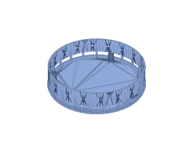
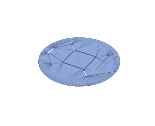
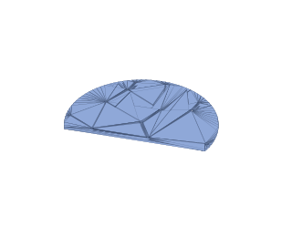
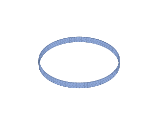
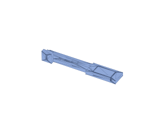
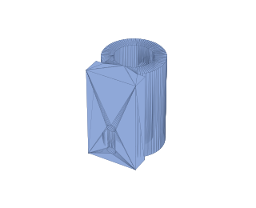
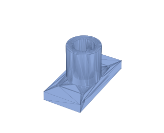
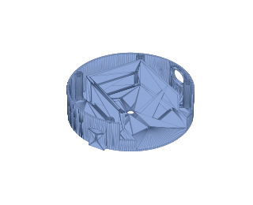
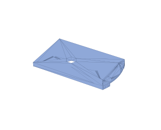
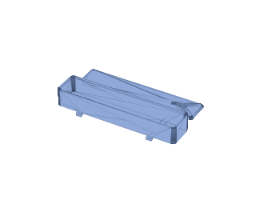

# 10 — Bill of materials (Canadian sourcing, Toronto / M2L 2E2)

Parts list for the UWB build: prices, Canadian sources, printed parts.
Main cost item: the Arducam PTZ camera (sensor, zoom lens, both motion axes).
Remainder: Pi, power chain, four UWB radios, fasteners.

Target: delivery to **M2L 2E2 (North York, Toronto) within two weeks**.

| Supplier | Lead time | Use |
| --- | --- | --- |
| **Amazon.ca Prime** | 1–3 days | general parts. Links are searches on the exact part name (listings change); choose a Prime-badged match and avoid "ships from China" sellers (3–4 weeks) |
| **[RobotShop Canada](https://ca.robotshop.com/)** | a few days (Mirabel, QC) | Arducam PTZ kits; ULA1 radios |
| **[PiShop.ca](https://www.pishop.ca/)** | 1–3 days (Ontario) | official Raspberry Pi reseller; all Pi items |
| **[Digi-Key Canada](https://www.digikey.ca/)** | 1–3 days | backstop for out-of-stock items. Free shipping over C$100 |
| **Makerfabs** (China, DHL) | 5–8 days + ≈ C$25 shipping, possible ≈ 13 % HST | only for generic ESP32-UWB boards instead of the ULA1 ([below](#why-the-ula1-radios)) |

Prices: approximate CAD street prices, Oct 2026, ±15 %.

> **Before printing:** complete
> [15 — Verification checklist](15-verification.md#before-you-print).
> Nine bought-part measurements determine whether the printed parts fit;
> the power drum is an 18-hour print.

**Status column:** **A** acquired, **O** ordered, **P** pending, blank = not
ordered. Printed-parts table: tick **Acquired** ☐ when printed.

## Camera

| #   | Status | Part                                                                    | Qty | ≈ CAD | Source                                                                                                                                                                        | Notes                                                                                                                                                                                                                                                                                                                                                                                                                        |
| --- | ------ | ----------------------------------------------------------------------- | --- | ----- | ----------------------------------------------------------------------------------------------------------------------------------------------------------------------------- | ---------------------------------------------------------------------------------------------------------------------------------------------------------------------------------------------------------------------------------------------------------------------------------------------------------------------------------------------------------------------------------------------------------------------------- |
| 1   | O      | **Arducam IMX477 12 MP PTZ camera with metal pan-tilt base (B0167B12)** | 1   | $293  | [RobotShop CA](https://ca.robotshop.com/products/arducam-imx477-12mp-ptz-camera-w-metal-pan-tilt-base-for-raspberry-pi-jetson-b0167b12) · [Arducam](https://www.arducam.com/) | camera, motorized zoom lens, aluminium base, two digital servos and the I2C controller, assembled. Both axes 0–180°. **Ordered 9 Oct direct from Arducam, order #000009517, express: US$204.99 + US$38 shipping. Arducam prices in USD and ships from China, so the landed cost lands nearer C$340 plus HST on import than the C$293 shown here — that figure is the RobotShop CA shelf price, kept as the planning number |

### Why the IMX477

- The 8 MP IMX219 PTZ kit (B0167B8) is discontinued; the 12 MP IMX477 kit is
  the only option. Design, CAD and software assume it.
- Larger pixels: better in dim gyms.
- Reach: [05 — Camera placement](../design/05-tracking-system.md#camera-placement-envelope).

## Compute, tracking and status

| #   | Status | Part                                                   | Qty | ≈ CAD  | Source                                                                                                                                                                                          | Notes                                                                                                                                                                                                                                                                                                   |
| --- | ------ | ------------------------------------------------------ | --- | ------ | ----------------------------------------------------------------------------------------------------------------------------------------------------------------------------------------------- | ------------------------------------------------------------------------------------------------------------------------------------------------------------------------------------------------------------------------------------------------------------------------------------------------------- |
| 2   | A      | **Raspberry Pi 4 Model B, 4 GB**                       | 1   | $95    | [PiShop.ca](https://www.pishop.ca/product/raspberry-pi-4-model-b-4gb/) · [Amazon.ca](https://www.amazon.ca/s?k=raspberry+pi+4+model+b+4gb)                                                      | **not a Pi 5.** The Pi 4 has a hardware H.264 encoder; the Pi 5 dropped it and encodes in software, which costs about 4 W and two hours of runtime. See [04](../../design/04-electronics.md#why-a-pi-4-and-not-a-pi-5). Buy the bare board                                                                           |
| 3   | A      | Pi 4 heatsink + fan case, or an aluminium heatsink set | 1   | $12    | [Amazon.ca](https://www.amazon.ca/s?k=raspberry+pi+4+heatsink+fan)                                                                                                                              | the Pi 5 Active Cooler does **not** fit a Pi 4. Passive heatsinks are enough at this load; a fan is cheap insurance in a sealed enclosure                                                                                                                                                               |
| 4   | O   | microSD 64 GB A2 (SanDisk Extreme)                     | 1   | $14    | [Amazon.ca](https://www.amazon.ca/s?k=sandisk+extreme+64gb+microsd+a2)                                                                                                                          | recordings land here at 5.4 GB/h, so 64 GB holds ≈ 10 h — more than one battery charge can produce. 128 or 256 GB only helps if you carry spare banks and stay offline; see [04](../../design/04-electronics.md#the-sd-card). **Buy a known brand**: counterfeit cards are the commonest cause of Pi corruption      |
| 6   | O      | **Haorutech ULA1 UWB module (ESP32 + DWM1000)**        | 4   | $78 ea | [RobotShop CA](https://ca.robotshop.com/products/haorutech-uwb-ultra-wideband-positioning-module-w-esp32-dwm1000-arduino) · [manual](https://www.haorutech.com/download/ULA1_UserManual-EN.pdf) | 3 anchors + 1 tag — A1/A2 on the arms, A3 on the mast for elevation. 40 × 25 mm, USB-A plug on the board, 10 cm accuracy, 50 m open range. Stocked in Canada, which the generic ESP32-UWB boards are not. **5 V USB only — no battery connector**, which is why the tag runs off a power bank (item 15) |
| 7   | O      | WS2812B LED ring, 16 px                                | 1   | $14    | [Amazon.ca](https://www.amazon.ca/s?k=ws2812b+ring+16+led)                                                                                                                                      | status indicator; `LED_COUNT = 16`. A 16-px ring is 44 mm across — to light the 120 mm window evenly, ~380 mm of 60/m WS2812B **strip** (≈ 23 px) lining the window works better; change `LED_COUNT` if you do                                                                                          |
| 8   | A      | 74AHCT125 level shifter                                | 1   | $6     | [Amazon.ca](https://www.amazon.ca/s?k=74ahct125) · [Digi-Key.ca](https://www.digikey.ca/)                                                                                                       | lifts the Pi's 3.3 V signals to 5 V: SPI data for the ring<!--both-->, and the two servo PWM lines (gates 2 and 3) when the Pi drives the servos<!--/--><!--pigpio:, and the two servo PWM lines (gates 2 and 3)-->. SPI is used instead of the classic PWM/DMA driver so the service need not run as root — see [04](../../design/04-electronics.md#driving-the-ws2812b-ring). Built on a 2 × 8 cm perfboard on standoffs: its parts are in [Level shifter](#level-shifter)                                                                                                         |

## Power

| #   | Status | Part                                                   | Qty | ≈ CAD | Source                                                                                                                                                           | Notes                                                                                                                                                                                                                                                                                                                                                                                        |
| --- | ------ | ------------------------------------------------------ | --- | ----- | ---------------------------------------------------------------------------------------------------------------------------------------------------------------- | -------------------------------------------------------------------------------------------------------------------------------------------------------------------------------------------------------------------------------------------------------------------------------------------------------------------------------------------------------------------------------------------- |
| 9   | A      | **USB-C PD power bank, 25 000 mAh (92 Wh), 65 W+**     | 1   | $80   | [Amazon.ca](https://www.amazon.ca/s?k=25000mah+power+bank+65w+usb+c+pd)                                                                                          | gives **6.2 h** tracking + recording on a Pi 4, after the bank's own conversion loss ([04](../../design/04-electronics.md#runtime)). A 20 000 mAh (74 Wh) bank makes 5.0 h, saves ≈ C$25 and 200 g, and is the better pick unless you want a full day between charges. Whichever you buy, set `BATTERY_WH` to match. Stay under 100 Wh to keep it flyable                                                 |
| 10  | O      | USB-C PD trigger board, 12 V                           | 1   | $10   | [Amazon.ca](https://www.amazon.ca/s?k=usb+c+pd+trigger+board+12v+female)                                                                                                | negotiates 12 V out of the bank. It must have a USB-C **socket** (female) for the bank cable to plug into — not a USB-C plug sticking out of its end. The common button type (5/9/12/15/20 V, "Type-C Female to 2pin Terminal") is a good choice: it saves its setting through power cycles, so it comes back at 12 V after every bank swap, and its S1 pad locks the button ([12c](../../setup/12c-power-boards.md)). It needs two mounting holes at its socket end: it stands on two M3 standoffs screwed up through the power drum's floor. Fixed-12 V boards are fine too. 3 A cables are enough: the camera draws ≈ 36 W at most; most banks cap their 5 V profile at 3 A, and the 5 V rail here also feeds the servos, the three anchors and the ring                                                                                                                                                                                                         |
| 11  | O      | 12 V → 5 V 8 A buck (≥ 40 W), **adjustable**           | 1   | $16   | [Amazon.ca](https://www.amazon.ca/s?k=12v+to+5v+8a+adjustable+buck+converter)                                                                                    | the single 5 V rail. Buy an adjustable unit, not a fixed-5 V one: it must be **trimmed to 5.1 V under a 4 A load before the Pi is ever connected**. Open-circuit voltage tells you nothing — a module that reads 5.1 V unloaded and sags to 4.8 V will brown out a Pi. This is the first bench job in the build ([12c](../../setup/12c-power-boards.md)). The Schottky diode that comes with it goes on its 12 V input ([12, Input diode](12-wiring.md#input-diode))                                                                             |
| 13  | O      | Round panel-mount rocker switch, threaded              | 1   | $8    | [Amazon.ca](https://www.amazon.ca/s?k=round+rocker+switch+threaded+nut+12v) | the on/off switch, in the power drum's wall. It signals the power latch (13a) rather than carrying the power, so switching off is a clean shutdown: the recording is saved and the head parked before the power goes. A round SPST rocker with a threaded body and a locking ring: the bezel sits on a flat cut into the wall outside and the ring screws up against a flat boss inside. The hole has a flat matching the key flat on the thread, so the switch can't turn. Measure it for `[switch]` before printing; a lit one is fine |
| 13a |  | **Power latch** — built from the parts in [its own table](#power-latch) | 1 | $34 | [below](#power-latch) | keeps the 12 V on after the switch goes off until the Pi has shut down, then cuts it |
| 14  |        | **Right-angle** USB-C to USB-C cable, 30 cm | 1   | $10   | [Amazon.ca](https://www.amazon.ca/s?k=right+angle+usb+c+to+usb+c+cable+30cm) | bank to trigger board, inside the power drum: the straight end in the trigger, out through a finger window, the right-angle end in the bank's face, which sits a little inside the drum's outline (a straight plug would stick out and get knocked). Any standard C-to-C cable works: the trigger draws ≈ 1.7 A at 12 V, inside the 3 A every C-to-C cable carries, and PD negotiates over the CC wire that even charge-only cables have. 30 cm is for fit; a short phone cable you already own will do. **Not USB-A to C**, which carries no PD                                                         |
| 14a |  | **USB-C plug power pigtail (USB-C male to bare leads), 20 AWG or heavier** | 1 | $10 | [Amazon.ca](https://www.amazon.ca/s?k=usb+c+male+pigtail+power+cable+20awg) | the buck's 5 V into the Pi's USB-C (connection R2 in the [wiring guide](12-wiring.md)). The Pi 4 needs no PD negotiation, just 5 V on VBUS. Thin "data" pigtails (28 AWG power wires) drop too much voltage: check the listing |
| 14b |  | **Dummy load: 1.2 Ω 50 W aluminium-housed resistor** (a tool) | 1 | $8 | [Amazon.ca](https://www.amazon.ca/s?k=1.2+ohm+50w+aluminum+resistor) | ≈ 4.2 A at 5.1 V, for trimming the buck under load before the Pi is connected ([wiring, step 1](12-wiring.md#wiring-order-with-checks)). It gets hot: lay it on something metal and connect it for no more than 30 s at a time. Already have an electronic load? Use that |

Notes:

- Pi power: 5 V rail via the USB-C pigtail (14a). No `config.txt` current flag on a
  Pi 4 (Pi 5 only).
- IMX477 not detected on first boot: add `dtoverlay=imx477`.

## Power latch

Item 13a is a small board you build: it keeps the 12 V on after the rocker goes off until the Pi has
shut down, then cuts it. Circuit, part labels (Q1–Q3, R1–R8) and pinout: [wiring](12-wiring.md#power-latch);
why: [04](../../design/04-electronics.md#power-switch); how to build it, hole by hole: [12a](../../setup/12a-power-latch.md).
Resistors marked *kit* are priced in 13a.9.

| #      | Status | Part | Qty | ≈ CAD | Source | Notes |
| ------ | ------ | ---- | --- | ----- | ------ | ----- |
| 13a.1 |  | **IRF4905 P-channel MOSFET**, TO-220 | 1 | $9 | [Amazon.ca](https://www.amazon.ca/s?k=irf4905) · [Digi-Key.ca](https://www.digikey.ca/en/products/result?keywords=irf4905) | Q1: carries the camera's 12 V (≈ 1.7 A). 0.02 Ω, so it stays cool with no heatsink — leave off the one many packs include. Sold in packs of 10–20. Any P-MOSFET rated ≥ 30 V, ≥ 5 A with RDS(on) ≤ 0.05 Ω at −10 V will do |
| 13a.2 |  | **2N3904 NPN transistor**, TO-92 | 2 | $5 | [Amazon.ca](https://www.amazon.ca/s?k=2n3904) · [Digi-Key.ca](https://www.digikey.ca/en/products/result?keywords=2n3904) | Q2 (the Pi's HOLD) and Q3 (the rocker). Sold in packs; a general-purpose NPN kit usually has them |
| 13a.3 |  | Resistor **100 kΩ**, ¼ W metal film | 3 | kit | [Amazon.ca](https://www.amazon.ca/s?k=100k+ohm+resistor+1%2F4w) | R1 (holds Q1 off), R4 and R6 (pull Q3's and Q2's bases down) |
| 13a.4 |  | Resistor **47 kΩ**, ¼ W metal film | 1 | kit | [Amazon.ca](https://www.amazon.ca/s?k=47k+ohm+resistor+1%2F4w) | R3: the rocker's 12 V into Q3's base |
| 13a.5 |  | Resistor **22 kΩ**, ¼ W metal film | 1 | kit | [Amazon.ca](https://www.amazon.ca/s?k=22k+ohm+resistor+1%2F4w) | R7: top half of the SENSE divider (12 V → 2.8 V for the Pi) |
| 13a.6 |  | Resistor **10 kΩ**, ¼ W metal film | 1 | kit | [Amazon.ca](https://www.amazon.ca/s?k=10k+ohm+resistor+1%2F4w) | R2: pulls Q1's gate down when either transistor is on |
| 13a.7 |  | Resistor **6.8 kΩ**, ¼ W metal film | 1 | kit | [Amazon.ca](https://www.amazon.ca/s?k=6.8k+ohm+resistor+1%2F4w) | R8: bottom half of the SENSE divider |
| 13a.8 |  | Resistor **4.7 kΩ**, ¼ W metal film | 1 | kit | [Amazon.ca](https://www.amazon.ca/s?k=4.7k+ohm+resistor+1%2F4w) | R5: the Pi's 3.3 V HOLD into Q2's base |
| 13a.9 |  | ¼ W metal-film resistor assortment kit | 1 | $10 | [Amazon.ca](https://www.amazon.ca/s?k=metal+film+resistor+assortment+kit+1%2F4w) | covers 13a.3–13a.8 in one buy; check the listing has all six values (6.8 k is the one some kits skip). Or buy each value on its own |
| 13a.10 | A | **Double-sided perfboard kit** (ELEGOO or similar: 2×8, 3×7, 4×6, 5×7, 7×9 cm, with a hole in each corner) | 1 | $10 | [Amazon.ca](https://www.amazon.ca/s?k=elegoo+double+sided+pcb+kit) | the latch is built on the **3 × 7 cm** board. It stands on edge on four M3 standoffs (13a.11) against a wall of the bank pocket in the power drum, and countersunk screws go through the wall from inside the pocket into them, like the buck. If an M3 screw won't pass its corner holes, drill them to 3.2 mm. Measure it for `[latch]` (`hole_dx`, `hole_dy`). A 2 × 8 cm board from the same kit carries the level shifter (8.4) |
| 13a.11 |  | M3 standoffs, female–female, 8 mm | 4 | — | item 21 | under the latch's corners: M3 screws down through the board into their tops, M3 countersunk screws (item 22) through the pocket wall into their bottoms. Any length that clears the solder joints underneath works; put it in `[latch] standoff_h` |

## Level shifter

Item 8 is a small board you build: the 74AHCT125 on a 2 × 8 cm perfboard, standing on four
M3 standoffs screwed up through the shelf (or the floor). Circuit and pin numbers:
[wiring](12-wiring.md#led-ring--spi-through-the-level-shifter); how to build it, hole by hole:
[12b](../../setup/12b-level-shifter.md).

| #   | Status | Part | Qty | ≈ CAD | Source | Notes |
| --- | ------ | ---- | --- | ----- | ------ | ----- |
| 8.1 |  | **74AHCT125** quad buffer, DIP-14 | 1 | item 8 | item 8 | the chip itself. "AHCT", not "HC": only the HCT/AHCT families read the Pi's 3.3 V as a clean high on a 5 V supply |
| 8.2 |  | DIP-14 socket | 1 | $3 | [Amazon.ca](https://www.amazon.ca/s?k=dip+14+ic+socket) | optional, recommended: the chip goes in last and swaps out in seconds. Sold in assorted packs |
| 8.3 |  | 100 nF ceramic capacitor (marked 104) | 1 | $3 | [Amazon.ca](https://www.amazon.ca/s?k=100nf+ceramic+capacitor+104) | C1, across the chip's supply by pin 14. Sold in packs; any ceramic rated ≥ 10 V |
| 8.4 |  | 2 × 8 cm perfboard (6 × 28 holes) | 1 | — | 13a.10 | from the same ELEGOO kit as the latch's board. If an M3 screw won't pass its corner holes, drill them to 3.2 mm. Measure it for `[shifter]` (`hole_dx`, `hole_dy`) |
| 8.5 <!--pigpio row--> |  | 2 × 3-pin straight male header | 2 | — | item 18 | the pan and tilt servo headers, cut from the header strip |
| 8.6 |  | M3 standoffs, female–female, 6 mm | 4 | — | item 21 | under the board's corners: M3 × 6 screws down through the board into their tops, M3 countersunk screws (item 22) up through the shelf or floor into their bottoms. Put their length in `[shifter] standoff_h` |

## Wearable

| #   | Status | Part                                     | Qty | ≈ CAD | Source                                                                  | Notes                                                                                                                                                                                                                                                        |
| --- | ------ | ---------------------------------------- | --- | ----- | ----------------------------------------------------------------------- | ------------------------------------------------------------------------------------------------------------------------------------------------------------------------------------------------------------------------------------------------------------ |
| 15  | O      | **Slim USB power bank, 2 500–5 000 mAh** | 1   | $18   | [Amazon.ca](https://www.amazon.ca/s?k=lipstick+power+bank+2500mah+slim) | powers the wearable tag. The ULA1 takes 5 V over USB and has no battery connector, so this bank is its battery. A 2 500 mAh "lipstick" bank runs the tag well past a full day and charges over USB like everything else |
| 17  | O      | Elastic armband/pouch + strap            | 1   | $10   | [Amazon.ca](https://www.amazon.ca/s?k=elastic+armband+pouch+small)      | 26 mm strap for the pod's strap bars; see [05](../design/05-tracking-system.md) for climbing-specific wearing                                                                                                                                                          |

## Charging

Both banks have built-in chargers; existing phone chargers and cables are
sufficient. Items 28–29 are optional (faster charging) and excluded from the
totals.

| Bank | Charge time |
| --- | --- |
| Tag bank (item 15) | 1–2 h from any phone charger |
| Tripod bank (item 9), 92 Wh (≈ 108 Wh from the wall) | depends on the charger, below |

| Charger | Time to full |
| --- | --- |
| Old USB-A cube, 5 V 1–2 A | 12–20 h. Too slow to be useful |
| USB-C phone charger, 20–25 W | ≈ 5 h. Fine overnight |
| USB-C laptop or fast charger, 45 W+ | ≈ 2.5 h |

Cable: **USB-C on both ends** for anything above the first row (USB-A to C
carries 5 V only). A standard C-to-C cable carries 60 W (3 A); only a 65 W
charger exceeds that, by a few minutes.

| #   | Status | Part                                                     | Qty | ≈ CAD | Source                                                                         | Notes                                                                                                                                                                                                                                                                                                                                       |
| --- | ------ | -------------------------------------------------------- | --- | ----- | ------------------------------------------------------------------------------ | ------------------------------------------------------------------------------------------------------------------------------------------------------------------------------------------------------------------------------------------------------------------------------------------------------------------------------------------- |
| 28  |        | *Optional:* USB-C PD GaN wall charger, 65 W, 1 × C + 1 × A  | 1   | $40   | [Amazon.ca](https://www.amazon.ca/s?k=65w+gan+charger+usb+c+usb+a+pd)          | USB-C port to the tripod bank (item 9), USB-A port to the tag bank (item 15). Only worth it if you have no USB-C charger of 20 W or more, or want ≈ 2 h refills. That needs the bank to accept 65 W *in*. Some 65 W banks only take 30–45 W in, so check the listing. Expect the C port to drop to ≈ 45 W while the A port is also in use |
| 29  |        | *Optional:* USB-C to USB-C cable, 1 m                    | 1   | $12   | [Amazon.ca](https://www.amazon.ca/s?k=usb+c+to+usb+c+cable+1m)                 | charger to the tripod bank. Item 14 is 30 cm and lives in the build, so it is too short to charge from the wall. Any C-to-C phone cable does this job, and most banks ship with one. Buy only if you have none                                                                                                                              |

Item 28 has an A port for the tag bank's supplied cable (usually USB-A to C
or micro-USB).

- **Pass-through charging** (bank charges and discharges simultaneously;
  stated in the listing): with a USB-C charger, the camera can run from mains
  with no runtime limit.
- **Adafruit 4410** (Micro-Lipo charger, Digi-Key 1528-4410-ND), already
  bought: not used. It charges bare single-cell LiPos; both banks have
  built-in chargers. Return or keep for another project. Excluded from the
  totals.

## Wiring and fasteners

| #   | Status | Part                                                                    | Qty | ≈ CAD | Source                                                                            | Notes                                                                                                                                                                                                                                             |
| --- | ------ | ----------------------------------------------------------------------- | --- | ----- | --------------------------------------------------------------------------------- | ------------------------------------------------------------------------------------------------------------------------------------------------------------------------------------------------------------------------------------------------- |
| 18  |        | JST kit, 18/22 AWG silicone wire, heatshrink, Dupont leads, 2 × 30 cm servo extension leads, male header strip | —   | $25   | [Amazon.ca](https://www.amazon.ca/s?k=jst+connector+kit+22awg+silicone+wire)      | 18 AWG on the 5 V rail — it carries 4 A. The extension leads and two 3-pin headers move the servos onto the Pi's PWM ([12, Servos](12-wiring.md#servos))<!--arducam:: not needed with the servos left on the PTZ controller-->                                                                                                                                                                                                           |
| 19  | O      | 470 µF electrolytic capacitor, 10 V or higher (small pack)              | 1   | $10   | [Amazon.ca](https://www.amazon.ca/s?k=470uf+16v+electrolytic+capacitor)           | across the buck output, stripe (−) to OUT− — connection R1 in the [wiring guide](12-wiring.md). The tag needs no parts of its own: the ULA1 plugs straight into its USB bank                                                                       |
| 20  |        | **USB-A male-to-female extension cables**, 3 × 50 cm                     | 3   | $18   | [Amazon.ca](https://www.amazon.ca/s?k=usb+a+male+to+female+extension+cable+50cm)  | the ULA1 has a USB-A plug on the board, so each anchor reaches its arm tip — or the top of the 250 mm mast — on an extension rather than a cable with two different ends, and comes into the enclosure through the slot high in the wall. An extension always carries data, so there's no risk of a charge-only cable |
| 21  |        | Nylon standoff kit, M2.5 + M3                                           | 1   | $10   | [Amazon.ca](https://www.amazon.ca/s?k=m2.5+m3+nylon+standoff+kit)                 | Pi on four 6 mm M2.5 standoffs on the shelf, ULA1 boards on 3 mm M2.5 standoffs. The buck keeps the brass standoffs it comes with; the power latch stands on four 8 mm M3 standoffs from this kit (13a.11), the level shifter on four 6 mm (8.6) and the PD trigger on two 6 mm, at its socket end |
| 22  |        | M2.5/M3 screw + nut + brass heat-set insert kit                         | 1   | $20   | [Amazon.ca](https://www.amazon.ca/s?k=m3+screw+assortment+brass+heat+set+inserts) | ≈ 57 × M3: buck and power latch 4 + 4 × M3 × 8 countersunk through the bank pocket's walls into their standoffs, PD trigger 2 × M3 × 8 countersunk up through the drum floor, level shifter 4 × M3 × 8 countersunk up through the shelf (all the lengths are in `cad/FIT_REPORT.md`), bank plate 2 × M3 × 8 countersunk (up through the drum floor into its inserts), power drum 4 × M3 × 8 countersunk (down through the enclosure floor from inside into the inserts in its posts) and 4 + 2 + 4 × M3 × 6 down through the latch, trigger and shifter boards into their standoffs, PTZ base 4 × M3 × 10–12 (up through the lid into its standoffs, no nuts; `bolt_l` in `ordered_parts.toml`) and the M3 washers under its standoffs if `cad/FIT_REPORT.md` asks for them, lid 4 × M3 × 8 countersunk (in sideways through the wall), shelf 3 × M3 × 8, anchor arms 4, mast foot 2, 2 pinch screws, boards. 16 × M2.5. Inserts: 21 × M3 — 2 in each of the three bosses on the drum wall, 1 in each mast socket, 1 in each shelf post, 4 in the lid's ring, 4 in the drum's posts, 2 in the bank plate |
| 23  |        | 3/8-16 hex nut + 3/8-16 → 1/4-20 reducer bushing                      | 1   | $12   | [Amazon.ca](https://www.amazon.ca/s?k=3%2F8-16+to+1%2F4-20+brass+tripod+bushing) + any hardware store for the nut | tripod interface: the nut is epoxied into a hex hole through the bank plate, under the bank, and the tripod screw pulls it down onto the power drum's floor (≈ 14.3 mm across the flats, ≈ 8.3 mm thick — a standard 3/8-16 nut; stainless or zinc-plated). 3/8-16 tripods screw into the nut, 1/4-20 ones into the bushing — so it fits any standard tripod ([C3](../../product/01-requirements.md#non-functional-requirements)). |
| 25  |        | PETG filament 1 kg                                                      | 1   | $25   | [Amazon.ca](https://www.amazon.ca/s?k=petg+filament+1kg)                          | ~525 g used across ten parts. Full settings, times and printer requirements: **[3D printing specifications](../../setup/11-3d-printing.md)** |
| 25a |        | PETG filament, **white or natural**, 250 g                              | 1   | $12   | [Amazon.ca](https://www.amazon.ca/s?k=white+petg+filament+250g+sample)            | the LED diffuser band, which has to pass light, and ideally the shelf, whose underside bounces the LED ring's light out — so not your main colour unless that is white. ~40 g used |
| 25b |        | Glue stick (PVA)                                                        | 1   | $4    | [Amazon.ca](https://www.amazon.ca/s?k=glue+stick+3d+printer+bed)                  | a **release agent**, not an adhesive: PETG fuses to bare smooth PEI and tears the sheet                                                                                                                                                           |
| 26  |        | Aluminium tripod (1/4-20 or 3/8-16 head)                                | 1   | $35   | [Amazon.ca](https://www.amazon.ca/s?k=aluminum+camera+tripod)                     | skip if you own one — any standard tripod rated for 2 kg or more fits; the bank and the power parts ride in the drum at the bottom of the head. The head is about 42 cm across the arms and 26 cm tall to the mast top, so a compact one does                                                                                                                                                                            |
| 27  |        | Build consumables: 2-part epoxy, threadlocker, zip ties, double-sided foam tape, 3 mm foam | —   | $15   | [Amazon.ca](https://www.amazon.ca/s?k=2+part+epoxy+threadlocker+zip+ties)         | epoxy for the 3/8-16 tripod nut; 1 mm foam tape sticks the LED ring under the shelf; 3 mm foam under the wearable board |
| 27a |        | **½-inch (12.7 mm) hardwood dowel**, 36 in                              | 1   | $5    | [Home Depot CA](https://www.homedepot.ca/search?q=1%2F2%20inch%20hardwood%20dowel) | the A3 mast, cut to 246 mm. Any hardware store has these. **Wood, not aluminium** — metal under a UWB antenna detunes it. Measure it: `mast_d` in `cad/config.scad` assumes 12.7 mm |

## Printed parts

| Item | Value |
| --- | --- |
| Material | items 25 and 25a, ≈ 570 g |
| Printer | FDM, ≥ 170 × 170 × 60 mm build volume (all parts fit a Bambu Lab A1 Mini), 0.4 mm nozzle, 250 °C hotend, 80 °C bed |
| Machine time | ≈ 55 h |
| Supports | none |
| Settings, orientation, print order | [11 — 3D printing](../../setup/11-3d-printing.md) |
| Printer purchase (not in totals) | Bambu Lab A1 Mini ([Bambu Lab Canada](https://ca.store.bambulab.com/products/a1-mini), ≈ C$249–389); alternatives: [Printers to buy](../../setup/11-3d-printing.md#printers-to-buy) |

STLs, previews and the images below are regenerated by `python3 cad/fit.py`
(also run by `./cad/render_all.sh`).

| Preview | Acquired | Part | Qty | Compiled STL | OpenSCAD source |
| --- | --- | --- | --- | --- | --- |
|  | ☐ | Enclosure | 1 | [base_housing.stl](../../../with_uwb/cad/stl/base_housing.stl) | [base_housing.scad](../../../with_uwb/cad/base_housing.scad) |
|  | ☐ | Lid (carries the camera) | 1 | [lid.stl](../../../with_uwb/cad/stl/lid.stl) | [lid.scad](../../../with_uwb/cad/lid.scad) |
|  | ☐ | Pi shelf | 1 | [shelf.stl](../../../with_uwb/cad/stl/shelf.stl) | [shelf.scad](../../../with_uwb/cad/shelf.scad) |
|  | ☐ | LED diffuser band | 1 | [led_diffuser_ring.stl](../../../with_uwb/cad/stl/led_diffuser_ring.stl) | [led_diffuser_ring.scad](../../../with_uwb/cad/led_diffuser_ring.scad) |
|  | ☐ | UWB anchor arm | 2 | [anchor_arm.stl](../../../with_uwb/cad/stl/anchor_arm.stl) | [anchor_arm.scad](../../../with_uwb/cad/anchor_arm.scad) |
|  | ☐ | A3 mast foot | 1 | [mast_foot.stl](../../../with_uwb/cad/stl/mast_foot.stl) | [anchor_mast.scad](../../../with_uwb/cad/anchor_mast.scad) |
|  | ☐ | A3 mast cradle | 1 | [mast_cradle.stl](../../../with_uwb/cad/stl/mast_cradle.stl) | [anchor_mast.scad](../../../with_uwb/cad/anchor_mast.scad) |
|  | ☐ | Power drum (under the enclosure: the bank and the power boards go in it, the tripod screws into it) | 1 | [power_drum.stl](../../../with_uwb/cad/stl/power_drum.stl) | [power_drum.scad](../../../with_uwb/cad/power_drum.scad) |
|  | ☐ | Bank plate (in the drum, under the bank; holds the tripod nut and the catch) | 1 | [bank_plate.stl](../../../with_uwb/cad/stl/bank_plate.stl) | [bank_plate.scad](../../../with_uwb/cad/bank_plate.scad) |
|  | ☐ | Wearable pod (body + lid) | 1 | [wearable_case.stl](../../../with_uwb/cad/stl/wearable_case.stl) | [wearable_case.scad](../../../with_uwb/cad/wearable_case.scad) |

## Totals (CAD)

| Configuration | Total |
| --- | --- |
| **Full build** (12 MP PTZ + three-anchor ULA1 UWB + 92 Wh battery), own tripod | **≈ C$1106** |
| Full build + tripod | ≈ C$1141 |
| Two anchors, no A3 mast (`UWB_ANCHORS = 2`; tilt from vision alone) | subtract ≈ C$89 |
| With a 74 Wh bank instead (5.0 h) | subtract ≈ C$25 |
| Optional charging kit (items 28–29), if your own chargers are too slow | add ≈ C$52 |
| Generic ESP32-UWB boards instead of ULA1 (`UWB_PROTOCOL = "dual-serial"`) | subtract ≈ C$100 |

(≈ US$796 / US$821 at typical exchange + Canadian markup.)

| Group | Items | ≈ CAD |
| --- | --- | --- |
| Camera and power | 1, 9–11, 13–14b | 459 |
| Compute and tracking | 2–8 | 369 |
| Wearable, wiring, fasteners, filament | 15–23, 25–25b, 27, 27a | 192 |

Optional charging items 28–29 excluded.

## Why the ULA1 radios

Item 6 is the **Haorutech ULA1**, not a generic ESP32-UWB board. Primary
reason: availability (stocked by RobotShop Canada; generic boards have no
dependable Canadian listing). ≈ C$28 more per board.

| Property | ULA1 | Generic boards (`dual-serial`) |
| --- | --- | --- |
| Range reporting | one RangeData frame with r₁, r₂, r₃ (one timestamp, as the maths in [05](../design/05-tracking-system.md) assumes) | independent serial streams (approximately simultaneous) |
| Data connections | one anchor; the others need 5 V only | one per anchor |
| Connector | USB-A plug on the board: plain extension cable | micro-USB (charge-only cable risk) |
| Wearable | 5 V USB, no battery connector: runs from a USB bank (item 15); no charge board or LiPo | charge board and LiPo |

`UWB_PROTOCOL = "dual-serial"` in `src/with_uwb/device/sportcam/config.py`
selects the generic boards (supported and tested).

**Before ordering all four:** bench-check two boards for RTLS firmware (one
frame with all ranges) and ranging rate:
[verification checklist](15-verification.md#on-the-bench-before-the-first-session),
rows 7–8. Why A3 is vertical:
[05](../design/05-tracking-system.md#why-the-third-anchor-is-vertical).

## Two-week delivery plan

Place all orders the same day:

| # | Supplier | Items | Lead time |
| --- | --- | --- | --- |
| 1 | Arducam direct | 1 (camera) | **ordered 9 Oct, express** (longest lead item) |
| 2 | PiShop.ca | 2, 3 | 1–3 days |
| 3 | RobotShop.ca | 6 (four ULA1s) | a few days |
| 4 | Amazon.ca Prime | everything else | 1–3 days |

Listing details to verify:

| Item | Check |
| --- | --- |
| Power bank (9) | USB-C output lists **12 V** (without it the trigger stays at 5 V). "65 W" is usually *output*; *input* wattage sets recharge time. Capacity = runtime; don't economise |
| Buck (11) | **adjustable** (must be trimmed); cheap units sag and brown out the Pi |
| USB-C cable (14) | any C-to-C cable carries the 12 V contract |
