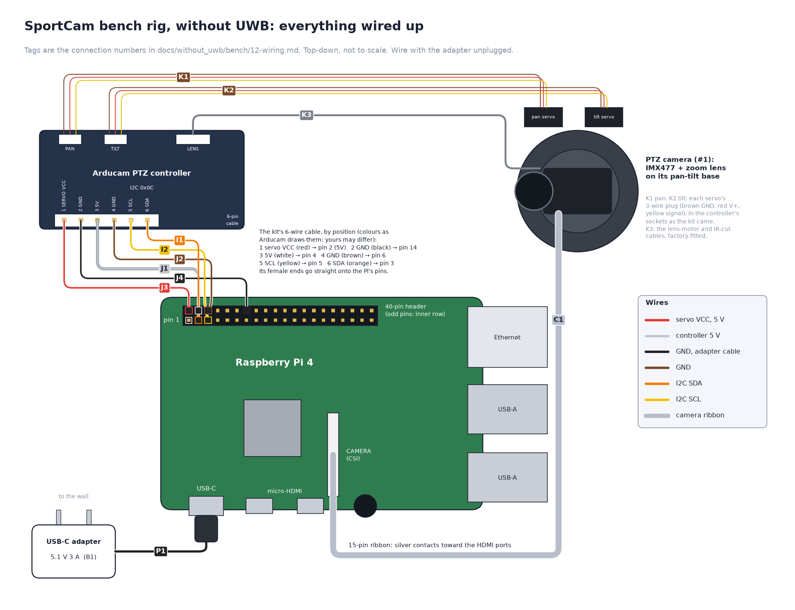

# 12 — Wiring guide (bench test, without UWB)

The bench rig: a USB-C wall adapter powers the Pi, and the PTZ controller
takes its power and its I2C from the Pi's header on the kit's own 6-wire
cable, the way Arducam's
[quick start](https://docs.arducam.com/Raspberry-Pi-Camera/Pan-Tilt-Zoom-Camera/quick-start/)
wires it. The servos and the lens stay plugged into the controller, as the
kit came. No mains wiring, no soldering, no
breadboard.
Parts are the [bench bill of materials](10-bill-of-materials.md)'s; the
full build's wiring, with the battery, latch, gauge, buck and ring, is the
[camera-only wiring guide](../setup/12-wiring.md).

**Schematics**, if you want the picture first:

| Diagram | Shows |
| --- | --- |
| [Interactive bench schematic](../../../without_uwb/schematics/interactive/bench.html) | the whole rig as one clickable graph, each lead tagged with its number below. Open it in a browser or from `npm run docs` |
| [Bench rig, wired up](../images/bench-wiring.png) | every part, top-down: a picture to copy wire for wire |



```
 wall ── USB-C power adapter 5.1 V 3 A (B1) ──► Pi USB-C
                                                Pi pin 2 (5V)   ◄── red ────── PTZ controller servo VCC  ┐
                                                Pi pin 14 (GND) ◄── black ──── PTZ controller GND        │ the kit's
                                                Pi pin 4 (5V)   ◄── white ──── PTZ controller 5V         │ 6-wire
                                                Pi pin 6 (GND)  ◄── brown ──── PTZ controller GND        │ cable
                                                Pi pin 5 (SCL)  ◄── yellow ─── PTZ controller SCL        │
                                                Pi pin 3 (SDA)  ◄── orange ─── PTZ controller SDA        ┘
                                                Pi CSI          ◄── camera ribbon
                                  PTZ controller PAN / TILT ◄── each servo's 3-wire plug (as the kit came)
                                  PTZ controller lens       ◄── lens-motor and IR-cut cables (factory-fitted)
```

**Rules:**

- **Wire with the adapter unplugged.** The header's 5 V pins are live
  whenever the Pi has power, and a wire slipping onto the wrong pin can
  kill the Pi.
- **Go by position, not colour.** The colours here are Arducam's and match
  the kits we've seen, but Arducam says the order varies from kit to kit.
  Count the wires from the end of the controller's connector (pin 1, servo
  VCC) and check the labels printed beside it.
- **Use a 5.1 V, 3 A adapter**, ideally the official Raspberry Pi one. The
  PTZ controller's motors and servos draw through the Pi, so a phone
  charger that sags under load browns the Pi out.
- **One ground.** Both of the cable's GND wires (J2, J4) go to the Pi's GND
  pins: the servos and the controller share the Pi's ground.

## Why this works on the bench, and not in the full build

The header's 5 V pins are the adapter's 5 V, passed straight through the
Pi. The Pi draws ≈ 1.2 A on average and 2 A at its peaks, and the PTZ
controller draws up to ≈ 1 A while the lens motors and both servos move,
which is within the adapter's 3 A.

The full build keeps its own wiring. It runs off the 12 V power bank, so
there is no 5 V adapter: the buck makes the 5 V for everything, and the
controller, servos and LED ring take it from the buck, not through the Pi
([04 — Electronics](../../design/04-electronics.md)).

If the check in step 3 shows undervoltage, the adapter is sagging: use the
official one, and a short USB-C cable.

## Connections

Pi pin numbers are physical header pins. Pin 1 is at the end of the header
away from the USB ports, and its pad is square. Odd pins are on the inner
row, even pins on the board's edge.

| # | From | To | Notes |
| --- | --- | --- | --- |
| P1 | USB-C power adapter (B1) | Pi **USB-C** | the only power in the rig. Plug it into the wall last |
| J3 | PTZ controller connector **pin 1, servo VCC** (red) | Pi **pin 2** (5V) | the kit's 6-wire cable: its female ends go straight onto the Pi's pins. Powers both servos |
| J4 | connector **pin 2, GND** (black) | Pi **pin 14** (GND) | any GND pin will do; Arducam's picture uses one further along the header |
| J1 | connector **pin 3, 5V** (white) | Pi **pin 4** (5V) | the controller and its zoom and focus motors |
| J2 | connector **pin 4, GND** (brown) | Pi **pin 6** (GND) | |
| I2 | connector **pin 5, SCL** (yellow) | Pi **pin 5** (GPIO3, SCL) | |
| I1 | connector **pin 6, SDA** (orange) | Pi **pin 3** (GPIO2, SDA) | |
| K1 | pan servo's 3-wire plug | controller **PAN** socket (the left one) | as the kit came: brown GND, red V+, yellow signal |
| K2 | tilt servo's 3-wire plug | controller **TILT** socket (the right one) | as the kit came |
| K3 | lens-motor cable and the 2-wire IR-cut lead | controller's lens and IR-cut sockets | factory-fitted: leave them |
| C1 | camera ribbon (15-pin, from the kit) | Pi **CSI** connector | silver contacts **toward the HDMI ports**; lift the latch, insert fully, press it down |

The servo plugs stay in the PTZ controller, as the kit came
(`SERVO_DRIVER = "arducam"` in [14](14-software-setup.md)).

```
                  3.3V  [ 1] [ 2]  5V    J3 red    servo VCC
  I1 orange SDA  GPIO2  [ 3] [ 4]  5V    J1 white  controller 5V
  I2 yellow SCL  GPIO3  [ 5] [ 6]  GND   J2 brown
                        [ 7] [ 8]
                        [ 9] [10]
                        [11] [12]
                        [13] [14]  GND   J4 black
                        ...
```

## Wiring order, with checks

1. **Camera and controller cable**, adapter unplugged. C1, then the
   cable: J3, J1, J2, J4, I1, I2. K1–K3 are already in, as the kit came.
   **Check** by eye before any power, counting pins from pin 1's square
   pad: red on pin 2 (the corner pin on the board's edge), white on pin 4,
   brown on pin 6, black on pin 14, orange on pin 3 and yellow on pin 5.
   The controller's end is one plug, so it can only go on one way.
2. **Power.** P1: plug the adapter into the Pi, then into the wall. The Pi
   boots.
   **Check**, once you can SSH in ([14](14-software-setup.md)):
   `i2cdetect -y 1` shows **0c**, and `rpicam-hello -t 2000` shows a
   picture.
3. **Power under load**, after the software setup's `ptzcheck` sweep
   ([14](14-software-setup.md)). **Check:** `vcgencmd get_throttled` prints
   `throttled=0x0`. Anything else means the 5 V sagged while the motors ran:
   see [below](#if-something-is-wrong).

## If something is wrong

| Symptom | Likely | Fix |
| --- | --- | --- |
| Pi doesn't boot, or reboots when the head moves | the adapter | a 5.1 V 3 A adapter (the official one) and a short USB-C cable |
| Zoom and focus work, but the head doesn't pan or tilt | J3, J4 or K1/K2 | the servo VCC pair (red, black) not on a 5V and a GND pin, or a servo plug out of its socket |
| `vcgencmd get_throttled` not `0x0`, or a lightning bolt on a monitor | the adapter sagging under the motors | as above. Still there with the official adapter? Take J3 (servo VCC) off pin 2 and give it its own 5 V supply, that supply's GND to a Pi GND pin |
| `0c` missing from `i2cdetect` | J1, J2, I1 or I2 | controller unpowered, SDA and SCL swapped, or a wire on the wrong pin |
| No picture | C1 | ribbon backwards or not fully in, or in the display socket; add `dtoverlay=imx477` ([14](14-software-setup.md)). After each try, reboot the Pi and run `./scripts/pi/camera-check.sh` on your Mac: it says which it is and, once the camera is found, opens a test photo |
| Pan moves in whole-degree ticks | — | expected on the bench: the servos run from the controller (`SERVO_DRIVER = "arducam"`) |
