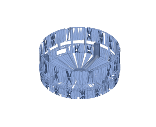
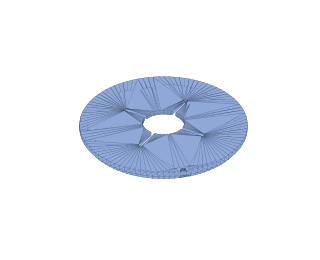
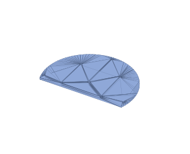
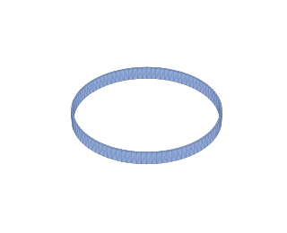

# 10 — Bill of materials (Canadian sourcing, Toronto / M2L 2E2)

Parts list for the camera-only build: prices, Canadian sources, printed parts.
No tag or anchors. Main cost item: the Arducam PTZ camera (sensor, zoom lens,
both motion axes). Remainder: Pi, power chain, fasteners. Differences from the
[UWB build](../../with_uwb/setup/10-bill-of-materials.md):
[Compared with the UWB build](#compared-with-the-uwb-build).

Target: delivery to **M2L 2E2 (North York, Toronto) within two weeks**.

| Supplier | Lead time | Use |
| --- | --- | --- |
| **Amazon.ca Prime** | 1–3 days | general parts. Links are searches on the exact part name (listings change); choose a Prime-badged match and avoid "ships from China" sellers (3–4 weeks) |
| **[RobotShop Canada](https://ca.robotshop.com/)** | a few days (Mirabel, QC) | Arducam PTZ kits |
| **[PiShop.ca](https://www.pishop.ca/)** | 1–3 days (Ontario) | official Raspberry Pi reseller; all Pi items |
| **[Digi-Key Canada](https://www.digikey.ca/)** | 1–3 days | INA260; backstop for out-of-stock items. Free shipping over C$100 |

Prices: approximate CAD street prices, Oct 2026, ±15 %.

> **Before printing:** complete
> [15 — Verification checklist](15-verification.md#before-you-print).
> Five bought-part measurements determine whether the printed parts fit;
> the enclosure is a 14-hour print.

**Status column:** **A** acquired, **O** ordered, **P** pending, blank = not
ordered. Printed-parts table: tick **Acquired** ☐ when printed.

## Camera

| #   | Status | Part                                                                    | Qty | ≈ CAD | Source                                                                                                                                                                        | Notes                                                                                                                                                                                                                                                                                                                                                                                                                        |
| --- | ------ | ----------------------------------------------------------------------- | --- | ----- | ----------------------------------------------------------------------------------------------------------------------------------------------------------------------------- | ---------------------------------------------------------------------------------------------------------------------------------------------------------------------------------------------------------------------------------------------------------------------------------------------------------------------------------------------------------------------------------------------------------------------------- |
| 1   | A      | **Arducam IMX477 12 MP PTZ camera with metal pan-tilt base (B0167B12)** | 1   | $293  | [RobotShop CA](https://ca.robotshop.com/products/arducam-imx477-12mp-ptz-camera-w-metal-pan-tilt-base-for-raspberry-pi-jetson-b0167b12) · [Arducam](https://www.arducam.com/) | camera, motorized zoom lens, aluminium base, two digital servos and the I2C controller, assembled. Both axes 0–180°. **Ordered 9 Oct direct from Arducam, order #000009517, express: US$204.99 + US$38 shipping. Arducam prices in USD and ships from China, so the landed cost lands nearer C$340 plus HST on import than the C$293 shown here — that figure is the RobotShop CA shelf price, kept as the planning number |

### Why the IMX477

- The 8 MP IMX219 PTZ kit (B0167B8) is discontinued; the 12 MP IMX477 kit is
  the only option. Design, CAD and software assume it.
- Larger pixels: better in dim gyms.
- Reach: [05 — Camera placement](../design/05-tracking-system.md#camera-placement-envelope).

## Compute and status

| #   | Status | Part                                                   | Qty | ≈ CAD  | Source                                                                                                                                                                                          | Notes                                                                                                                                                                                                                                                                                                   |
| --- | ------ | ------------------------------------------------------ | --- | ------ | ----------------------------------------------------------------------------------------------------------------------------------------------------------------------------------------------- | ------------------------------------------------------------------------------------------------------------------------------------------------------------------------------------------------------------------------------------------------------------------------------------------------------- |
| 2   | A      | **Raspberry Pi 4 Model B, 4 GB**                       | 1   | $95    | [PiShop.ca](https://www.pishop.ca/product/raspberry-pi-4-model-b-4gb/) · [Amazon.ca](https://www.amazon.ca/s?k=raspberry+pi+4+model+b+4gb)                                                      | **not a Pi 5.** The Pi 4 has a hardware H.264 encoder; the Pi 5 dropped it and encodes in software, which costs about 4 W and two hours of runtime. See [04](../../design/04-electronics.md#why-a-pi-4-and-not-a-pi-5). Buy the bare board                                                                           |
| 3   | A      | Pi 4 heatsink + fan case, or an aluminium heatsink set | 1   | $12    | [Amazon.ca](https://www.amazon.ca/s?k=raspberry+pi+4+heatsink+fan)                                                                                                                              | the Pi 5 Active Cooler does **not** fit a Pi 4. Passive heatsinks are enough at this load; a fan is cheap insurance in a sealed enclosure                                                                                                                                                               |
| 4   | A      | microSD 64 GB A2 (SanDisk Extreme)                     | 1   | $14    | [Amazon.ca](https://www.amazon.ca/s?k=sandisk+extreme+64gb+microsd+a2)                                                                                                                          | recordings land here at 5.4 GB/h, so 64 GB holds ≈ 10 h — more than one battery charge can produce. 128 or 256 GB only helps if you carry spare banks and stay offline; see [04](../../design/04-electronics.md#the-sd-card). **Buy a known brand**: counterfeit cards are the commonest cause of Pi corruption      |
| 7   | A      | WS2812B LED ring, 16 px                                | 1   | $14    | [Amazon.ca](https://www.amazon.ca/s?k=ws2812b+ring+16+led)                                                                                                                                      | status indicator; `LED_COUNT = 16`. A 16-px ring is 44 mm across — to light the 120 mm window evenly, ~380 mm of 60/m WS2812B **strip** (≈ 23 px) lining the window works better; change `LED_COUNT` if you do                                                                                          |
| 8   | A      | 74AHCT125 level shifter                                | 1   | $6     | [Amazon.ca](https://www.amazon.ca/s?k=74ahct125) · [Digi-Key.ca](https://www.digikey.ca/)                                                                                                       | lifts the Pi's 3.3 V signals to 5 V: SPI data for the ring, and the two servo PWM lines (gates 2 and 3). SPI is used instead of the classic PWM/DMA driver so the service need not run as root — see [04](../../design/04-electronics.md#driving-the-ws2812b-ring)                                                                                                         |

## Power

| #   | Status | Part                                                   | Qty | ≈ CAD | Source                                                                                                                                                           | Notes                                                                                                                                                                                                                                                                                                                                                                                        |
| --- | ------ | ------------------------------------------------------ | --- | ----- | ---------------------------------------------------------------------------------------------------------------------------------------------------------------- | -------------------------------------------------------------------------------------------------------------------------------------------------------------------------------------------------------------------------------------------------------------------------------------------------------------------------------------------------------------------------------------------- |
| 9   | A      | **USB-C PD power bank, 25 000 mAh (92 Wh), 65 W+**     | 1   | $80   | [Amazon.ca](https://www.amazon.ca/s?k=25000mah+power+bank+65w+usb+c+pd)                                                                                          | gives **6.2 h** tracking + recording on a Pi 4, after the bank's own conversion loss ([04](../../design/04-electronics.md#runtime)). A 20 000 mAh (74 Wh) bank makes 5.0 h, saves ≈ C$25 and 200 g, and is the better pick unless you want a full day between charges. Whichever you buy, set `BATTERY_WH` to match. Stay under 100 Wh to keep it flyable                                                 |
| 10  | A      | USB-C PD trigger board, 12 V                           | 1   | $10   | [Amazon.ca](https://www.amazon.ca/s?k=usb+c+pd+trigger+board+12v)                                                                                                | negotiates 12 V out of the bank. Fixed-12 V or adjustable both fine; most banks cap their 5 V profile at 3 A, and the 5 V rail here also feeds the servos and the ring                                                                                                                                                                                                         |
| 11  | A      | 12 V → 5 V 8 A buck (≥ 40 W), **adjustable**           | 1   | $16   | [Amazon.ca](https://www.amazon.ca/s?k=12v+to+5v+8a+adjustable+buck+converter)                                                                                    | the single 5 V rail. Buy an adjustable unit, not a fixed-5 V one: it must be **trimmed to 5.1 V under a 4 A load before the Pi is ever connected**. Open-circuit voltage tells you nothing — a module that reads 5.1 V unloaded and sags to 4.8 V will brown out a Pi. This is the first bench job in the build                                                                              |
| 12  | A      | **Current/voltage sensor — INA260 breakout preferred** | 1   | $22   | [Digi-Key.ca](https://www.digikey.ca/en/products/result?keywords=adafruit%204226%20ina260) · [Amazon.ca](https://www.amazon.ca/s?k=ina226+current+sensor+module) | the battery gauge, on the 12 V side, I2C 0x40. The **INA260** (Adafruit 4226) has the shunt on the die: nothing to calibrate, no `INA226_SHUNT_OHMS` to get wrong, 36 V and 15 A headroom. A bare **INA226** module works too if you can find one — set `POWER_MONITOR = "ina226"` and the shunt value. **Hard to source in Canada — see [below](#parts-that-are-hard-to-source-in-canada)** |
| 13  | A      | Panel-mount rocker switch, 10 A                        | 1   | $8    | [Amazon.ca](https://www.amazon.ca/s?k=panel+mount+rocker+switch+12v) | the on/off switch, in the enclosure wall. It signals the power latch (13a) rather than carrying the power, so switching off is a clean shutdown: the recording is saved and the head parked before the power goes. Any SPST rocker that snaps into a 19 × 13 mm cut-out; a lit one is fine |
| 13a | O      | **Power latch:** IRF4905 P-MOSFET (TO-220), 2 × 2N3904, resistors 100 k × 3, 47 k, 22 k, 10 k, 6.8 k, 4.7 k, perfboard scrap | 1 | $15 | [Amazon.ca](https://www.amazon.ca/s?k=irf4905) · [Digi-Key.ca](https://www.digikey.ca/en/products/result?keywords=irf4905) | keeps the 12 V on after the switch goes off until the Pi has shut down, then cuts it. Circuit and pinout: [wiring](12-wiring.md#power-latch); why: [04](../../design/04-electronics.md#power-switch). IRF4905 and 2N3904 come in packs of 10; any P-MOSFET rated ≥ 30 V, ≥ 5 A with RDS(on) ≤ 0.05 Ω at −10 V works for Q1 |
| 14  | A      | USB-C to USB-C cable, 30 cm                            | 1   | $10   | [Amazon.ca](https://www.amazon.ca/s?k=short+usb+c+to+usb+c+cable+30cm)                                                                                           | bank to trigger board, inside the build. Any standard C-to-C cable works: the trigger draws ≈ 1.7 A at 12 V, inside the 3 A every C-to-C cable carries, and PD negotiates over the CC wire that even charge-only cables have. 30 cm is for fit; a short phone cable you already own will do. **Not USB-A to C**, which carries no PD                                                         |
| 14a | O | **USB-C plug power pigtail (USB-C male to bare leads), 20 AWG or heavier** | 1 | $10 | [Amazon.ca](https://www.amazon.ca/s?k=usb+c+male+pigtail+power+cable+20awg) | the buck's 5 V into the Pi's USB-C (connection R2 in the [wiring guide](12-wiring.md)). The Pi 4 needs no PD negotiation, just 5 V on VBUS. Thin "data" pigtails (28 AWG power wires) drop too much voltage: check the listing |
| 14b | O | **Dummy load: 1.2 Ω 50 W aluminium-housed resistor** (a tool) | 1 | $8 | [Amazon.ca](https://www.amazon.ca/s?k=1.2+ohm+50w+aluminum+resistor) | ≈ 4.2 A at 5.1 V, for trimming the buck under load before the Pi is connected ([wiring, step 1](12-wiring.md#wiring-order-with-checks)). It gets hot: lay it on something metal and connect it for no more than 30 s at a time. Already have an electronic load? Use that |

Notes:

- Pi power: 5 V rail via the USB-C pigtail (14a). No `config.txt` current flag on a
  Pi 4 (Pi 5 only).
- IMX477 not detected on first boot: add `dtoverlay=imx477`.

## Charging

The bank has a built-in charger; an existing phone charger and cable are
sufficient. Items 28–29 are optional (faster charging) and excluded from the
totals. Tripod bank (item 9), 92 Wh (≈ 108 Wh from the wall), charge time by
charger:

| Charger | Time to full |
| --- | --- |
| Old USB-A cube, 5 V 1–2 A | 12–20 h. Too slow to be useful |
| USB-C phone charger, 20–25 W | ≈ 5 h. Fine overnight |
| USB-C laptop or fast charger, 45 W+ | ≈ 2.5 h |

Cable: **USB-C on both ends** for anything above the first row (USB-A to C
carries 5 V only). A standard C-to-C cable carries 60 W (3 A); only a 65 W
charger exceeds that, by a few minutes.

| #   | Status | Part                                                     | Qty | ≈ CAD | Source                                                                         | Notes                                                                                                                                                                                                                                                                                                                                       |
| --- | ------ | -------------------------------------------------------- | --- | ----- | ------------------------------------------------------------------------------ | ------------------------------------------------------------------------------------------------------------------------------------------------------------------------------------------------------------------------------------------------------------------------------------------------------------------------------------------- |
| 28  |        | *Optional:* USB-C PD GaN wall charger, 65 W  | 1   | $40   | [Amazon.ca](https://www.amazon.ca/s?k=65w+gan+charger+usb+c+usb+a+pd)          | USB-C port to the tripod bank (item 9). Only worth it if you have no USB-C charger of 20 W or more, or want ≈ 2 h refills. That needs the bank to accept 65 W *in*. Some 65 W banks only take 30–45 W in, so check the listing. |
| 29  |        | *Optional:* USB-C to USB-C cable, 1 m                    | 1   | $12   | [Amazon.ca](https://www.amazon.ca/s?k=usb+c+to+usb+c+cable+1m)                 | charger to the tripod bank. Item 14 is 30 cm and lives in the build, so it is too short to charge from the wall. Any C-to-C phone cable does this job, and most banks ship with one. Buy only if you have none                                                                                                                              |

- **Pass-through charging** (bank charges and discharges simultaneously;
  stated in the listing): with a USB-C charger, the camera can run from mains
  with no runtime limit.
- **Adafruit 4410** (Micro-Lipo charger, Digi-Key 1528-4410-ND), already
  bought: not used. It charges bare single-cell LiPos; the bank has
  built-in chargers. Return or keep for another project. Excluded from the
  totals.

## Wiring and fasteners

| #   | Status | Part                                                                    | Qty | ≈ CAD | Source                                                                            | Notes                                                                                                                                                                                                                                             |
| --- | ------ | ----------------------------------------------------------------------- | --- | ----- | --------------------------------------------------------------------------------- | ------------------------------------------------------------------------------------------------------------------------------------------------------------------------------------------------------------------------------------------------- |
| 18  |        | Barrel jack, JST kit, 18/22 AWG silicone wire, heatshrink, Dupont leads, 2 × 30 cm servo extension leads, male header strip | —   | $25   | [Amazon.ca](https://www.amazon.ca/s?k=jst+connector+kit+22awg+silicone+wire)      | 18 AWG on the 5 V rail — it carries 4 A. The extension leads and two 3-pin headers move the servos onto the Pi's PWM ([12, Servos](12-wiring.md#servos))                                                                                                                                                                                                           |
| 19  |        | 470 µF electrolytic capacitor, 10 V or higher (small pack)              | 1   | $10   | [Amazon.ca](https://www.amazon.ca/s?k=470uf+16v+electrolytic+capacitor)           | across the buck output, stripe (−) to OUT− — connection R1 in the [wiring guide](12-wiring.md).                                                                       |
| 21  |        | Nylon standoff kit, M2.5 + M3                                           | 1   | $10   | [Amazon.ca](https://www.amazon.ca/s?k=m2.5+m3+nylon+standoff+kit)                 | Pi on four 6 mm M2.5 standoffs on the shelf. The power boards are foam-taped down, so no M3 standoffs are needed |
| 22  |        | M2.5/M3 screw + nut + brass heat-set insert kit | 1   | $20   | [Amazon.ca](https://www.amazon.ca/s?k=m3+m2.5+screw+nut+assortment) | ≈ 11 × M3: PTZ base 4 + nuts, lid 4 × M3 × 8 countersunk (in sideways through the wall), shelf 3 × M3 × 8. 8 × M2.5. Inserts: 7 × M3 — 1 in each shelf post, 4 in the lid's ring. Kit price kept at the UWB build's figure |
| 23  |        | 3/8-16 brass insert (≤ 8 mm long) + 3/8-16 → 1/4-20 reducer bushing   | 1   | $12   | [Amazon.ca](https://www.amazon.ca/s?k=3%2F8-16+to+1%2F4-20+brass+tripod+bushing)  | tripod interface: 3/8-16 tripods screw into the insert, 1/4-20 ones into the bushing — so it fits any standard tripod ([C3](../../product/01-requirements.md#non-functional-requirements)).                                                                                                                                                                      |
| 24  |        | Hook-and-loop strap, 25 mm                                              | 1   | $8    | [Amazon.ca](https://www.amazon.ca/s?k=hook+and+loop+cinch+strap+25mm)             | holds the bank in the tray, and the tray to a tripod leg or the centre column |
| 25  |        | PETG filament 1 kg                                                      | 1   | $25   | [Amazon.ca](https://www.amazon.ca/s?k=petg+filament+1kg)                          | ~240 g used across the four structural parts. Full settings, times and printer requirements: **[3D printing specifications](../../setup/11-3d-printing.md)** |
| 25a |        | PETG filament, **white or natural**, 250 g                              | 1   | $12   | [Amazon.ca](https://www.amazon.ca/s?k=white+petg+filament+250g+sample)            | the LED diffuser band, which has to pass light, and ideally the shelf, whose underside bounces the LED ring's light out — so not your main colour unless that is white. ~40 g used |
| 25b |        | Glue stick (PVA)                                                        | 1   | $4    | [Amazon.ca](https://www.amazon.ca/s?k=glue+stick+3d+printer+bed)                  | a **release agent**, not an adhesive: PETG fuses to bare smooth PEI and tears the sheet                                                                                                                                                           |
| 26  |        | Aluminium tripod (1/4-20 or 3/8-16 head)                                | 1   | $35   | [Amazon.ca](https://www.amazon.ca/s?k=aluminum+camera+tripod)                     | skip if you own one — any standard tripod fits. The head is about 30 cm across and 28 cm tall, so a compact one does                                                                                                                                                                            |
| 27  |        | Build consumables: 2-part epoxy, threadlocker, zip ties, double-sided foam tape, 3 mm foam | —   | $15   | [Amazon.ca](https://www.amazon.ca/s?k=2+part+epoxy+threadlocker+zip+ties)         | epoxy for the 3/8-16 insert; 1 mm foam tape sticks the power boards to the floor and the LED ring under the shelf |

## Printed parts

| Item | Value |
| --- | --- |
| Material | items 25 and 25a, ≈ 280 g |
| Printer | FDM, ≥ 160 × 155 × 90 mm build volume (all parts fit a Bambu Lab A1 Mini), 0.4 mm nozzle, 250 °C hotend, 80 °C bed |
| Machine time | ≈ 26 h |
| Supports | none |
| Settings, orientation, print order | [11 — 3D printing](../../setup/11-3d-printing.md) |
| Printer purchase (not in totals) | Bambu Lab A1 Mini ([Bambu Lab Canada](https://ca.store.bambulab.com/products/a1-mini), ≈ C$249–389); alternatives: [Printers to buy](../../setup/11-3d-printing.md#printers-to-buy) |

STLs, previews and the images below are regenerated by `python3 cad/fit.py`
(also run by `./cad/render_all.sh`).

| Preview | Acquired | Part | Qty | Compiled STL | OpenSCAD source |
| --- | --- | --- | --- | --- | --- |
|  | ☐ | Enclosure | 1 | [base_housing.stl](../../../without_uwb/cad/stl/base_housing.stl) | [base_housing.scad](../../../without_uwb/cad/base_housing.scad) |
|  | ☐ | Lid (carries the camera) | 1 | [lid.stl](../../../without_uwb/cad/stl/lid.stl) | [lid.scad](../../../without_uwb/cad/lid.scad) |
|  | ☐ | Pi shelf | 1 | [shelf.stl](../../../without_uwb/cad/stl/shelf.stl) | [shelf.scad](../../../without_uwb/cad/shelf.scad) |
|  | ☐ | LED diffuser band | 1 | [led_diffuser_ring.stl](../../../without_uwb/cad/stl/led_diffuser_ring.stl) | [led_diffuser_ring.scad](../../../without_uwb/cad/led_diffuser_ring.scad) |
|  | ☐ | Battery tray | 1 | [battery_tray.stl](../../../without_uwb/cad/stl/battery_tray.stl) | [battery_tray.scad](../../../without_uwb/cad/battery_tray.scad) |

## Totals (CAD)

| Configuration | Total |
| --- | --- |
| **Full build** (12 MP PTZ + 92 Wh battery, camera-only), own tripod | **≈ C$754** |
| Full build + tripod (item 26) | ≈ C$789 |
| With a 74 Wh bank instead (6.7 h) | subtract ≈ C$25 |
| Without the battery gauge (`POWER_MONITOR = "none"`) | subtract ≈ C$22 |
| Optional charging kit (items 28–29), if your own chargers are too slow | add ≈ C$52 |

(≈ US$540 / US$565 at typical exchange + Canadian markup.)

| Group | Items | ≈ CAD |
| --- | --- | --- |
| Camera and power | 1, 9–14b (293 + 80 + 10 + 16 + 22 + 8 + 15 + 10 + 10 + 8) | 472 |
| Compute and status | 2–4, 7, 8 (95 + 12 + 14 + 14 + 6) | 141 |
| Wiring, fasteners, filament | 18, 19, 21–25b, 27 (25 + 10 + 10 + 20 + 12 + 8 + 25 + 12 + 4 + 15) | 141 |
| **Total** | | **754** |

Optional charging items 28–29 excluded.

## Parts that are hard to source in Canada

One item: the battery gauge (item 12).

| Option | Detail |
| --- | --- |
| **INA260 (default)** | [Adafruit 4226 via Digi-Key Canada](https://www.digikey.ca/en/products/result?keywords=adafruit%204226%20ina260): duty-free, customs pre-cleared, 1–3 days. Free shipping over C$100 (combine with other parts). `POWER_MONITOR = "ina260"` |
| INA226 module | grey-market in Canada. `POWER_MONITOR = "ina226"` plus `INA226_SHUNT_OHMS` |
| **No gauge** | `POWER_MONITOR = "none"`. No low-battery warning or automatic save-and-park at 7 %; runtime ≈ 8.4 h by the clock. Can be added later with no other change |
| ~~ADS1115 + shunt~~ | **do not use.** Inputs are rated to the supply rail + 0.3 V; 12 V common mode on a high-side shunt exceeds absolute maximum. A low-side shunt plus divider needs three extra parts, breaks the ground path, and measures worse |

## Compared with the UWB build

[UWB build](../../with_uwb/setup/10-bill-of-materials.md): ≈ C$1117
excluding tripod. Omitted here:

| Removed | ≈ CAD |
| --- | --- |
| Four Haorutech ULA1 UWB modules (3 anchors + 1 tag), 4 × $78 | $312 |
| Slim tag USB power bank (item 15) | $18 |
| Elastic armband/pouch (item 17) | $10 |
| USB-A extension cables, 3 × 50 cm (item 20) | $18 |
| ½-inch hardwood dowel (item 27a) | $5 |
| **Total saved** | **$363** |

C$1117 − C$363 = **C$754**.

Also omitted, not itemised (kit prices unchanged): heat-set inserts, M3
hardware for the arms and mast, the radios' M2.5 standoffs. Printed parts: 5
instead of 10 (no anchor arms, mast foot, mast cradle, wearable pod); ≈ 140 g
less PETG, ≈ 14 h less printing; plain enclosure wall, no supports.

## Two-week delivery plan

Place all orders the same day:

| # | Supplier | Items | Lead time |
| --- | --- | --- | --- |
| 1 | Arducam direct | 1 (camera) | **ordered 9 Oct, express** (longest lead item) |
| 2 | PiShop.ca | 2, 3 | 1–3 days |
| 3 | Digi-Key.ca | 12 (INA260; [above](#parts-that-are-hard-to-source-in-canada)) | 1–3 days |
| 4 | Amazon.ca Prime | everything else | 1–3 days |

Listing details to verify:

| Item | Check |
| --- | --- |
| Power bank (9) | USB-C output lists **12 V** (without it the trigger stays at 5 V). "65 W" is usually *output*; *input* wattage sets recharge time. Capacity = runtime; don't economise |
| Buck (11) | **adjustable** (must be trimmed); cheap units sag and brown out the Pi |
| USB-C cable (14) | any C-to-C cable carries the 12 V contract |
