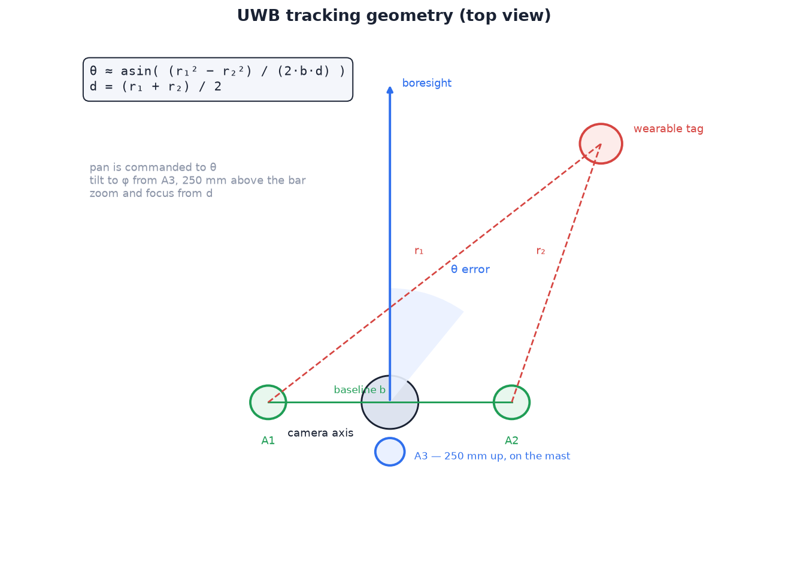

# 05 — Tracking system

The subject wears a UWB (ultra-wideband) tag. Three anchors on the camera
head range it at 20 Hz. The ranges give the subject's **bearing, elevation
and distance**. Vision (person detector) has three secondary roles: trim the
residual aim error, set the zoom framing, and confirm a person is in view
before a session records.

Contents: sensor choice, geometry, control loops, placement envelope,
calibration, tag placement.

## Why UWB (and not BLE, GPS, or vision alone)

| Option | Accuracy / behaviour | Verdict |
| --- | --- | --- |
| BLE RSSI | ±3–5 m; poor under multipath | unusable for aiming |
| GPS on the wearable | 2–5 m; outdoor only; no bearing without a second receiver | unusable |
| Vision only | can't identify *which* person; loses lock on occlusion or exit | used as a secondary sensor |
| **UWB two-way ranging** | **±10–30 cm range, ≈ 20 Hz, low-cost DW1000 modules, identity from the tag** | **primary sensor** |

Fusion: UWB provides identity, bearing, elevation and distance. Vision trims
both angles, frames the shot, and verifies lock-on.

## Geometry



| Anchor | Position | Purpose |
| --- | --- | --- |
| A1, A2 | on arms bolted to the enclosure; 250 mm apart (baseline b), symmetric about the pan axis | bearing, distance |
| A3 | on a mast behind the lens; **250 mm above** A1/A2, ≈ 89 mm back | elevation |

- All anchors are **static**: they don't move with the lens.
- Spacing is a compromise between head size
  ([C1, C2](../../../docs/product/01-requirements.md#non-functional-requirements-with-uwb))
  and angle noise, which grows as spacing shrinks.
- The tag ranges each anchor in turn and broadcasts one frame with r₁, r₂, r₃.
  A single frame means one timestamp: the formulas below assume simultaneous
  ranges. Ranges sampled tens of ms apart from independent radios would add
  the subject's motion to the angle error.

```
d  = (r₁ + r₂) / 2                     # distance to subject
θ  ≈ asin( (r₁² − r₂²) / (2·b·d) )     # bearing from the anchor bar's normal
```

**Bearing noise.** σ_θ ≈ √2·σ_range / b. With b = 0.25 m and σ_range ≈ 10 cm:
≈ 32° raw per sample. A 1-D Kalman filter on θ feeds the pan loop; its
measurement noise is derived from the baseline and `UWB_RANGE_SIGMA_M`, so
it smooths more on shorter baselines. Simulated subject crossing at 5 m, up
to 1.8 m/s: **≈ 9° RMS** filtered. Wide-end horizontal FOV is 96°, so the
subject stays in frame; the vision trim removes the remainder.

| Baseline | Raw σ_θ | Filtered, moving subject | Head width |
| --- | --- | --- | --- |
| 400 mm | ≈ 20° | ≈ 7° RMS | ≈ 45 cm |
| **250 mm** | **≈ 32°** | **≈ 9° RMS** | **≈ 30 cm** |
| 200 mm | ≈ 40° | ≈ 11° RMS | ≈ 25 cm |

### Elevation from the third anchor

A1 and A2 are level, so r₁ and r₂ carry no height information; A3 does.
Frame: origin midway between A1 and A2, x along the bar, y forward, z up;
A3 at (0, −back, up).

```
R² = (r₁² + r₂²)/2 − b²/4              # squared distance from the bar's midpoint
x  = (r₁² − r₂²) / 2b
r₃² = R² + 2·y·back + back² − 2·z·up + up²
```

- Solve: the last equation is linear in z given y, and y² + z² = R² − x², so
  it is a line–circle intersection. Closed form, no iteration
  (`uwb.solve_elevation`). The forward root is the subject; the rear root is
  behind the bar. φ = asin(z / R).
- **`back` offset:** A3 sits behind the bar so the camera can tilt without
  hitting the mast. Omitting the `back` term reads **16–20° low** from level
  to 65° with a 250 mm mast, beyond the vision trim's range.
- **Blind corner:** three anchors can't distinguish a point from its mirror
  image in their plane, which leans back atan(89/250) ≈ 20° from vertical. A
  subject well below *and* far to the side of the camera can fall behind that
  plane and resolve to the mirror. Worst case within the pan/tilt limits:
  pan ±80°, 45° down, **≈ 6.3°** error with A3 89 mm back (≈ 1.2° with a 400 mm
  mast); the solver returns the mirror image exactly. Exact elsewhere.
- **Noise** (Monte Carlo, σ_range = 10 cm, 5 m): raw elevation spread
  **27–35° from level to 65°**, comparable to bearing (≈ 38° in the same run)
  because the vertical baseline equals the horizontal one; it does not grow
  at steep angles. The elevation filter derives its noise from `UWB_A3_UP_M`.
  The solver's one-sided clamp biases the raw mean low by up to 8° near
  level; the vision trim (±10°) absorbs it. ≈ 1 % of noisy frames have no
  consistent solution and are dropped; the filter coasts through them.
- **A3 dropout** (most likely to be body-shadowed): bearing still comes from
  A1/A2; that frame has no elevation.

### Why the third anchor is vertical

The vendor's minimum system (three anchors, one tag) is for trilateration of
a *position*. The camera needs two *angles*.

| A3 placement | Adds | Value to the loops |
| --- | --- | --- |
| Horizontal plane | (x, y) position | none: atan(x, y) is the existing bearing |
| **Vertical offset** | **elevation** | tilt from ranging |

| | Tilt source | Effect of a missed detection |
| --- | --- | --- |
| Without A3 (`UWB_ANCHORS = 2`) | person detector only (OpenCV HOG, trained on upright pedestrians; misses overhangs, extended reaches, back-facing climbers) | tilt axis stops |
| **With A3** | ranging, with a slow vision bias trim | only the trim pauses |

Cost: one C$78 module, a dowel, two small prints, and a longer ranging cycle.
Measure the three-anchor update rate during bench checks
([15 — Verification](../setup/15-verification.md)).

### Static anchors change the loop

The anchors are fixed to the enclosure, so θ is an angle in the bar's frame
and is commanded directly as an absolute position:

```
pan_target = θ + bias          # absolute position, commanded to OPT_MOTOR_X
```

- No velocity integration, windup or dead-reckoned heading.
- Error source: the pan servo is **open-loop**; the commanded angle is
  assumed, accurate to ≈ 2°.
- `bias` corrects it: the detector's horizontal error feeds a slow
  integrator (`PAN_CV_BIAS_GAIN`, clamped ±12°). Vision never drives the
  axis directly, so it can't fight the ranging loop. A 3° servo offset is
  absorbed within seconds.
- Front/back ambiguity of a two-anchor baseline (+91° vs 91° behind) is
  irrelevant: pan is limited to ±80°.

## Control loops (all run on the Pi, 20 Hz)

```
uwb θ ──► Kalman ──┐
                   ├──► pan target (°) ──► slew limit ──► OPT_MOTOR_X (0x05)
person bbox ──► CV bias (slow integrator, ±12°) ──┘

uwb φ ──► Kalman ──► lens-height correction ──┐
                                              ├──► tilt target ──► slew limit ──► OPT_MOTOR_Y (0x06)
person bbox ──► CV bias (slow integrator, ±10°) ──┘
   (no A3: person bbox ──► tilt PID ──► OPT_MOTOR_Y)

d ─────► zoom setpoint: EFL = frac · sensor_h · d / subject_h × vision scale
                       └─► OPT_ZOOM (0x00), rate-limited
person bbox ──► vision scale: fill the frame to 65 % (guard: zoom out fast near an edge)

d, EFL ──► FOCUS_GRID lookup (in 1/d) ──► OPT_FOCUS (0x01)
```

| Loop | Behaviour |
| --- | --- |
| **Pan** | absolute position = UWB bearing + CV bias; slew-limited to `PAN_MAX_DPS` |
| **Tilt (with A3)** | absolute position. φ is measured at the anchor plane; the lens is 98 mm higher, so `Tracker._aim_tilt` recomputes the angle from the lens (≈ 1° at 5 m). `TAG_AIM_OFFSET_M` raises the aim point above a low-worn tag. Vision bias clamped ±10° |
| **Tilt (no A3)** | `UWB_ANCHORS = 2`, or a frame without A3: box centre → PID → `OPT_MOTOR_Y` |
| **Zoom** | initial setting from distance (1.8 m subject at 45 % of frame height); vision then frames to 65 % with an edge guard ([06](../../../docs/design/06-device-software.md#framing-and-focus)). Vision scale limited to 0.5–2.5× the distance zoom and to the lens range (no windup) |
| **Focus** | ranged distance + focal length → `FOCUS_GRID` ([06](../../../docs/design/06-device-software.md#framing-and-focus)); no hunting |
| **Detector** | OpenCV HOG on the 720p preview, 3 fps (0.5 idle); record stream untouched 1080p. Each detection used once; search strip ≈ 40 % of frame width around the ranged bearing ([06](../../../docs/design/06-device-software.md#vision-and-why-it-runs-slowly)). Sufficient: a climber at 0.3 m/s seen from 10 m moves 1.7°/s, and the 17 % framing margin gives several seconds of tolerance |
| **Lost tag** | > 2 s without ranges: hold, LED flashes. > 5 s: `idle` (recording saved first). Same path as a tag switched off |

### Acquiring and lock-on

| Condition | Parameter | Default |
| --- | --- | --- |
| Pan (and tilt, with A3) within tolerance of the ranged position | `ACQUIRE_POINT_TOL_DEG` | 4° |
| … held for | `ACQUIRE_SETTLE_S` | 0.5 s |
| Person detected near centre (box centre within 25 % of frame size) | `ACQUIRE_DETECTIONS` | 2 detections |
| Report "Can't see you — step into view, facing the camera" | `ACQUIRE_STALLED_S` | 15 s |

- **Ranging alone never locks.** A sign or calibration error shows as a ring
  that keeps chasing, not a recording of a wall. Session start is usually an
  upright climber at the wall base, HOG's best case.
- **Start recording** in the app overrides verification.
- Once recording, nothing depends on vision; detector loss mid-route doesn't
  stop the clip.
- A subject beyond a soft limit is locked from the limit.
- In a tag-started session, lock-on starts recording
  ([01](../../../docs/product/01-requirements.md#state-machine-with-uwb)).

## Camera placement envelope

| # | Constraint | Limit |
| --- | --- | --- |
| 1 | **UWB link** | bearing error is independent of distance (σ_θ ≈ √2·σ_r / b; ≈ 9° filtered at 5 m or 30 m). Reliable 20 Hz DS-TWR to **≈ 25–35 m** in a gym (steel, concrete); 50 m+ outdoors line-of-sight |
| 2 | **Resolution (zoom)** — binding | 1.8 m subject at full zoom: 65 % of frame to ≈ 8.3 m, 40 % at 13.5 m, 18 % at 30 m; full body from ≈ 1.5 m ([03](../../../docs/design/03-mechanical-design.md#how-far-the-zoom-reaches)) |
| 3 | **Geometry** | < 5 m from a tall wall: steep tilt (foreshortening) and high angular rates. At 8–12 m a 15 m route spans ≈ 50–60° of tilt |
| 4 | **Pan range ±80°** | at 8 m the sweep is ≈ 22 m wide (any bouldering wall, most routes). Aim at the centre of the area; check both ends before starting |

**Recommended: 6–12 m. Working range: 2–20 m.** Beyond 13.5 m the subject is
below the framing target; beyond ≈ 30 m the UWB link fails first.

## Calibration

| # | Step | Method | Notes |
| --- | --- | --- | --- |
| 1 | **Antenna delay** (optional) | tune each board's DW1000 antenna-delay constant until its range to a taped 5.00 m is close | only if the firmware exposes it; step 2 absorbs the remainder. Skip with stock ULA1 firmware |
| 2 | **Range bias** | pan centred; tag **5.00 m** out on the boresight, level with A1/A2; `python3 -m sportcam.rangecal 5` | 300 frames; median range per anchor vs geometric truth (A1/A2: hypot(d, b/2); A3: hypot(d + back, up)); prints `RANGE_BIAS_M`. Also corrects A1–A2 imbalance. Reports per-anchor noise; investigate if well above `UWB_RANGE_SIGMA_M`. A3 bias is critical: 5 cm ≈ 12° elevation at 10 m |
| 3 | **A3 geometry** | measure A3 height above A1/A2 and distance behind the pan axis; set `UWB_A3_UP_M`, `UWB_A3_BACK_M` | defaults 0.250 / 0.089 (kept in step with the CAD by `cad/fit.py`) match the printed mast with the dowel cut to 246 mm and fully seated. Check: tag level with the anchors at 5 m reads ≈ 0° |
| 4 | **Lens and servos** | zoom curve, focus grid, axis centre and direction | same in both builds; procedure in [14 — Software setup](../setup/14-software-setup.md#6-calibrate). With A3, `TILT_SIGN` matters as much as `PAN_SIGN`: a wrong sign drives the camera away from the subject |

## Wearing the tag

Propagation: UWB passes through fabric with negligible loss; no optical line
of sight is needed. The body (water) attenuates it. Placement goal: keep the
torso out of the tag → camera path. The pod (`cad/wearable_case.scad`) keeps
a foam pad between the ceramic antenna and skin; direct skin contact detunes
the antenna.

General ranking: upper-arm band > back of cap/collar > chest/back pocket.
Avoid: wrist (arm swing moves the bearing), below the waist.

### Indoor climbing (bouldering / top-rope / lead)

The climber faces the wall and the camera is behind them, so the back faces
the camera for most of the climb. A back-mounted tag is rarely body-shadowed.

| Discipline | Position | Rationale |
| --- | --- | --- |
| Top-rope / lead | **Rear of the harness waist belt, 5–10 cm off-spine** (strap bars through the belt webbing, or clipped beside the haul loop) | stable; camera-facing; clear of belay loop and rope |
| Bouldering | **Low back, off-spine, under the shirt** on an elastic waistband; or upper-arm band | no harness; off-spine for falls onto mats |
| Either | chalk-bag belt | works, but bags rotate and get repositioned; bearing jitters |

| Topic | Guidance |
| --- | --- |
| Front of torso | never: compressed against the wall on slabs and mantles; full occlusion |
| Spine | keep 5–10 cm off-spine; a 45 g pod is safe to land on elsewhere |
| Overhangs | body horizontal, tag may face the ceiling. Ranges continue (diffraction); A3 usually has the clearest path. Expect the noisiest angles, not loss of lock |
| Camera distance | 8–12 m from the wall base (works 2–20 m, [placement envelope](#camera-placement-envelope)). Tilt −45° to +85° covers a 15 m top-out from 7 m (≈ 65°) |
| Jumpy bearing | multipath from steel and concrete. Raise `UWB_RANGE_SIGMA_M` from 0.10 toward 0.15 before changing any gain |
| Sweat and chalk | USB-C slot faces down when worn; clean the case, not the board. Chalk is non-conductive. No top vents (sweat ingress) |

## Wearable behaviour

| Item | Behaviour |
| --- | --- |
| Role | ranging **initiator**: polls each anchor, broadcasts the collected ranges |
| Power | independent USB bank; 2 500 mAh lasts > 1 day |
| Control | power switch only. On starts a session, off ends it; the camera detects ranging start and stop ([01](../../../docs/product/01-requirements.md#state-machine-with-uwb), `src/with_uwb/device/sportcam/session.py`) |
| LED | blinks green while ranging. Battery level: the bank's own indicator |
