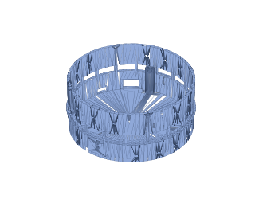
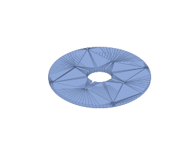
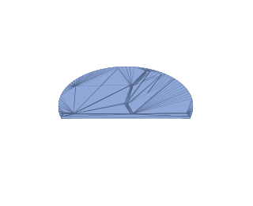
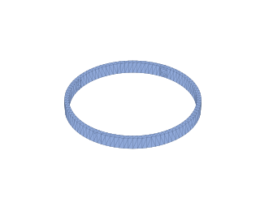
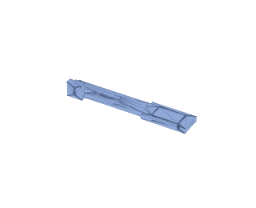
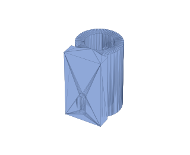
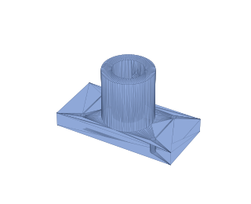
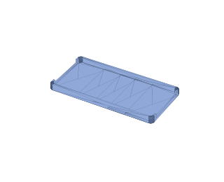
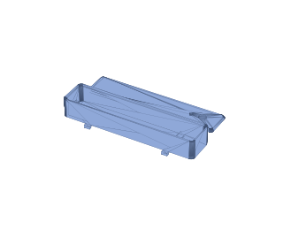

# 10 — Bill of materials (Canadian sourcing, Toronto / M2L 2E2)

This is the **PTZ-base, battery-powered build**. The Arducam PTZ camera
supplies the sensor, the zoom lens and both motion axes, so the pan stage —
stepper, driver, slip ring, lazy susan, belt and pulleys — is gone, along with
the base ESP32 and the mains supply. What replaces them is one expensive
camera and a power bank.

Sourcing strategy for delivery to **M2L 2E2 (North York, Toronto) in under two
weeks**:

- **Amazon.ca Prime** — 1–3 days for everything they stock. Listings churn, so
  Amazon links are search links pinned to the exact part name; take a
  Prime-badged result matching the name (avoid "ships from China" sellers —
  those are the 3–4 week ones).
- **[RobotShop Canada](https://ca.robotshop.com/)** — ships from Mirabel, QC.
  The Canadian source for the Arducam PTZ kits.
- **[PiShop.ca](https://www.pishop.ca/)** — official Canadian Raspberry Pi
  reseller, ships from Ontario in 1–3 days. First choice for all Pi items.
- **[Digi-Key Canada](https://www.digikey.ca/)** — 1–3 days to Toronto,
  free shipping over C$100. Good backstop for anything Amazon is out of.
- **Makerfabs (China, DHL)** — the UWB boards' manufacturer; DHL Express is
  5–8 days to Toronto, but add ~C$25 shipping + possible ~13% HST on import.

Prices are approximate CAD street prices (Oct 2026), ±15%.

> **Before you print anything**, work through
> [15 — Verification checklist](15-verification.md#before-you-print). Four
> dimensions in this build come off parts you bought, not numbers we chose,
> and the lid is a six-hour print that depends on one of them.

Every parts table carries an **Status|Acquired** column. Replace the ☐ with a ☑, a date or an order number as things arrive; on the printed-parts table it means printed rather than bought.

Status: A = acquired, O = ordered, P = pending
## The camera (this is the design)

| #   | Status | Part                                                                    | Qty | ≈ CAD | Source                                                                                                                                                                        | Notes                                                                                                                                                                                                                                                                                                                                                                                                                        |
| --- | ------ | ----------------------------------------------------------------------- | --- | ----- | ----------------------------------------------------------------------------------------------------------------------------------------------------------------------------- | ---------------------------------------------------------------------------------------------------------------------------------------------------------------------------------------------------------------------------------------------------------------------------------------------------------------------------------------------------------------------------------------------------------------------------- |
| 1   | O      | **Arducam IMX477 12 MP PTZ camera with metal pan-tilt base (B0167B12)** | 1   | $293  | [RobotShop CA](https://ca.robotshop.com/products/arducam-imx477-12mp-ptz-camera-w-metal-pan-tilt-base-for-raspberry-pi-jetson-b0167b12) · [Arducam](https://www.arducam.com/) | camera, motorized zoom lens, aluminium base, two digital servos and the I2C controller, assembled. Both axes 0–180°. **Ordered 9 Oct direct from Arducam, order #000009517, express: US$204.99 + US$38 shipping. Arducam prices in USD and ships from China, so the landed cost lands nearer C$340 plus HST on import than the C$293 shown here — that figure is the RobotShop CA shelf price, kept as the planning number |

### Why the IMX477, and what it means for reach

Arducam's cheaper 8 MP IMX219 PTZ kit (B0167B8) is discontinued, so the 12 MP
IMX477 kit is the only option and the design, CAD and software all assume it.

Its one trade-off is reach. A 1.8 m subject fills the 65 % framing target out
to about **8 m** (40 % at 13.5 m), and full-body framing works from as close
as **1.5 m**. Past 8 m the subject just gets smaller in frame ([05](../design/05-tracking-system.md)).
The larger sensor gives bigger pixels, which helps in a dim gym, and 12 MP of
resolution to crop into.

## Compute, tracking and status

| #   | Status | Part                                                   | Qty | ≈ CAD  | Source                                                                                                                                                                                          | Notes                                                                                                                                                                                                                                                                                                   |
| --- | ------ | ------------------------------------------------------ | --- | ------ | ----------------------------------------------------------------------------------------------------------------------------------------------------------------------------------------------- | ------------------------------------------------------------------------------------------------------------------------------------------------------------------------------------------------------------------------------------------------------------------------------------------------------- |
| 2   | A      | **Raspberry Pi 4 Model B, 4 GB**                       | 1   | $95    | [PiShop.ca](https://www.pishop.ca/product/raspberry-pi-4-model-b-4gb/) · [Amazon.ca](https://www.amazon.ca/s?k=raspberry+pi+4+model+b+4gb)                                                      | **not a Pi 5.** The Pi 4 has a hardware H.264 encoder; the Pi 5 dropped it and encodes in software, which costs about 4 W and two hours of runtime. See [04](../../../docs/design/04-electronics.md#why-a-pi-4-and-not-a-pi-5). Buy the bare board                                                                           |
| 3   | A      | Pi 4 heatsink + fan case, or an aluminium heatsink set | 1   | $12    | [Amazon.ca](https://www.amazon.ca/s?k=raspberry+pi+4+heatsink+fan)                                                                                                                              | the Pi 5 Active Cooler does **not** fit a Pi 4. Passive heatsinks are enough at this load; a fan is cheap insurance in a sealed enclosure                                                                                                                                                               |
| 4   | O<br>  | microSD 64 GB A2 (SanDisk Extreme)                     | 1   | $14    | [Amazon.ca](https://www.amazon.ca/s?k=sandisk+extreme+64gb+microsd+a2)                                                                                                                          | recordings land here at 5.4 GB/h, so 64 GB holds ≈ 10 h — more than one battery charge can produce. 128 or 256 GB only helps if you carry spare banks and stay offline; see [04](../../../docs/design/04-electronics.md#the-sd-card). **Buy a known brand**: counterfeit cards are the commonest cause of Pi corruption      |
| 6   | O      | **Haorutech ULA1 UWB module (ESP32 + DWM1000)**        | 4   | $78 ea | [RobotShop CA](https://ca.robotshop.com/products/haorutech-uwb-ultra-wideband-positioning-module-w-esp32-dwm1000-arduino) · [manual](https://www.haorutech.com/download/ULA1_UserManual-EN.pdf) | 3 anchors + 1 tag — A1/A2 on the arms, A3 on the mast for elevation. 40 × 25 mm, USB-A plug on the board, 10 cm accuracy, 50 m open range. Stocked in Canada, which the generic ESP32-UWB boards are not. **5 V USB only — no battery connector**, which is why the tag runs off a power bank (item 15) |
| 7   | O      | WS2812B LED ring, 16 px                                | 1   | $14    | [Amazon.ca](https://www.amazon.ca/s?k=ws2812b+ring+16+led)                                                                                                                                      | status indicator; `LED_COUNT = 16`. A 16-px ring is 44 mm across — to light the 120 mm window evenly, ~380 mm of 60/m WS2812B **strip** (≈ 23 px) lining the window works better; change `LED_COUNT` if you do                                                                                          |
| 8   | A      | 74AHCT125 level shifter                                | 1   | $6     | [Amazon.ca](https://www.amazon.ca/s?k=74ahct125) · [Digi-Key.ca](https://www.digikey.ca/)                                                                                                       | lifts the Pi's 3.3 V SPI data to 5 V for the ring. SPI is used instead of the classic PWM/DMA driver so the service need not run as root — see [04](../../../docs/design/04-electronics.md#driving-the-ws2812b-ring)                                                                                                         |

## Power

| #   | Status | Part                                                   | Qty | ≈ CAD | Source                                                                                                                                                           | Notes                                                                                                                                                                                                                                                                                                                                                                                        |
| --- | ------ | ------------------------------------------------------ | --- | ----- | ---------------------------------------------------------------------------------------------------------------------------------------------------------------- | -------------------------------------------------------------------------------------------------------------------------------------------------------------------------------------------------------------------------------------------------------------------------------------------------------------------------------------------------------------------------------------------- |
| 9   | A      | **USB-C PD power bank, 25 000 mAh (92 Wh), 65 W+**     | 1   | $80   | [Amazon.ca](https://www.amazon.ca/s?k=25000mah+power+bank+65w+usb+c+pd)                                                                                          | gives **6.2 h** tracking + recording on a Pi 4, after the bank's own conversion loss ([04](../../../docs/design/04-electronics.md#runtime)). A 20 000 mAh (74 Wh) bank makes 5.0 h, saves ≈ C$25 and 200 g, and is the better pick unless you want a full day between charges. Whichever you buy, set `BATTERY_WH` to match. Stay under 100 Wh to keep it flyable                                                 |
| 10  | O      | USB-C PD trigger board, 12 V                           | 1   | $10   | [Amazon.ca](https://www.amazon.ca/s?k=usb+c+pd+trigger+board+12v)                                                                                                | negotiates 12 V out of the bank. Fixed-12 V or adjustable both fine; most banks cap their 5 V profile at 3 A, and the 5 V rail here also feeds the servos, both anchors and the ring                                                                                                                                                                                                         |
| 11  | O      | 12 V → 5 V 8 A buck (≥ 40 W), **adjustable**           | 1   | $16   | [Amazon.ca](https://www.amazon.ca/s?k=12v+to+5v+8a+adjustable+buck+converter)                                                                                    | the single 5 V rail. Buy an adjustable unit, not a fixed-5 V one: it must be **trimmed to 5.1 V under a 4 A load before the Pi is ever connected**. Open-circuit voltage tells you nothing — a module that reads 5.1 V unloaded and sags to 4.8 V will brown out a Pi. This is the first bench job in the build                                                                              |
| 12  | A      | **Current/voltage sensor — INA260 breakout preferred** | 1   | $22   | [Digi-Key.ca](https://www.digikey.ca/en/products/result?keywords=adafruit%204226%20ina260) · [Amazon.ca](https://www.amazon.ca/s?k=ina226+current+sensor+module) | the battery gauge, on the 12 V side, I2C 0x40. The **INA260** (Adafruit 4226) has the shunt on the die: nothing to calibrate, no `INA226_SHUNT_OHMS` to get wrong, 36 V and 15 A headroom. A bare **INA226** module works too if you can find one — set `POWER_MONITOR = "ina226"` and the shunt value. **Hard to source in Canada — see [below](#parts-that-are-hard-to-source-in-canada)** |
| 13  | O      | Panel-mount rocker switch, 10 A                        | 1   | $8    | [Amazon.ca](https://www.amazon.ca/s?k=panel+mount+rocker+switch+12v)                                                                                             | between the trigger and the buck, so you are not unplugging USB-C to turn it off                                                                                                                                                                                                                                                                                                             |
| 14  | A      | USB-C to USB-C cable, 30 cm                            | 1   | $10   | [Amazon.ca](https://www.amazon.ca/s?k=short+usb+c+to+usb+c+cable+30cm)                                                                                           | bank to trigger board, inside the build. Any standard C-to-C cable works: the trigger draws ≈ 1.7 A at 12 V, inside the 3 A every C-to-C cable carries, and PD negotiates over the CC wire that even charge-only cables have. 30 cm is for fit; a short phone cable you already own will do. **Not USB-A to C**, which carries no PD                                                         |

The Pi draws from the 5 V rail through a USB-C pigtail. A Pi 4 needs no
`config.txt` current flag for this; that requirement is specific to the Pi 5.
If the IMX477 is not detected on first boot, add `dtoverlay=imx477`.

## Wearable

| #   | Status | Part                                     | Qty | ≈ CAD | Source                                                                  | Notes                                                                                                                                                                                                                                                        |
| --- | ------ | ---------------------------------------- | --- | ----- | ----------------------------------------------------------------------- | ------------------------------------------------------------------------------------------------------------------------------------------------------------------------------------------------------------------------------------------------------------ |
| 15  | O      | **Slim USB power bank, 2 500–5 000 mAh** | 1   | $18   | [Amazon.ca](https://www.amazon.ca/s?k=lipstick+power+bank+2500mah+slim) | powers the wearable tag. The ULA1 takes 5 V over USB and has no battery connector, so this replaces the charge board and cell the old design needed. A 2 500 mAh "lipstick" bank runs the tag well past a full day and charges over USB like everything else |
| 17  | O      | Elastic armband/pouch + strap            | 1   | $10   | [Amazon.ca](https://www.amazon.ca/s?k=elastic+armband+pouch+small)      | 26 mm strap for the pod's strap bars; see [05](../design/05-tracking-system.md) for climbing-specific wearing                                                                                                                                                          |

## Charging

Both banks have their own charge circuitry. All they need is a USB charger and
a cable, and **the phone chargers and cables you already own will do**. Items 28
and 29 are optional, only buy them for faster charging, and they are not in the
totals.

The tag bank (item 15) charges from any phone charger in 1–2 h. The tripod bank
(item 9) holds 92 Wh, ≈ 108 Wh from the wall after charging loss, so the charger
sets the time:

| Charger | Time to full |
| --- | --- |
| Old USB-A cube, 5 V 1–2 A | 12–20 h. Too slow to be useful |
| USB-C phone charger, 20–25 W | ≈ 5 h. Fine overnight |
| USB-C laptop or fast charger, 45 W+ | ≈ 2.5 h |

For anything better than the first row the cable needs **USB-C on both ends**.
USB-A to USB-C carries 5 V only, however fast the charger. Any ordinary C-to-C
phone cable carries up to 60 W (3 A), and the bank cannot take more than that
except from a 65 W charger, which saves a few minutes.

| #   | Status | Part                                                     | Qty | ≈ CAD | Source                                                                         | Notes                                                                                                                                                                                                                                                                                                                                       |
| --- | ------ | -------------------------------------------------------- | --- | ----- | ------------------------------------------------------------------------------ | ------------------------------------------------------------------------------------------------------------------------------------------------------------------------------------------------------------------------------------------------------------------------------------------------------------------------------------------- |
| 28  |        | *Optional:* USB-C PD GaN wall charger, 65 W, 1 × C + 1 × A  | 1   | $40   | [Amazon.ca](https://www.amazon.ca/s?k=65w+gan+charger+usb+c+usb+a+pd)          | USB-C port to the tripod bank (item 9), USB-A port to the tag bank (item 15). Only worth it if you have no USB-C charger of 20 W or more, or want ≈ 2 h refills. That needs the bank to accept 65 W *in*. Some 65 W banks only take 30–45 W in, so check the listing. Expect the C port to drop to ≈ 45 W while the A port is also in use |
| 29  |        | *Optional:* USB-C to USB-C cable, 1 m                    | 1   | $12   | [Amazon.ca](https://www.amazon.ca/s?k=usb+c+to+usb+c+cable+1m)                 | charger to the tripod bank. Item 14 is 30 cm and lives in the build, so it is too short to charge from the wall. Any C-to-C phone cable does this job, and most banks ship with one. Buy only if you have none                                                                                                                              |

The tag bank charges from the cable it ships with, usually USB-A to USB-C or
USB-A to micro-USB. That is why item 28, if you buy it, has an A port.

If the tripod bank supports **pass-through charging** (it charges and
discharges at the same time; the listing will say so), a USB-C charger also lets you
run the camera from a wall socket at the gym with no runtime limit.

**Already bought and not needed: Adafruit 4410** (Micro-Lipo charger, USB-C,
Digi-Key 1528-4410-ND). It charges a bare single-cell LiPo, the charge board
for the old wearable's cell. A power bank has its own charger, so the 4410
cannot charge either bank and has no place in this build. Return it, or
keep it for a future project with a bare LiPo cell. It is not counted in the totals.

## Wiring and fasteners

| #   | Status | Part                                                                    | Qty | ≈ CAD | Source                                                                            | Notes                                                                                                                                                                                                                                             |
| --- | ------ | ----------------------------------------------------------------------- | --- | ----- | --------------------------------------------------------------------------------- | ------------------------------------------------------------------------------------------------------------------------------------------------------------------------------------------------------------------------------------------------- |
| 18  |        | Barrel jack, JST kit, 18/22 AWG silicone wire, heatshrink, Dupont leads | —   | $20   | [Amazon.ca](https://www.amazon.ca/s?k=jst+connector+kit+22awg+silicone+wire)      | 18 AWG on the 5 V rail — it carries 4 A                                                                                                                                                                                                           |
| 19  |        | 470 µF electrolytic capacitor, 10 V or higher (small pack)              | 1   | $10   | [Amazon.ca](https://www.amazon.ca/s?k=470uf+16v+electrolytic+capacitor)           | across the buck output, stripe (−) to OUT− — connection R1 in the [wiring guide](12-wiring.md). The tag needs no parts of its own: the ULA1 plugs straight into its USB bank                                                                       |
| 20  |        | **USB-A male-to-female extension cables**, 3 × 50 cm                     | 3   | $18   | [Amazon.ca](https://www.amazon.ca/s?k=usb+a+male+to+female+extension+cable+50cm)  | the ULA1 has a USB-A plug on the board, so each anchor reaches its arm tip — or the top of the 250 mm mast — on an extension rather than a cable with two different ends, and comes into the enclosure through the slot high in the wall. Full extensions carry data by definition, which removes the charge-only trap the old micro-USB cables had |
| 21  |        | Nylon standoff kit, M2.5 + M3                                           | 1   | $10   | [Amazon.ca](https://www.amazon.ca/s?k=m2.5+m3+nylon+standoff+kit)                 | Pi on four 6 mm M2.5 standoffs on the shelf, ULA1 boards on 3 mm M2.5 standoffs. The power boards are foam-taped down, so no M3 standoffs are needed |
| 22  |        | M2.5/M3 screw + nut + brass heat-set insert kit                         | 1   | $20   | [Amazon.ca](https://www.amazon.ca/s?k=m3+screw+assortment+brass+heat+set+inserts) | ≈ 23 × M3: PTZ base 4 + nuts, lid 4 × M3 × 8 countersunk (in sideways through the wall), shelf 3 × M3 × 8, anchor arms 4, mast foot 2, 2 pinch screws, boards. 16 × M2.5. Inserts: 15 × M3 — 2 in each of the three wall bosses, 1 in each mast socket, 1 in each shelf post, 4 in the lid's ring |
| 23  |        | 3/8-16 brass insert (≤ 8 mm long) + 3/8-16 → 1/4-20 reducer bushing   | 1   | $12   | [Amazon.ca](https://www.amazon.ca/s?k=3%2F8-16+to+1%2F4-20+brass+tripod+bushing)  | tripod interface: 3/8-16 tripods screw into the insert, 1/4-20 ones into the bushing — so it fits any standard tripod ([C3](../../../docs/product/01-requirements.md#non-functional-requirements)).                                                                                                                                                                      |
| 24  |        | Hook-and-loop strap, 25 mm                                              | 1   | $8    | [Amazon.ca](https://www.amazon.ca/s?k=hook+and+loop+cinch+strap+25mm)             | holds the bank in the tray, and the tray to a tripod leg or the centre column |
| 25  |        | PETG filament 1 kg                                                      | 1   | $25   | [Amazon.ca](https://www.amazon.ca/s?k=petg+filament+1kg)                          | ~380 g used across nine parts. Full settings, times and printer requirements: **[3D printing specifications](../../../docs/setup/11-3d-printing.md)** |
| 25a |        | PETG filament, **white or natural**, 250 g                              | 1   | $12   | [Amazon.ca](https://www.amazon.ca/s?k=white+petg+filament+250g+sample)            | the LED diffuser band, which has to pass light, and ideally the shelf, whose underside bounces the LED ring's light out — so not your main colour unless that is white. ~40 g used |
| 25b |        | Glue stick (PVA)                                                        | 1   | $4    | [Amazon.ca](https://www.amazon.ca/s?k=glue+stick+3d+printer+bed)                  | a **release agent**, not an adhesive: PETG fuses to bare smooth PEI and tears the sheet                                                                                                                                                           |
| 26  |        | Aluminium tripod (1/4-20 or 3/8-16 head)                                | 1   | $35   | [Amazon.ca](https://www.amazon.ca/s?k=aluminum+camera+tripod)                     | skip if you own one — any standard tripod fits. The head is about 30 cm across and 28 cm tall, so a compact one does                                                                                                                                                                            |
| 27  |        | Build consumables: 2-part epoxy, threadlocker, zip ties, double-sided foam tape, 3 mm foam | —   | $15   | [Amazon.ca](https://www.amazon.ca/s?k=2+part+epoxy+threadlocker+zip+ties)         | epoxy for the 3/8-16 insert; 1 mm foam tape sticks the power boards to the floor and the LED ring under the shelf; 3 mm foam under the wearable board |
| 27a |        | **½-inch (12.7 mm) hardwood dowel**, 36 in                              | 1   | $5    | [Home Depot CA](https://www.homedepot.ca/search?q=1%2F2%20inch%20hardwood%20dowel) | the A3 mast, cut to 246 mm. Any hardware store has these. **Wood, not aluminium** — metal under a UWB antenna detunes it. Measure it: `mast_d` in `cad/config.scad` assumes 12.7 mm |

## Printed parts

Fabricated from items 25 and 25a (~420 g total). Printer requirements,
per-part settings, orientation, supports and print times are in
**[3D printing specifications](../../../docs/setup/11-3d-printing.md)** — read that
before you buy filament or start an 18-hour enclosure.

**Measure your parts first** and put the numbers in
[`cad/ordered_parts.toml`](../../../cad/ordered_parts.toml), then run
`python3 cad/fit.py` from `sport_cam/`: it re-solves the layout around them,
re-renders every part and checks that they all fit together. The
[15 — Verification checklist](15-verification.md#before-you-print) says which
ones matter most.

The short version: any FDM printer with a **160 × 155 × 90 mm** build volume
(every part also fits a Bambu Lab A1 Mini, the reference printer), a 0.4 mm
nozzle, a 250 °C hotend and an 80 °C bed. About **40 hours** of machine time.
No supports anywhere except three small ledges on the enclosure.

**Don't have a printer?** Top choice: the **Bambu Lab A1 Mini** ([Bambu Lab Canada](https://ca.store.bambulab.com/products/a1-mini), ≈ C$249–389). It also prints Croc charms. Other options and why: [Printers to buy](../../../docs/setup/11-3d-printing.md#printers-to-buy). Not counted in the totals.

STLs, previews and this table's pictures are regenerated by `python3 cad/fit.py`
(or `./cad/render_all.sh`, which runs it).

| Preview | Acquired | Part | Qty | Compiled STL | OpenSCAD source |
| --- | --- | --- | --- | --- | --- |
|  | ☐ | Enclosure | 1 | [base_housing.stl](../../cad/stl/base_housing.stl) | [base_housing.scad](../../cad/base_housing.scad) |
|  | ☐ | Lid (carries the camera) | 1 | [lid.stl](../../cad/stl/lid.stl) | [lid.scad](../../cad/lid.scad) |
|  | ☐ | Pi shelf | 1 | [shelf.stl](../../cad/stl/shelf.stl) | [shelf.scad](../../cad/shelf.scad) |
|  | ☐ | LED diffuser band | 1 | [led_diffuser_ring.stl](../../cad/stl/led_diffuser_ring.stl) | [led_diffuser_ring.scad](../../cad/led_diffuser_ring.scad) |
|  | ☐ | UWB anchor arm | 2 | [anchor_arm.stl](../../cad/stl/anchor_arm.stl) | [anchor_arm.scad](../../cad/anchor_arm.scad) |
|  | ☐ | A3 mast foot | 1 | [mast_foot.stl](../../cad/stl/mast_foot.stl) | [anchor_mast.scad](../../cad/anchor_mast.scad) |
|  | ☐ | A3 mast cradle | 1 | [mast_cradle.stl](../../cad/stl/mast_cradle.stl) | [anchor_mast.scad](../../cad/anchor_mast.scad) |
|  | ☐ | Battery tray | 1 | [battery_tray.stl](../../cad/stl/battery_tray.stl) | [battery_tray.scad](../../cad/battery_tray.scad) |
|  | ☐ | Wearable pod (body + lid) | 1 | [wearable_case.stl](../../cad/stl/wearable_case.stl) | [wearable_case.scad](../../cad/wearable_case.scad) |

## Totals (CAD)

| Configuration | Total |
| --- | --- |
| **Full build** (12 MP PTZ + three-anchor ULA1 UWB + 92 Wh battery), own tripod | **≈ C$1079** |
| Full build + tripod | ≈ C$1114 |
| Two anchors, no A3 mast (`UWB_ANCHORS = 2`; tilt from vision alone) | subtract ≈ C$89 |
| With a 74 Wh bank instead (5.0 h) | subtract ≈ C$25 |
| Without the battery gauge (`POWER_MONITOR = "none"`) | subtract ≈ C$22 |
| Optional charging kit (items 28–29), if your own chargers are too slow | add ≈ C$52 |
| Generic ESP32-UWB boards instead of ULA1 (`UWB_PROTOCOL = "dual-serial"`) | subtract ≈ C$100 |

(≈ US$775 / US$800 at typical exchange + Canadian markup.)

Of the full build: camera and power ≈ C$429 (items 1 and 9–14), compute and
tracking ≈ C$369 (items 2–8), wearable, wiring, fasteners and filament
≈ C$195 (items 15–25b, 27 and 27a). The optional charging items 28–29 are not
included.

Switching from a Pi 5 to a Pi 4 saved about C$60: C$55 on the board, C$8 on
the camera adapter cable the Pi 4 does not need, less C$3 more for cooling.

## A note on the radios

Item 6 moved from generic ESP32-UWB boards to the **Haorutech ULA1**, and the
reason is availability as much as anything: the generic boards have no
dependable Canadian listing, while RobotShop stocks the ULA1 domestically.

It costs about C$28 more per board, and it buys three things beyond stock:

- **Every range arrives in one frame.** The tag polls each anchor and
  broadcasts a single RangeData message, so r₁, r₂ and r₃ share a
  timestamp. The formulas in [05](../design/05-tracking-system.md) assume exactly
  that; with independent serial streams it was only approximately true.
- **Only one anchor needs a data connection.** The others just need 5 V.
- **A USB-A plug on the board**, so the arm run is a plain extension cable
  rather than a micro-USB cable that might be charge-only.

It also forced a better wearable. The ULA1 is 5 V USB with no battery
connector, so the tag now runs off a small USB power bank (item 15) instead
of a charge board and a LiPo cell — which happens to delete both of the parts
that had no Canadian listing at all.

If you would rather keep the cheaper generic boards, set
`UWB_PROTOCOL = "dual-serial"` in `src/with_uwb/device/sportcam/config.py`; that path is
still supported and tested.

### Verify on the bench before committing to three

These three are also in the [verification checklist](15-verification.md#on-the-bench-before-the-first-session)
alongside everything else to check in order.

The manual documents the frame format and we parse it exactly as written, but
three things are worth a quick check with the first two boards:

1. **That the RTLS firmware is loaded.** The vendor ships two sketch pairs:
   `RangingAnchor`/`RangingTag` reports a single tag-to-anchor distance, and
   `RTLS_Anchor`/`RTLS_Tag` ranges to every anchor and broadcasts the lot.
   Only the second gives one anchor the full picture. If you see one range
   where three should be, you are on the wrong pair; reflash, or fall back to
   `dual-serial`. If you see two (mask `03`), the tag is not configured for
   the third anchor.
2. **The update rate.** The control loop runs at 20 Hz. Each anchor adds a
   ranging exchange to the cycle, so three anchors run slower than two —
   and two-anchor cycles on this hardware are generally quoted at 10–20 Hz
   once firmware overhead is counted. Anything above about 8 Hz is fine: the
   Kalman filters degrade gracefully, and a climber moves a couple of degrees
   a second. Measure it rather than assuming.
3. **The tag's button.** The old wearable sketch had a pair/record button and
   a BLE broadcast. The ULA1 ships its own firmware; that feature needs
   porting. The vendor publishes the hardware schematic, so the free pins are
   documented — it is a job rather than a risk. Until then, drive recording
   from the phone.

**The third anchor goes up, not out.** The vendor's "minimum three anchors"
describes a system that solves for position in a plane. We need two angles,
not a position. A1 and A2 give the bearing; A3, 250 mm above them on a mast,
gives elevation, so tilt no longer depends on the person detector. A third
anchor in the horizontal plane would add nothing. See
[05](../design/05-tracking-system.md#why-the-third-anchor-is-vertical).

## Parts that are hard to source in Canada

**Both are now resolved.** The INA260 substitution below still stands, and the
wearable charge board is gone entirely — the tag runs off a USB power bank.

### Item 12, the battery gauge — substitute the INA260

Bare INA226 modules are a grey-market item here. The clean answer is the
**[Adafruit INA260 breakout, part 4226](https://www.digikey.ca/en/products/result?keywords=adafruit%204226%20ina260), through Digi-Key Canada**: duty-free,
customs pre-cleared, one to three days to Toronto, and free shipping once the
order passes C$100. The INA260 alone does not reach that, so expect a small
shipping charge, or put other parts on the same order.

The INA260 is the better part anyway. Its shunt is on the die, so there is no
`INA226_SHUNT_OHMS` to measure or mistype, and it carries 36 V and 15 A
against our 12 V and 1.7 A. Same I2C address, so only one config line changes:

```python
POWER_MONITOR = "ina260"      # src/with_uwb/device/sportcam/config.py — this is the default
```

**Do not use the ADS1115-plus-shunt route.** An ADS1115 cannot see a high-side
shunt at 12 V: its inputs are rated to the supply rail plus 0.3 V, so 12 V of
common mode is outside absolute maximum and will damage it. You could move the
shunt low-side and add a divider for bus voltage, but that is three extra parts,
a broken ground path and a worse measurement than a single chip that was
designed for the job.

**Or build without it.** The gauge is optional and the software knows it:

```python
POWER_MONITOR = "none"
```

Everything runs. You lose the low-battery warning and the automatic
save-and-park at 7 %, so you watch the clock instead — the camera gives about
6.2 hours. Add the sensor later without touching anything else.

### Item 15, the wearable charge board

**This line no longer exists.** Moving to the ULA1 made the wearable a module
plugged into a small USB power bank (item 15), so there is no cell to charge
and no charge board to find. The part with no Canadian listing is simply gone
from the design, along with the 30 mm LiPo width trap that went with it.

## What this build deleted

Against the earlier continuous-pan revision: NEMA17 stepper, TMC2209 driver,
22 mm slip ring, 3" lazy-susan bearing, GT2 belt and 20T pulley, 6701ZZ
bearing, DS3225 servo, A3144 hall sensor and magnet, ESP32 DevKitC, the 12 V
mains brick and all three bucks — about C$206 of parts and the entire pan
stage. The camera and the battery cost more than that back.

## Two-week delivery plan

Order everything the same day:

1. **Item 1, the camera — done.** Ordered direct from Arducam on 9 October,
   express. That was the long pole; everything below arrives inside a week.
2. **PiShop.ca** (items 2 and 3): 1–3 days.
3. **Digi-Key.ca** (item 12, the INA260): no reliable domestic listing. See
   [above](#parts-that-are-hard-to-source-in-canada). Nothing else in this
   build comes from Digi-Key; the charge board earlier revisions bought there
   is gone.
4. **Amazon.ca Prime** (everything else): 1–3 days per item. Vet two
   listings carefully: the UWB boards (item 6), and the power bank (item 9).
   For the bank, check that its USB-C output lists **12 V**, because some
   banks skip that profile and the trigger then sits at 5 V. Also check its
   **input** wattage, which sets how fast it recharges.

Substitution-sensitive parts, worth full price: the **buck** (item 11 — cheap
units sag and brown the Pi out) and the **power bank** (item 9 — the capacity
is the runtime). The USB-C cable (item 14) is not: any C-to-C cable carries the
12 V contract.

Three things in the fine print that look identical in a listing photo and are
not: a bank's **output versus input** wattage (item 9, since "65 W" on the box
is usually output), whether its PD output **includes 12 V** (item 9), and
**fixed versus adjustable** bucks (item 11 — you must be able to trim it).
