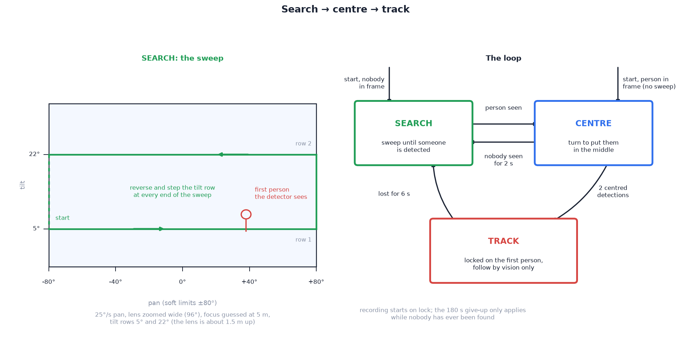

# 05 — Tracking system



Subject localisation by **vision only**: no tag, radio or anchors.
**Track & record** starts a pan sweep (skipped if idle already has a person
in frame); the person detector finds a person; the camera centres them, locks
on and keeps them framed. Pan, tilt, zoom and
focus are register writes to one I2C controller on the Pi
([03](../../../docs/design/03-mechanical-design.md),
[04](../../../docs/design/04-electronics.md)); the loop runs on the device at
20 Hz.

## Why camera-only

Comparison with the [UWB build](../../../with_uwb/docs/design/05-tracking-system.md)
(wearable tag ranged by three anchors on the head):

<!--compare-->

| | Camera-only (this build) | With UWB (the other build) |
| --- | --- | --- |
| Wearable | none | tag on a harness or armband |
| Who gets filmed | the first person the camera sees | whoever wears the tag, even out of sight |
| Hardware on the head | the camera | camera + 3 radios + arms + mast |
| Calibration | zoom, focus, servo direction | those, plus range bias per anchor |
| Starts when | user taps **Track & record** | tag switched on |
| Distance | estimated from the person's size | measured |
| Fails when | pose or light defeats the detector; person hidden | body shadows the radio; tag switched off or flat |
| Power | ≈ 3 W less at 5 V | |

Trade-off: nothing worn and half the parts, at the cost of identity. The
camera films the first person it finds ([limitations](#limitations)).

## The state machine

```
   idle, no person in frame ──Track & record──►  SEARCH   sweep pan ±80° at 25°/s,
                                                   │      step tilt row at each turn,
                                                   │      zoom wide, focus 5 m
                                                   │ person seen
                                                   ▼
   idle, person in frame ───Track & record──────►  CENTRE   turn to put them in the middle
             (skips the sweep)                     │        (nobody seen again for 2 s → SEARCH)
                                                   │ 2 consecutive centred detections
                                                   ▼
                                                 TRACK ── first lock starts recording
                                                   │
                          missing 2 s: hold, ring flashes
                          missing 6 s: ─────────────► SEARCH (toward the side they left)
```

| Mode | Behaviour | Exit |
| --- | --- | --- |
| **idle**, no person in frame / person in frame | head parked (centred), zoom wide; detector at `DETECT_FPS_IDLE` (0.5 fps). Person in frame from a detection until `IDLE_PERSON_HOLD_S` (4 s) pass without one | **Track & record** → SEARCH (no person in frame) or CENTRE on the last detected person (person in frame) |
| **SEARCH** | zoom wide; focus at `SEARCH_FOCUS_M` (5 m); pan sweeps end to end at `SEARCH_PAN_DPS` (25°/s); steps to the next of `SEARCH_TILT_ROWS_DEG` (5°, 22°) at each end | person detected → CENTRE. Tracking-only session, nobody ever found, `SEARCH_GIVE_UP_S` (180 s) elapsed → `idle` |
| **CENTRE** | sweep stops (or never ran); turn toward the largest person until the box centre is within `ACQUIRE_CENTRE_FRACTION` (20 %) of frame centre | `ACQUIRE_DETECTIONS` (2) consecutive centred detections → TRACK; nobody seen for `CENTRE_TIMEOUT_S` (2 s) → SEARCH |
| **TRACK** | follow and frame the person; estimate distance for focus | missing for `RESEARCH_AFTER_S` (6 s) → SEARCH |

Mapping to app states (telemetry `phase`): idle = `idle`/`no-person-in-frame`
or `idle`/`person-in-frame`; SEARCH and CENTRE = `tracking`/`acquiring`;
TRACK = `tracking`/`acquired`.

Sweep timing:

| Quantity | Value | Consequence |
| --- | --- | --- |
| Frame width at the wide end | 96° | at 25°/s the frame moves ¼ width per second: several detections per person, no motion blur |
| One pass | 160° ÷ 25°/s ≈ 6.4 s | both tilt rows ≈ 13 s |
| "Can't see anyone" in the app | `ACQUIRE_STALLED_S` = 15 s | just over one full cycle |

### Lock-on rules

| Rule | Detail |
| --- | --- |
| **First person found wins** | at first sighting with several people in view, the largest detection is taken |
| **Two centred detections to lock** | a single-frame false positive (coat stand, chair) causes a ≤ 2 s pause, then the sweep resumes; it can't start a recording |
| **Recording starts on first lock** | `AUTO_RECORD_ON_LOCK`. Stopping the recording keeps tracking; no second auto-recording in the session. `False`: recording via **Record now** |
| **Nearest, not largest, while tracking** | each detection is matched to the one nearest the last position, within `TRACK_GATE_FRACTION` (45 % of frame width). Detections outside the gate are ignored (bystanders) |
| **Missing target** | `LOST_HOLD_S` (2 s): hold, ring flashes at 2 Hz. `RESEARCH_AFTER_S` (6 s): sweep toward the last direction of travel. Recording continues; zoom relaxes wide meanwhile |
| **Empty room** | tracking-only session, nobody found for 180 s → `idle`. Never applied to a recording |

## Control loops (all run on the Pi, 20 Hz)

```
person boxes (3 fps, fresh only) ──► nearest-to-last (gate) ──► offset from centre (px)
      │                                                            │ × degrees-per-pixel at current FOV
      │                                                            ▼
      │                                         goal += gain × offset   (pan 0.6, tilt 0.5, deadband 4 %)
      │                                                            ▼
      │                                         slew limit (PAN_MAX_DPS 120, TILT_MAX_DPS 90) ──► OPT_MOTOR_X / _Y
      │
      ├──► fill = person size / frame ──► zoom loop (target 65 %, guard, stale relax) ──► OPT_ZOOM
      └──► apparent height, thin lens ──► distance (smoothed) ──► FOCUS_GRID lookup ──► OPT_FOCUS
```

| Loop | Behaviour |
| --- | --- |
| **Pan / tilt** | on each fresh detection: pan goal += `TRACK_PAN_GAIN` (0.6) × offset (converted to degrees via the current FOV); tilt goal += `TRACK_TILT_GAIN` (0.5) × offset (pixel y grows downward: a low person tilts the camera down). Offsets < `TRACK_DEADBAND_FRACTION` (4 %) ignored. Servos slew toward the goals at ≤ `PAN_MAX_DPS` / `TILT_MAX_DPS`. Goals clamped to the soft limits |
| **Gains < 1** | detections are ≈ 3 fps and a few hundred ms old on arrival; full correction overshoots. Under-correction settles in a few detections, with some lag on fast movers |
| **Fresh only** | loop 20 Hz, vision 3 Hz: goals move only on a new detection ([06](../../../docs/design/06-device-software.md#vision-and-why-it-runs-slowly)) |
| **Zoom** | starts wide; vision frames to 65 % with an edge guard and a slow relax to wide when unseen ([06](../../../docs/design/06-device-software.md#framing-and-focus)) |
| **Focus from size** | distance estimated by the thin-lens relation: body height H at distance d images at f·H/d. Inputs: focal length f, apparent body height on the sensor (`SENSOR_H_MM`), `SUBJECT_HEIGHT_M` = 1.7 m. Clamped to `DIST_MIN_M`–`DIST_MAX_M` (1–30 m), smoothed by `DIST_SMOOTHING` (0.3 per detection). Reported as `dist` in telemetry. Biased by children, crouching and reaches; the error matters mainly at full zoom. During SEARCH, focus is fixed at `SEARCH_FOCUS_M` (5 m). Focus position from distance and focal length via `FOCUS_GRID` ([06](../../../docs/design/06-device-software.md#framing-and-focus)) |
| **Detector** | OpenCV HOG on the 720p preview, downscaled to `DETECT_DOWNSCALE_W` (480 px); `DETECT_FPS_TRACKING` 3 fps in a session, `DETECT_FPS_IDLE` 0.5 otherwise; record stream untouched 1080p. `DETECT_HIT_THRESHOLD` (0.3): SVM margin; higher = fewer false positives, more misses. While locked, searches a strip of `DETECT_STRIP_FRACTION` (60 %) of frame width around the person; whole frame while searching. 3 fps suffices for climbing (≈ 1.7°/s seen from 10 m), not for running |

**Upgrade path:** MobileNet-SSD via `cv2.dnn` replaces HOG inside
`Camera._detect()` only; the return type stays a list of `(x, y, w, h)`.

## Limitations

| Limitation | Effect | Mitigation |
| --- | --- | --- |
| **No identity** | follows the first person found (largest detection at first sighting). After a loss and re-search the same rule applies; someone passing between camera and subject can take the lock | clear the view when starting; subject stands in front |
| **HOG blind spots** | best on upright, side- or front-on people in good light. Weak on unusual poses (overhangs, horizontal body, crouching), back views in bulky clothing, partial occlusion, poor or high-contrast light. False positives on coat stands and similar | the two-detection lock turns false positives into a pause; `DETECT_HIT_THRESHOLD` trades misses against false positives |
| **Pan ±80°** | can't look behind; the sweep covers the front 160° only | aim the tripod at the area of interest |
| **Distance is estimated** | zoom from apparent size; focus from an assumed 1.7 m body. Biased by children, crouching, long reaches | — |
| **Recording starts on first lock** | the wrong person may be recorded | stop and restart from the app, or `AUTO_RECORD_ON_LOCK = False` |
| **Latency** | lags fast movers; gains tuned for stability, not sprinting | — |

## Camera placement envelope

| # | Constraint | Limit |
| --- | --- | --- |
| 1 | **Resolution (zoom)** | 1.8 m subject at full zoom: 65 % of frame to ≈ 8.3 m, 40 % at 13.5 m, 18 % at 30 m; full body from ≈ 1.5 m ([03](../../../docs/design/03-mechanical-design.md#how-far-the-zoom-reaches)) |
| 2 | **Geometry** | < 5 m from a tall wall: steep tilt (foreshortening) and high angular rates. At 8–12 m a 15 m route spans ≈ 50–60° of tilt |
| 3 | **Search range** — binding for acquisition | the search runs at full wide. At 10 m the frame is ≈ 12.5 m tall, so a 1.7 m person is ≈ 14 % of it, at HOG's detection limit. **Reliable search to ≈ 8–10 m**; beyond that, start the subject closer (or entering from the side) and let the zoom follow them out. Pan ±80°: ≈ 22 m wide at 8 m |

**Recommended: 6–12 m. Working range: 2–20 m.** Beyond 13.5 m the subject is
below the framing target; beyond ≈ 30 m the person is too small to detect at
any zoom.

## Calibration

The tracker needs no calibration; the lens and servos do. Zoom curve, focus
grid, and axis centre and direction are calibrated the same way in both
builds: [14 — Software setup](../setup/14-software-setup.md#5-calibrate). A
wrong `PAN_SIGN` or `TILT_SIGN` drives the camera away from the subject.

## Tuning

Change one parameter at a time and film a short walk or climb after each.
Defaults are in `src/without_uwb/device/sportcam/config.py`.

| Symptom | Likely cause | Adjust |
| --- | --- | --- |
| Camera sweeps past a person, or never stops | detector missing them; sweep too fast; light | lower `DETECT_HIT_THRESHOLD` (0.3 → 0.2), lower `SEARCH_PAN_DPS`; check the preview |
| Locks on to furniture or empty wall | false positives | raise `DETECT_HIT_THRESHOLD`; raise `ACQUIRE_DETECTIONS` to 3 |
| Camera oscillates around the person | gain too high for the detection rate | lower `TRACK_PAN_GAIN` / `TRACK_TILT_GAIN` (0.6 → 0.45); widen `TRACK_DEADBAND_FRACTION` |
| Camera lags a mover and the person drifts out of frame | gain too low | raise the gains toward 0.8; raise `PAN_MAX_DPS`; widen `ZOOM_FILL_TARGET` margin (lower it) |
| Shot "breathes" in and out | zoom too reactive | lower `ZOOM_VISION_GAIN`; raise `ZOOM_MIN_STEP_MM` |
| Person clipped at the edge | fill target too high or guard too late | lower `ZOOM_FILL_TARGET` (0.65 → 0.55); raise `ZOOM_GUARD_EDGE` |
| Bystanders steal the lock | gate too wide | lower `TRACK_GATE_FRACTION` (0.45 → 0.3) |
| Tracking jumps to someone else after a short loss | re-search too eager | raise `RESEARCH_AFTER_S`; lower `TRACK_GATE_FRACTION` |
| Gives up on an empty room too soon, or never | give-up timer | `SEARCH_GIVE_UP_S` |
| Person seen late or missed at the sweep's ends | tilt rows miss them | edit `SEARCH_TILT_ROWS_DEG` for your lens height and room |
| Detector too slow on the Pi | strip too wide | lower `DETECT_STRIP_FRACTION`; lower `DETECT_DOWNSCALE_W` (hurts small, far people) |

## Parameter reference

All in `src/without_uwb/device/sportcam/config.py`.

| Parameter | Default | Meaning |
| --- | --- | --- |
| `CONTROL_RATE_HZ` | 20 | tracker / state-machine tick |
| `DETECT_FPS_TRACKING` / `_IDLE` | 3.0 / 0.5 | detector rate |
| `DETECT_HIT_THRESHOLD` | 0.3 | HOG margin; higher = fewer false people |
| `DETECT_STRIP_FRACTION` | 0.6 | width searched around the person once locked (0 = whole frame) |
| `DETECT_DOWNSCALE_W` | 480 | detector input width, px |
| `PAN_MIN_DEG` / `PAN_MAX_DEG` | −80 / 80 | pan soft limits |
| `TILT_MIN_DEG` / `TILT_MAX_DEG` | −45 / 85 | tilt soft limits |
| `PAN_MAX_DPS` / `TILT_MAX_DPS` | 120 / 90 | servo slew limits |
| `SEARCH_PAN_DPS` | 25 | sweep speed |
| `SEARCH_TILT_ROWS_DEG` | (5, 22) | tilt for each sweep pass |
| `SEARCH_TILT_DPS` | 40 | speed of the step between rows |
| `SEARCH_FOCUS_M` | 5 | focus distance while sweeping |
| `SEARCH_GIVE_UP_S` | 180 | tracking, never found anyone → idle |
| `ACQUIRE_DETECTIONS` | 2 | consecutive centred detections to lock |
| `ACQUIRE_CENTRE_FRACTION` | 0.2 | how close to centre counts as centred |
| `CENTRE_TIMEOUT_S` | 2 | nobody seen while centring → resume sweep |
| `ACQUIRE_STALLED_S` | 15 | searching this long → app says it can't see anyone |
| `TRACK_PAN_GAIN` / `TRACK_TILT_GAIN` | 0.6 / 0.5 | share of the pixel offset corrected per detection |
| `TRACK_DEADBAND_FRACTION` | 0.04 | offsets below this share of the frame are ignored |
| `TRACK_GATE_FRACTION` | 0.45 | max jump (share of frame width) still "the same person" |
| `LOST_HOLD_S` | 2 | target missing → hold and flash the ring |
| `RESEARCH_AFTER_S` | 6 | target missing → sweep again |
| `AUTO_RECORD_ON_LOCK` | True | first lock of a session starts recording |
| `ZOOM_FILL_TARGET` | 0.65 | fraction of the frame the person should fill |
| `ZOOM_VISION_GAIN` | 0.35 | share of the log error corrected per detection |
| `ZOOM_GUARD_FILL` / `_EDGE` / `_STEP` | 0.85 / 0.03 / 0.8 | fast zoom-out guard |
| `ZOOM_STALE_S` / `_RELAX` | 2 / 0.3 | ease back to wide with no detection |
| `SUBJECT_HEIGHT_M` | 1.7 | body height assumed for the distance estimate |
| `DIST_SMOOTHING` | 0.3 | share of each new distance estimate taken |
| `DIST_MIN_M` / `DIST_MAX_M` | 1 / 30 | clamp on the estimate |

The control code is in [`src/without_uwb/device/sportcam/tracker.py`](../../../src/without_uwb/device/sportcam/tracker.py);
session rules in [`session.py`](../../../src/without_uwb/device/sportcam/session.py).
