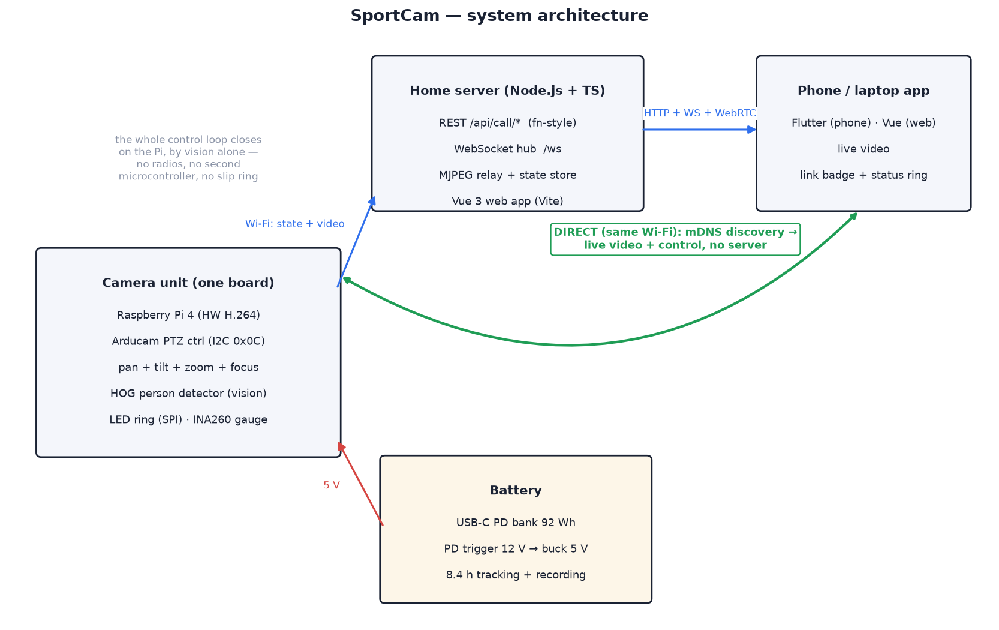
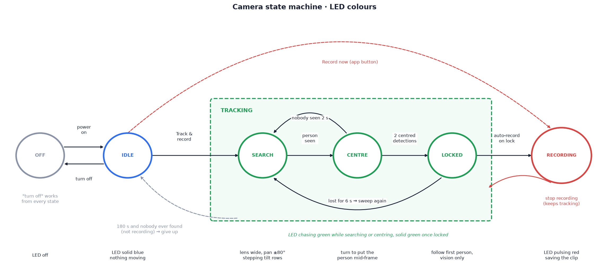
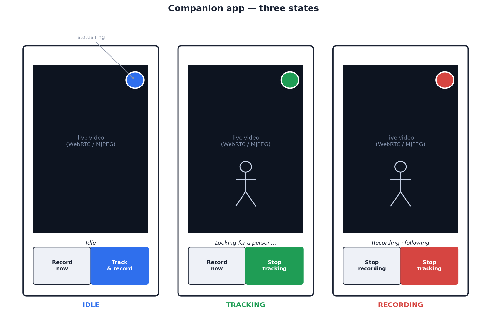

# 01 — System overview

## Introduction

One picture of what this project builds — an indoor climbing session, filmed
by nobody:

Nobody wears anything. SportCam sits on an ordinary photo tripod on the mats
6–12 m back — see the
[placement envelope](04-tracking-system.md#camera-placement-envelope) —
running off a power bank with nothing plugged in. The climber taps
**Track & record** in the app; the camera zooms wide and sweeps the room until
its person detector sees someone, turns to centre them, locks on and starts
recording. From then on it pans and tilts to keep them centred and the
motorized lens zooms to hold framing as they move up the wall. The LED ring on
the base glows green (tracking) or pulses red (recording), and the same status
shows in the companion app streaming the live view to a phone. Tap, climb,
and the session films itself.

## Goals

1. Camera on a motorized tripod head: **160° of pan** (±80°), **130° of tilt**
   (−45° to +85°), motorized **optical zoom**. Both axes and the lens come
   from the Arducam PTZ base, which is what keeps the build to a weekend —
   see [02](02-hardware-mechanical.md) for what that trades away.
2. Camera **finds and follows a human subject** by vision alone — no
   wearable, no beacons: it sweeps the room, locks on to the first person it
   sees and keeps them in frame.
3. **Runs on a battery** for a full session: ≥ 4 h tracking and recording from
   a USB-C power bank, with a gauge that says how long is left.
4. **LED status ring** on the unit showing the states: on-but-not-tracking, searching,
   tracking, recording.
5. **Companion web app**: opens straight into the live stream, state-dependent
   bottom buttons, circular status indicator (top-right) matching the LED
   colours.
6. Both camera and app talk to a **home server** (Node.js + TypeScript,
   Vue 3 web app) started with a single `npm run dev` that watches `src` and
   reloads.
7. Server code written as **portable typed functions** so the API can later be
   lifted onto Firebase Cloud Functions with minimal change.

## Constraints

Hard limits the design has to stay inside. A change that breaks one of these
needs a reason in the doc that makes it.

| # | Constraint | Value | Why | Where it is set |
| --- | --- | --- | --- | --- |
| C1 | **Compact head** for use in a cramped room | Ø 135 mm enclosure with the camera on top and nothing sticking out sideways, excluding the tripod | the camera has to stand in small rooms without being in the way | enclosure diameter in `cad/config.scad` |
| C2 | **Pan range ±80°** | soft limits `PAN_MIN_DEG` / `PAN_MAX_DEG` = ∓80°, no continuous rotation | the metal base fouls before 180°, and it cannot turn 360°; the search sweeps this range and the camera cannot look behind itself | `device/sportcam/config.py` |
| C3 | **Fits any standard tripod**, with interchangeable threads | 3/8-16 brass insert in the floor; a removable 3/8-16 → 1/4-20 reducer bushing for 1/4-20 screws | photo and phone tripods use 1/4-20, video heads and heavier tripods 3/8-16; one socket with a bushing takes both, with no adapter plate | `tripod_boss_d`, `tripod_hole_d` in `cad/config.scad`; BOM item 23 |

## The four subsystems

| Subsystem | Compute | Role |
| --- | --- | --- |
| **Camera unit** | Raspberry Pi 4 | Camera + zoom lens, pan/tilt servos, LED ring, battery gauge, video encode/stream, person detection and the search/track control loop |
| **Home server** | Node.js + TS | State authority, command routing, stream relay, serves the app |
| **Companion app** | Vue 3 SPA | Live view + control |

There is no wearable and no radio: the camera is the only sensor.

Key architectural decision: **the whole control loop closes on one board.**
Pan, tilt, zoom and focus are all register writes to the Arducam PTZ
controller on the Pi's I2C bus, so a tracking correction never leaves the
device. The old revision put the pan stepper in a separate static base and
relayed velocity commands Pi → server → ESP32 over the LAN, because the head
rotated continuously and a stepper cannot ride on a slip ring. Giving up
continuous rotation deleted the slip ring, the second microcontroller, its
firmware and that entire network hop. Dropping the UWB radios then deleted the
only other thing the camera had to talk to.

The server and the network are now optional in the strict sense: unplug the
Wi-Fi and the camera still tracks, films, and shows its state on the ring.

## Concept of operations

1. Power on → the Pi boots, joins Wi-Fi, registers with the server.
   State = **IDLE** (LED solid blue). Opening the app immediately shows the
   live stream.
2. **The climber taps Track & record** in the app (or on the camera's local
   page). State = **TRACKING**, phase **acquiring** (green light chasing round
   the ring, "Looking for a person…" in the app). The camera zooms wide and
   **sweeps** pan ±80° at 25°/s, stepping between two tilt rows at each
   turn-around, until the person detector sees someone.
3. **Centre, then lock.** The sweep stops and the head turns to put that
   person in the middle of the frame. After two consecutive centred
   detections it is **locked** (solid green) and, because the session began
   in idle, recording starts straight away (LED breathing red, the app
   chimes): the clip is of the person, not of an empty room. The first person
   found wins; afterwards the camera follows the detection nearest the last
   position, so a bystander walking past does not steal the lock. Vision
   zooms so the person fills about 65 % of the frame, with margin all round
   for sudden moves. H.264 video is written on the Pi and uploaded
   afterwards. If nobody turns up for 15 s the app says so.
4. **Losing and finding again.** If the person is missing for 2 s the ring
   flashes and the camera holds still; after 6 s it sweeps again, starting
   toward the side they were last heading, while the recording carries on.
   If the camera is tracking (not recording), has never found anyone and 180 s
   pass, it gives up and returns to **IDLE**. A recording is never abandoned
   automatically — stopping it is the user's call.

   The app can drive everything by hand: **Record now** while tracking,
   **Stop recording** (tracking continues, and the camera does not start a
   second recording in the same session), **Stop tracking** to go back to
   idle. Set `AUTO_RECORD_ON_LOCK = False` to make recording a separate tap.
   Details: [`device/sportcam/session.py`](../device/sportcam/session.py).
5. **Turn off** from any state centres both axes, stops recording safely, and
   powers down cleanly. The same thing happens on its own at 7 % battery, so
   a session that outlasts the pack still ends with a saved clip.

## State machine

| State | LED | App status ring | Bottom buttons |
| --- | --- | --- | --- |
| `off` | off | grey | *(app shows reconnect screen)* |
| `idle` | solid blue | blue | **Turn off** · **Track & record** |
| `tracking`, searching | green, chasing round the ring | green (fast blink), "Looking for a person…" | **Turn off** · **Record now** |
| `tracking`, locked on | solid green | green | **Turn off** · **Record now** |
| `recording` | pulsing red | red (pulsing) | **Stop recording** · **Stop tracking** |

Rules:

- `recording` implies `tracking`. **Stop recording** returns to `tracking`;
  **Stop tracking** while recording stops both (with a confirm in the app).
- Losing the person for > 2 s in `tracking` holds position and flashes the
  LED (2 Hz); after 6 s the camera sweeps again. Nothing drops to `idle` on
  its own except a tracking-only session that never found anyone in 180 s.
- Below 20 % battery the ring dims and blinks orange once a second over
  whatever colour the state is; below 7 % the camera saves and drops to idle.
- The server is the single source of truth for state; devices and app render
  whatever the server last broadcast.

## Companion app

Single screen: full-bleed live video, circular status indicator top-right
(same colours as the LED ring), two bottom buttons that change with state.
See [06 — Server & app](06-server-and-app.md).
