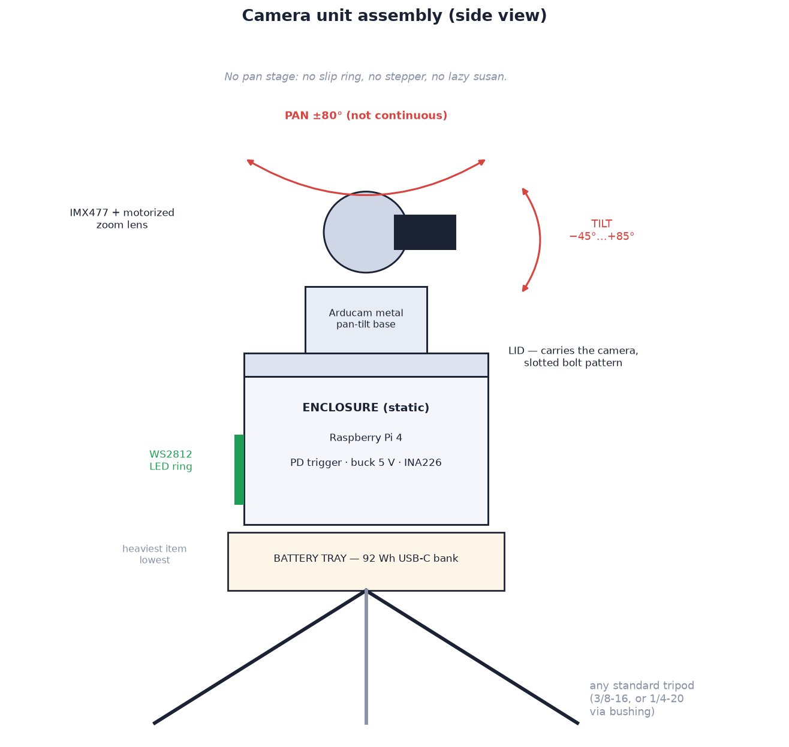

# 02 — Mechanical design

SportCam is built around the **Arducam IMX477 PTZ camera with metal pan-tilt
base** (B0167B12). That one part supplies the camera, the motorized zoom lens,
and both motion axes, which is why there is no pan stage, no slip ring and no
tilt tower in this design. Everything printed is an enclosure or a bracket.

> **This is a deliberate trade.** An earlier revision used a continuous-rotation
> pan stage: a lazy-susan bearing, a slip ring, a NEMA17 driving a printed 120T
> ring pulley, and a 270° tilt tower. It panned forever and tilted past vertical,
> and it took about a month to build. This one is a weekend, and it gives up
> continuous pan. See [ranges of motion](#ranges-of-motion) for exactly what
> that costs.

## Stack, bottom to top

1. **Any standard tripod** — the floor socket is a 3/8-16 insert with a
   removable 1/4-20 reducer bushing, so photo tripods (1/4-20) and video
   tripods (3/8-16) both screw straight on.
2. **Battery tray** — a printed saddle that sandwiches between the tripod plate
   and the enclosure, carrying the USB-C power bank under the whole assembly.
   Hanging the heaviest single item lowest is what keeps the thing from being
   tippy.
3. **Enclosure** (3D-printed, Ø 135 × 66 mm): the Raspberry Pi 4 flat on
   standoffs, the 5 V buck and PD trigger, the INA260 battery gauge, and the
   WS2812B LED ring in a diffused window around the circumference so status is
   visible from any direction. Nothing in here moves, and the wall is plain all
   round — there are no bosses for arms or masts.
4. **Lid** (3D-printed, 5 mm): structural. It carries the entire camera, so it
   is the one printed part worth extra walls. The Arducam base bolts to it
   through four radial slots; the camera ribbon and the servo lead drop through
   the central opening to the Pi below.
5. **Arducam metal pan-tilt base**: aluminium bracket, two digital servos, both
   axes 0–180°. It arrives assembled with the camera already in it.
6. **Camera and lens**: IMX477 12 MP sensor behind the motorized zoom lens.
   Zoom and focus are driven by the lens's own steppers, commanded over the
   same I2C bus as the two servos.
That is the whole head: the camera on top, a round enclosure under it, a tray
under that. Nothing sticks out sideways, which suits a cramped room (see
[constraints](01-system-overview.md#constraints)).

## Ranges of motion

| Axis | Mechanism | Range | Notes |
| --- | --- | --- | --- |
| Pan | PTZ base servo, direct | **±80° soft (160° total)** | servo sweeps 180°; soft limits stop short of where the bracket fouls |
| Tilt | PTZ base servo, direct | **−45° … +85°** | same; verify yours with `python -m sportcam.ptzcheck` |
| Zoom | Arducam motorized lens | 96° → 33° horizontal (≈ 3.5× optical) | ≈ 2.8–10.6 mm EFL on this sensor |

**What the 160° pan costs you.** There are no end stops on a continuous axis,
so the old build could follow a subject through a full circle and always take
the shorter way round. This one cannot. A subject crossing a soft limit
is lost: the camera holds at the limit, and after a few seconds sweeps again.
The search covers the same ±80°, so the camera can never look behind
itself. Point the lens at the thing you are filming — a wall, a pitch, a mat —
and this never comes up. Expect to care if people circulate around the
tripod.

**Tilt is enough for climbing.** A 15 m top-out filmed from 7 m back is about
65° of elevation, comfortably inside +85°. At +85° and full wide zoom, the
top edge of the frame looks about 27° past vertical. The search only uses two
shallow tilt rows (5° and 22°), so the rest of the tilt range is there for
following the person once found.

## Design rules that matter

- **The lid is the structure.** Print it at 5 walls, 40 % infill. Everything
  above it is cantilevered off those four slots.
- **Mass balance barely matters now** because the pan axis carries only the
  camera, but the *tripod* still cares: keep the battery tray low and spread
  the legs.
- **Cable service loop**: the camera ribbon and the servo lead cross the pan
  axis, so leave ~80 mm of slack coiled under the lid. Sweep both axes to their
  limits by hand before you tidy the loop, not after.
- Print structural parts in **PETG** (20 % infill, 4 walls); the lid heavier.

## Printed / fabricated parts list

| Part | Qty | Notes |
| --- | --- | --- |
| Enclosure + LED diffuser ring | 1 | diffuser in white PETG, 2 walls, 0 % infill |
| Lid | 1 | 5 walls, 40 % — it carries the camera |
| Battery tray | 1 | sized in `cad/config.scad` to your power bank |

Four parts, on any printer with a 170 × 150 × 80 mm build volume. Settings, orientation and materials are in
[3D printing specifications](3d_printer/specifications.md).

Deleted with the pan stage: the rotating platform, the 120T ring pulley, both
tilt-tower uprights and the camera cradle.

## Assembly

The **[interactive assembly guide](setup/assembly/index.html)** walks the build in 3D
(open `docs/setup/assembly/index.html`, or use the docs viewer's sidebar): enclosure
electronics, lid and camera, battery, cabling
and bring-up, with
the part being fitted highlighted and animated into place.

## CAD sources

All printed parts have parametric OpenSCAD sources in [`cad/`](../cad/) —
see **[Appendix A — CAD: printed parts](appendix-a-cad-parts.md)** for the
render workflow, per-part print settings, and the measure-before-printing
checklist.

The one dimension worth measuring twice is the **Arducam base's bolt pattern**.
Arducam publishes no drawing and it has changed between revisions, so the lid
is cut with slots spanning 30–72 mm rather than fixed holes. Mark through the
slots and bolt it down.
