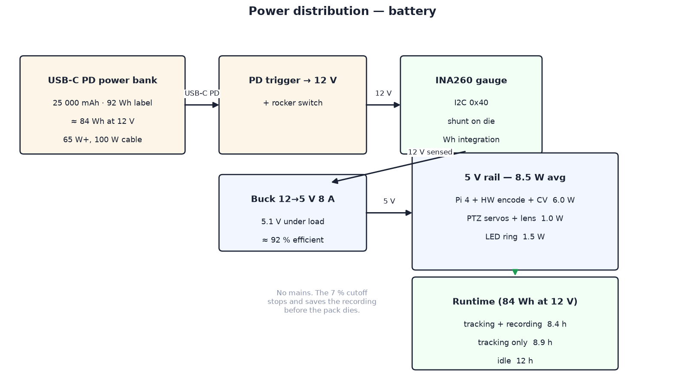

# 03 — Electronics

One board does the computing and one does the moving. There is no base
controller any more: with the pan stepper gone, the ESP32, the TMC2209, the
slip ring and the carrier PCB all left with it, and the status ring moved onto
the Pi. What remains is a Raspberry Pi 4, the Arducam PTZ controller it talks
to over I2C, and a battery. There are no radios, no anchors and no wearable:
the camera is the only sensor, so the Pi's USB ports are left free.

### Why a Pi 4 and not a Pi 5

Because of the **hardware H.264 encoder**. The Pi 5 dropped the block the
Pi 4 has, so on a Pi 5 every recorded frame is encoded in software on the CPU,
and on a battery-powered camera whose main job is recording that is the single
largest line in the power budget. A Pi 4 encodes 1080p for almost nothing.

The Pi 5 is roughly two to two and a half times faster on CPU, and in this
build that matters more than it did: the person detector is the *only* sense
the tracker has, and a Pi 4 runs HOG at about 3 fps. That is enough for a
person walking or climbing at several metres (a few hundred milliseconds of
delay, handled by under-correcting gains — see [04](04-tracking-system.md)),
and the 3 fps tuning is what makes the Pi 4 workable. A faster board, or a
MobileNet-SSD detector, is the upgrade if you need to follow fast movers.
Paying four watts for a Pi 5 costs about two hours of runtime.

Three smaller things follow from the choice, all in the Pi 4's favour: the
Arducam kit's 15-pin ribbon plugs straight in, so there is no adapter cable to
buy; there is no `usb_max_current_enable` flag to set; and the board is about
C$55 cheaper.

Schematic sources live in `schematics/` — `render_schematics.py` (schemdraw)
produces the PNGs below, and `schematics/interactive/index.html` is a zoomable
view of the whole system (open it via `npm run docs` at
http://localhost:8090/schematics/interactive/index.html — its libraries are
vendored locally, no internet needed).

## Head unit

To actually wire it, follow the **[wiring guide](setup/wiring.md)**: every
connection pin by pin, in order, with a check after each. This section
explains the choices behind it.


| Signal | From → To | Notes |
| --- | --- | --- |
| CSI | Pi CSI → Arducam 15-pin FFC | the cable in the kit fits a Pi 4 directly; service loop under the lid |
| PTZ I2C | Pi GPIO2/3 → PTZ controller | one board at **0x0C** drives pan, tilt, zoom and focus |
| LED data | Pi GPIO10 (SPI0 MOSI) → 74AHCT125 → WS2812B DIN | see the note below |
| Battery gauge | INA260 (or INA226) on I2C **0x40** | sits on the 12 V side, between trigger and buck. Optional — see below |

### The PTZ controller

Everything that moves is a register write on one I2C device:

| Channel | Register | Range | Axis |
| --- | --- | --- | --- |
| `OPT_ZOOM` | 0x00 | 3000–20000 | zoom motor, wide → tele |
| `OPT_FOCUS` | 0x01 | 0–20000 | focus motor |
| `OPT_MOTOR_X` | 0x05 | 0–180 | pan servo, degrees |
| `OPT_MOTOR_Y` | 0x06 | 0–180 | tilt servo, degrees |
| `OPT_IRCUT` | 0x0C | 0/1 | IR-cut filter |

`device/sportcam/ptz.py` wraps this. Power the controller board from the 5 V
rail directly rather than through the Pi's GPIO 5 V pin — two servos stalling
is about 0.7 A, which you do not want crossing the header — and share ground.

### Driving the WS2812B ring

Data goes out of SPI0 MOSI (GPIO10), through a 74AHCT125 to lift 3.3 V logic
to 5 V, into DIN. Enable SPI in `raspi-config` → Interface Options.
`device/sportcam/led.py` uses `adafruit-circuitpython-neopixel-spi`.

A Pi 4 can also drive WS2812B the classic way, with `rpi_ws281x` on GPIO18
using PWM and DMA. We do not, for one reason: that driver needs the whole
camera service to run as root. SPI does not. It is also the only method that
would survive a move to a Pi 5, whose RP1 I/O controller does not expose the
peripherals the PWM driver pokes.

## Power



SportCam runs off a **USB-C PD power bank**, so there is nothing to plug in.
A PD trigger board negotiates 12 V from the bank, one buck makes the single
5 V rail, and everything hangs off that:

```
power bank ──PD trigger (12 V)──► INA260 ──► buck 12→5 V 8 A ──┬─► Pi 4 (USB-C)
                                                               ├─► PTZ controller + servos
                                                               └─► WS2812B ring
```

Why not feed the Pi from the bank's 5 V port directly? Because the 5 V rail
also carries the servos and the LED ring, and most banks cap
their 5 V profile at 3 A. Pulling 12 V and stepping down locally gives the
whole rail headroom and costs about 8 % in conversion.

### Load budget

| Load | Average | Peak |
| --- | --- | --- |
| Raspberry Pi 4, 1080p hardware encode + 3 fps detect | 6.0 W | 7 W |
| PTZ servos and lens motors | 1.0 W | 4 W |
| WS2812B ring at 45 % | 1.5 W | 2.9 W |
| **5 V total** | **8.5 W** | ≈ 14 W |

Of the Pi's six watts, roughly three is the board simply being on, one is
JPEG-encoding the preview stream, one is the person detector and half a watt
is the recording. Recording is the cheapest thing it does, which is the whole
argument for this board.

### Runtime

A bank's advertised capacity is measured at its cells, and there are **two**
conversions between there and the 5 V rail: the bank's own boost up to 12 V,
and our buck back down. At roughly 91 % and 92 %, about **84 Wh of a 92 Wh
bank reaches the 12 V rail** where the gauge sits. Stopping at the 7 %
critical threshold leaves 78 Wh to spend:

| Mode | Draw at 12 V | Runtime |
| --- | --- | --- |
| Tracking **and** recording | 9.2 W | **8.4 h** |
| Tracking only | 8.7 W | 8.9 h |
| Idle, streaming preview | 6.4 W | 12 h |

These are estimates, derived from the per-item figures in the load budget
above (5 V total ÷ 92 % buck efficiency), not measurements; measure your own
unit with the gauge. Taking out the three UWB anchors removed about 3 W at 5 V,
3.3 W at 12 V, which is roughly a third off the draw and about two hours on top
of every runtime. Well over the 4 h target. A **74 Wh (20 000 mAh) bank manages
about 6.7 h**, saves about C$25 and a couple of hundred grams, and is the
sensible choice unless you want a full day between charges — the BOM lists it
as the alternative. Stay under 100 Wh if you ever want to fly with it.

`BATTERY_WH` in `config.py` is therefore **84**, not the 92 on the label. The
gauge measures what passes the 12 V rail, so that is what it has to be told is
available; setting it to the nameplate makes every estimate about 10 %
optimistic. Use 67 for a 74 Wh bank.

The biggest remaining lever is the preview stream, not the recording. Dropping
`MJPEG_FPS` or only streaming when a phone is actually connected would take
roughly a watt off every mode.

### Knowing what is left

A power bank reports nothing about its own charge over PD, so SportCam
measures instead. The sensor on the 12 V side is read every second;
`device/sportcam/power.py` integrates watt-hours and reports a fraction
remaining, present draw, and an estimated minutes-left from a 60 s rolling
average. That assumes a full pack when the gauge was last zeroed, so the app
exposes a reset for when you clip on a fresh one.

Two parts work, set by `POWER_MONITOR` in `config.py`. Prefer the **INA260**:
its shunt is on the die, so there is nothing to calibrate and no
`INA226_SHUNT_OHMS` to get wrong. An **INA226** with an external shunt is
equivalent if you already have one. Both sit at I2C 0x40.

The gauge is **optional**. Set `POWER_MONITOR = "none"` and everything still
runs; you lose the low-battery warning and the automatic save-and-park, so
you watch the clock instead. Sourcing is the usual reason — see the
[bill of materials](07-bill-of-materials.md#parts-that-are-hard-to-source-in-canada).

Two thresholds act on their own:

- **20 % — low.** The ring dims and slips an orange blink in once a second,
  the app shows a warning, and the estimate keeps counting down.
- **7 % — critical.** Recording stops and is saved, both axes park, and the
  camera drops to idle. The clip survives; a pack that dies mid-write might
  not have let it.

### The SD card

Recording is 1080p H.264 at 12 Mbit/s, which is **5.4 GB per hour**. The card
is a buffer, not a store: clips upload in the background and are deleted only
once the backend confirms the byte count.

| Card | Free for clips after the OS | Recording time |
| --- | --- | --- |
| 32 GB | ≈ 24 GB | 4.4 h |
| **64 GB**, as specified | ≈ 56 GB | **10 h** |
| 128 GB | ≈ 120 GB | 22 h |
| 256 GB | ≈ 248 GB | 46 h |

64 GB already holds more than one battery charge can produce, so storage is
not the binding constraint — the pack is. Bigger cards only pay off if you
carry spare banks and stay offline for days. Write speed is a non-issue:
12 Mbit/s is 1.5 MB/s, which any genuine Class 10 card beats several times
over. Buy a real card from a known brand; counterfeits are the commonest
cause of Pi corruption.

What does bite is **failed uploads**. Film a session with no backend
reachable and those clips stay on the card. Two safeguards handle it:

- **`upload_loop` drains the backlog.** The per-recording retry ladder gives
  up after about 15 minutes, so everything still on the card is re-attempted
  at start-up and every 15 minutes after, oldest first, skipped while
  recording. Without this a stranded clip is never looked at again.
- **`storage.py` guards the space**, with the same shape as the battery
  gauge. Below **20 minutes** of recording room the ring blinks orange and
  the app warns. Below **5 minutes** the camera refuses to start a recording
  and stops a running one cleanly. A 500 MB reserve is never spent on video,
  because filesystems corrupt at zero.

That last part matters because the encoder has no graceful failure. It writes
until the card returns ENOSPC and leaves a truncated file. Stopping
deliberately leaves one you can watch.

### Saving power

`config.py` carries the levers. The detector drops to 2 fps when nothing is
being tracked and the ring dims on low battery, both automatically. Beyond
that: lower `MJPEG_FPS`, drop `RECORD_SIZE` to 720p, or cap the Pi's clock.

Grounds: single star point at the buck output; everything on the head shares
that plane.

## Bring-up order

1. **Bench, no camera:** power the buck from the trigger → **trim it to
   5.1 V under a 4 A dummy load** → check the gauge appears at
   `i2cdetect -y 1`. Do this before the Pi is ever connected. Open-circuit
   voltage tells you nothing; a module reading 5.1 V unloaded can sag to
   4.8 V and brown the Pi out.
2. **Pi:** boots, `rpicam-hello` shows the camera, `i2cdetect -y 1` shows
   `0c` and `40`, SPI enabled, ring cycles its three colours. If the IMX477 is
   not detected, add `dtoverlay=imx477` to `/boot/firmware/config.txt`.
3. **Motion:** `python -m sportcam.ptzcheck` sweeps pan then tilt to the soft
   limits. Watch for the lens or the ribbon binding and adjust the limits in
   `config.py` before anything else.
4. **Vision:** with the camera aimed at a person standing 3–5 m away, check
   the preview shows a sensible picture, then run a search from the app and
   confirm the sweep reverses cleanly at both pan limits before the ring ever
   goes green. Tune `DETECT_HIT_THRESHOLD` here ([04](04-tracking-system.md#tuning)).
5. **Integration:** full search-and-track run on the bench, then check the gauge's
   estimate against a stopwatch over the first half hour.
